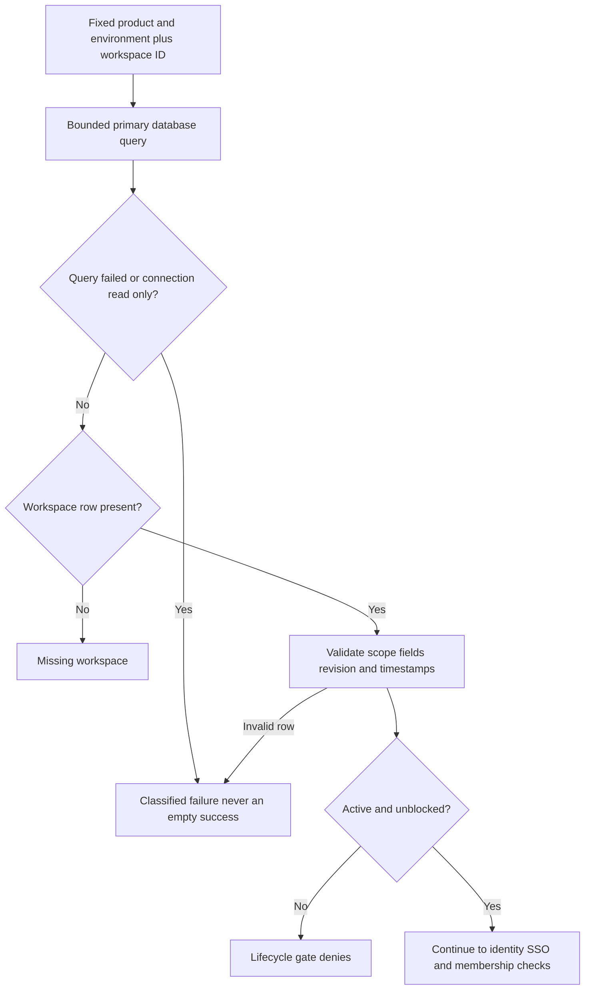

Both SDKs now have an internal primary-database workspace reader for the managed
lifecycle gate. It fixes product/environment at construction, accepts a workspace
ID per read, and returns a validated record or explicit absence. This is a Phase 3
storage checkpoint, not a public managed authorization API.

The last node is future composition, not permission granted by this reader. The
existing lifecycle gate returns `check_relationships` for active/unblocked records;
public enforcement must still perform current identity/enterprise/membership checks
and persist the required decision audit before protected work.

## Implemented behavior

Internal TypeScript `WorkspaceRecords.get` and Go `WorkspaceRecords.Get` make one
query per call. A SELECT-only application role can use the reader. No startup I/O,
migration, worker or cache is introduced; the caller retains pool ownership.
Queries have a five-second bound and preserve earlier caller cancellation.

Missing records are null/nil only after a successful primary query. Failed queries,
read-only connections and corrupt rows never become successful absence. Decoding
checks exact scope, valid lifecycle and boolean flags, Unicode name length/byte
bounds, canonical positive bigint revisions, safe timestamps and their ordering.
Revisions remain decimal strings through both language APIs, including values
larger than JavaScript's safe integer range.

The primary snapshot observes committed lifecycle changes; an uncommitted change
is invisible. It cannot fence work already authorized before a later suspension.
This reader performs no mutation, does not clear an uncertain operation, and does
not substitute local state for an OpenFGA check.

## Evidence

Local PostgreSQL 17.11 run `0d0c266d99d44cb6b70394e658ee4756` passed:

- 25 shared row-decoding cases covering active/blocked/inactive/missing records,
  cross-scope rows, partial absence, malformed/overflow revisions and timestamps.
- Both SDKs reading through a SELECT-only role, product/environment isolation and
  current committed mutation-block visibility without caching.
- Real table-lock contention: earlier caller deadlines return deadline errors;
  subsequent reads succeed after rollback, proving connection-pool recovery.
- Read-only connection rejection even for a nonexistent workspace, closed-pool
  failures, input validation and cancellation before connection.
- TypeScript reads the Go-written workspace and Go reads the TypeScript-written
  workspace, preserving Unicode names and blocked lifecycle state.
- The existing managed SQL, migration, readiness and bidirectional intent-byte
  regression tests in the same disposable database.

Run `python3 tests/integration/managed-schema.py` with the repository toolchain.
The harness removes its disposable container/database after completion. Results
are recorded in `tests/integration/evidence/managed-workspace-read-2026-11-11.json`.
This checkpoint executes native SDK tests locally; the prior
[[phase-3-managed-migrations]] page records the actual compiled CLI proof on Railway.
Publishing this page to Railway is documentation deployment, not a live managed
product rollout.

Managed create/update, operation and candidate adapters with atomic audit remain
required, as do the operational foundations in [[phase-3-readiness-audit]]. Phase 3
is still active; no later phase is accepted by this checkpoint.
