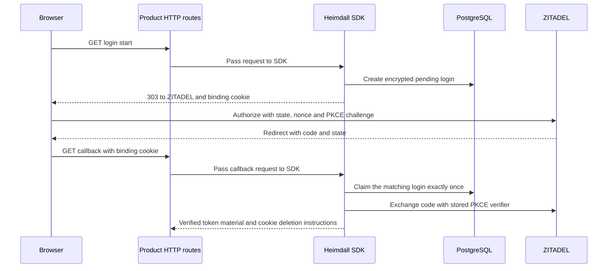

The internal Fetch and net/http adapters connect the authorization redirect and callback to PostgreSQL login records and the verified OIDC exchange. Both use the configured public callback URL and a configured return destination key. The product backend mounts the routes. The SDK sets the redirect and browser binding cookie and validates the callback before exchange.

Each login receives a separate cookie tied to its state so parallel tabs can finish independently. The production cookie uses Secure, HttpOnly, SameSite=Lax, Path=/ and the host-only prefix. It expires after ten minutes. A successful callback returns instructions to delete only the matching cookie. The current adapter accepts GET callbacks on the configured host and path. The Go handler uses the request host and configured scheme when TLS terminates at a reverse proxy.

The pinned PostgreSQL integration runner exercises both implementations with signed responses from a controlled OIDC provider. Each language verifies two overlapping logins, concurrent replay, cookie flags, PKCE and nonce continuity, and rejection before exchange for missing or duplicate cookies, a cookie from the other tab, duplicate state, or a mismatched issuer, host, path or method.

This checkpoint covers the internal product-default login flow and uses a single configured return destination key. The callback result stays server-side and feeds the upcoming audited session creation. Public mounting, tenant-login policy resolution, session cookie issuance, refresh/logout and reference-product verification remain Phase 4 work. [[phase-4-browser-oidc-exchange|Live ZITADEL code exchange]] was verified independently.
