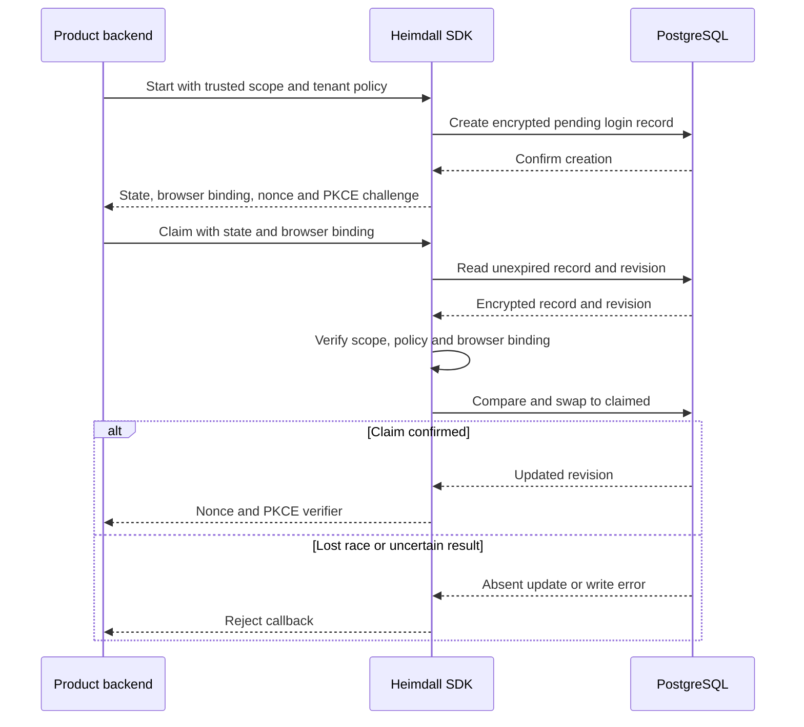

TypeScript and Go use the encrypted PostgreSQL record adapter to issue and claim browser login transactions. A transaction lasts ten minutes and holds independent random state, browser binding, nonce and PKCE verifier material. Only the digest of the browser binding is stored. The state is the storage key and is hashed by the adapter.

The PostgreSQL runner uses pinned PostgreSQL 17.11. Both SDKs consume the same scope and lifetime fixture. Each language tests eight concurrent callbacks, the original PKCE challenge and nonce, expiry, pre-dispatch cancellation, malformed storage, cross-product attempts and changed tenant policy. The test injects a lost result after a real committed update to verify that the SDK withholds exchange material and that a retry cannot reclaim the transaction.

Run the workspace gate with `pnpm run check` and the pinned database integration suite with `python3 tests/integration/postgres-records.py` from the root with pnpm and Go on PATH.

Phase 4 remains open. This checkpoint is internal to the SDKs. The Fetch and net/http routes still need to mount the flow, derive trusted policy and return targets, exchange the authorization code, verify the provider response, and issue and manage sessions. The two reference products and audited tenant operation remain part of Phase 4 acceptance.
