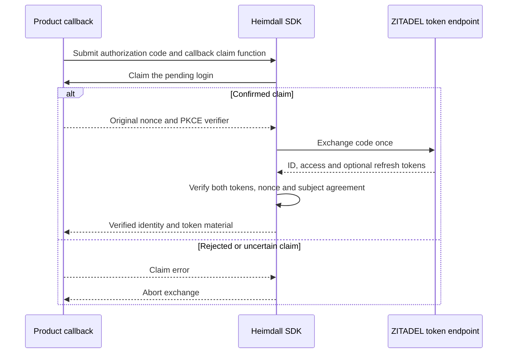

Both SDKs now have an internal code exchange for the pinned ZITADEL browser flow. The exchange waits for the callback claim and sends one PKCE-bound request with the configured redirect URI and confidential client credentials. The SDKs reuse the issuer-pinned discovery and RSA verification paths.

The ID token must name the configured client. Its permitted additional audiences are the configured product audience and, for browser sessions that request self-service lookup, the explicitly configured ZITADEL API audience. If multiple audiences are present, the authorized party must name the client. This matches the observed ZITADEL claims when the product audience scope is requested. The access token must name the product audience, and both tokens must identify the same subject. The SDKs also verify the ID token nonce and any access-token hash present. [OpenID Connect ID-token validation](https://openid.net/specs/openid-connect-core-1_0.html#IDTokenValidation)

The shared fixture covers successful client-only and client-plus-product ID audiences, missing or incorrect authorized party, unrelated audiences, wrong nonce, incorrect access-token hash, subject mismatch, OAuth rejection, redirects, response size limits and uncertain claims. Go exercises HTTP against a local server. TypeScript exercises its Fetch call against a controlled transport. Both verify real signatures in these tests.

With `HEIMDALL_PROBE_SDK_BROWSER_EXCHANGE=1`, the OIDC probe issued independent fresh codes for each product and SDK against Railway ZITADEL deployment `7ef5c76d-4911-4326-97dc-50d5614f2a55`. Run `41270504-16fa-4e46-a8bf-bbc710a431fb` verified successful exchange for Ledger TypeScript, Ledger Go, Support TypeScript and Support Go. The probe supplies the nonce and verifier through a fixture claim function after using the ZITADEL Login API.

The public Fetch and net/http callback integration still needs to connect exchange to the durable claim, identity status, audited session creation and session cookies. The live probe exercises the code exchange with fresh authorization codes. Durable claims are covered independently in [[phase-4-browser-login-records]].
