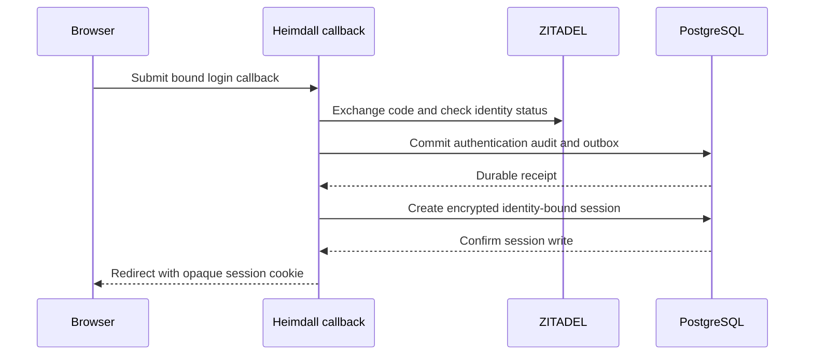

Both internal HTTP adapters now use the verified callback to issue a browser session. The SDK checks the access token against ZITADEL and the durable identity gate, commits the authentication audit event, and creates an identity-bound encrypted session. Only after storage confirms the write does it return a redirect with a session cookie and delete the callback's binding cookie.

The browser cookie contains a fresh random value. The SDK hashes it before using it as a storage key. The encrypted record holds the tokens, principal, identity check timestamp and absolute, idle and access-token expirations. The default absolute and idle lifetimes are eight hours and thirty minutes. The redirect uses the path configured by the server.

The browser flow can request the ZITADEL API audience needed by the pinned self-service user lookup. The ID token accepts that additional audience only when its exact deployment value is configured. The SDK still verifies the product audience and requires the expected authorized party when the ID token contains multiple audiences. [[phase-2-self-service-evidence]]

Live ZITADEL run `791f4e5d-0d4b-4223-8542-a683ec84dfd3` confirmed code exchange and online identity status for Ledger and Support in both SDKs. The live probe used a fixture login claim and identity gate.

The pinned PostgreSQL suite exercises successful issuance and verifies that audit unavailability prevents session creation. An injected uncertain session-store result prevents cookie issuance even though authentication was audited. Both languages check the committed session and audit records.

This evidence covers internal session issuance. Cookie authentication, refresh, logout, public constructors, tenant login and the deployed reference product flows remain pending.
