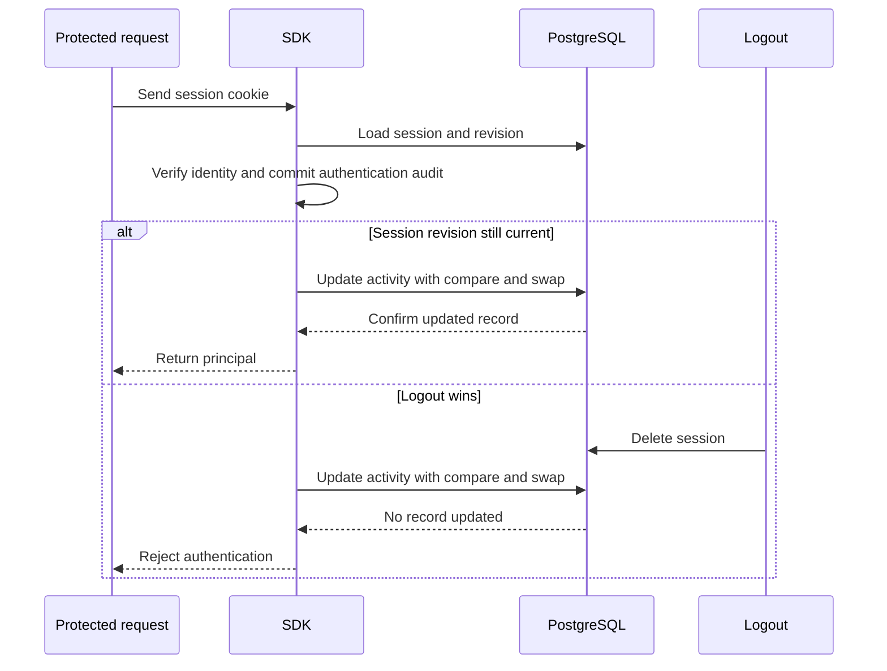

Both internal browser adapters read the opaque cookie, derive the storage key, and load the unexpired encrypted session. They authenticate its access token through the existing audited identity path and bind the identity check to the loaded record revision. Authentication advances idle expiry up to the absolute limit by compare-and-swap. The SDK returns the principal only after the write is confirmed.

Logout requires a POST with an Origin matching the configured callback origin. The SDK deletes the local record before clearing the cookie, including for repeat logout. The built-in flow leaves upstream revocation to explicit policy.

The pinned PostgreSQL integration checks successful cookie authentication, activity revision advancement, cross-origin logout refusal, cookie clearing, and logout between audited authentication and session update. Both languages reject reuse of the logged-out cookie. A competing session update can return unavailable and the caller can retry with the current revision.

Refresh exchange, public constructors, tenant login and end-to-end reference product acceptance remain Phase 4 work.
