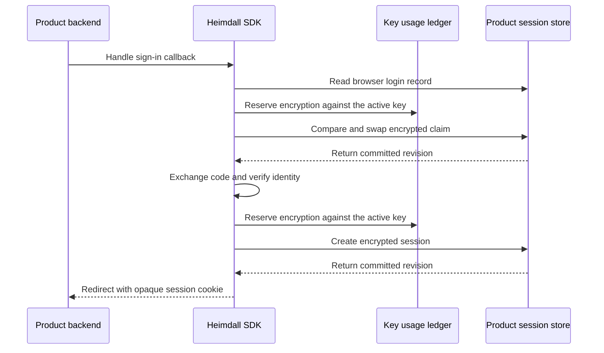

A product can supply its own atomic store for browser login and session records. The same Fetch and net/http handlers use that store for the browser-bound OIDC callback, session authentication, refresh claims and logout. The bundled PostgreSQL composition remains available.

```ts
const auth = await createHeimdall(configJSON, manifestJSON, {
  policyVersion,
  credentials,
  storage: durableIdentityAndAudit,
  sessionStorage: { store, activeKeyId, keys, reserveKeyUsage },
}, { signal })
const sessions = await auth.createSessions({
  callbackUrl, returnTo: "/workspaces", zitadelAPIAudience,
}, { signal })
```

```go
auth, err := heimdall.New(ctx, configJSON, manifestJSON, heimdall.Options{
    PolicyVersion: policyVersion, Credentials: credentials, Storage: durableIdentityAndAudit,
    SessionStorage: &heimdall.SessionStoreOptions{
        Store: store, ActiveKeyID: activeKeyID, Keys: keys, ReserveKeyUsage: reserveKeyUsage,
    },
})
if err != nil { return err }
sessions, err := auth.NewSessions(ctx, heimdall.SessionOptions{
    CallbackURL: callbackURL, ReturnTo: "/workspaces", ZitadelAPIAudience: zitadelAPIAudience,
})
if err != nil { return err }
```



The product supplies the store, the shared key ring and an atomic key-usage ledger. Its durable identity gate handles account-wide denials. The SDK handles version-bound token invalidation in the session store, so an old token cannot erase a newer session revision. The store implements expiry, revision allocation, bounded cancellation and atomic create, compare-and-swap and delete across replicas. The SDK binds the ciphertext to its product, environment, record type and record key, and authenticates the expiry.

Shared fixtures exercise key scope, revision syntax, expiry tampering, record substitution and rotation. Both languages also verify single-winner writes, delete/recreate, conditional token invalidation and public login-start wiring. The custom-store tests use in-memory stores. The deployed [[phase-4-reference-backends|Ledger and Support reference backends]] use the bundled PostgreSQL adapter.
