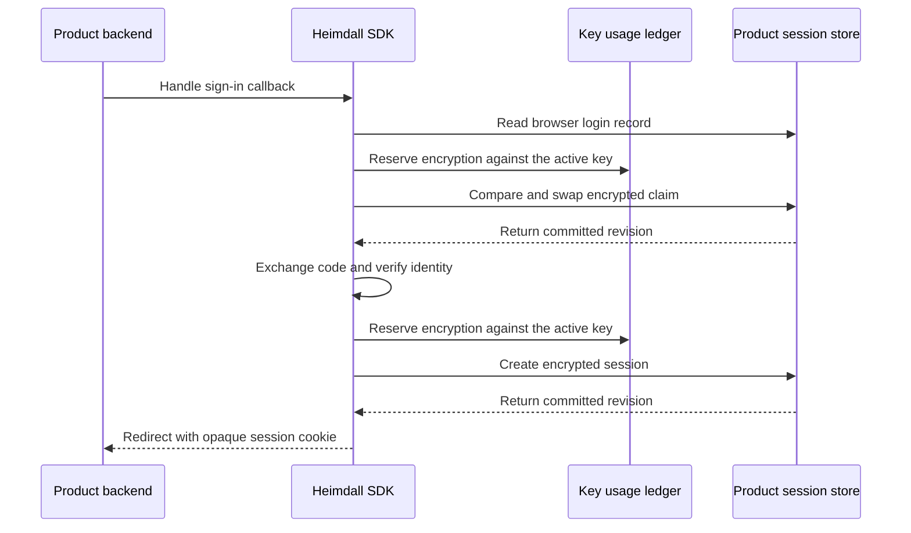

A product can supply its own atomic store for browser login and session records. The same Fetch and net/http handlers use that store for the browser-bound OIDC callback, session authentication, refresh claims and logout. The bundled PostgreSQL composition remains available.

```ts
const auth = await createHeimdall(configJSON, manifestJSON, {
  policyVersion,
  credentials,
  storage: durableIdentityAndAudit,
  sessionStorage: { store, activeKeyId, keys, reserveKeyUsage },
}, { signal })
const sessions = await auth.createSessions({
  callbackUrl, returnTo: "/workspaces", zitadelAPIAudience,
}, { signal })
```

```go
auth, err := heimdall.New(ctx, configJSON, manifestJSON, heimdall.Options{
    PolicyVersion: policyVersion, Credentials: credentials, Storage: durableIdentityAndAudit,
    SessionStorage: &heimdall.SessionStoreOptions{
        Store: store, ActiveKeyID: activeKeyID, Keys: keys, ReserveKeyUsage: reserveKeyUsage,
    },
})
if err != nil { return err }
sessions, err := auth.NewSessions(ctx, heimdall.SessionOptions{
    CallbackURL: callbackURL, ReturnTo: "/workspaces", ZitadelAPIAudience: zitadelAPIAudience,
})
if err != nil { return err }
```



The product supplies the store, the shared key ring and an atomic key-usage ledger. Its durable identity gate handles account-wide denials. The SDK handles version-bound token invalidation in the session store, so an old token cannot erase a newer session revision. The store implements expiry, revision allocation, bounded cancellation and atomic create, compare-and-swap and delete across replicas. The SDK binds the ciphertext to its product, environment, record type and record key, and authenticates the expiry.

Shared fixtures exercise key scope, revision syntax, expiry tampering, record substitution and rotation. Both languages also verify single-winner writes, delete/recreate, conditional token invalidation and public login-start wiring. The custom-store tests use in-memory stores. The deployed [[phase-4-reference-backends|Ledger and Support reference backends]] use the bundled PostgreSQL adapter.

## Verification record

Source revision `190bc8d` passed `pnpm run check` and the pinned PostgreSQL regression runner `python3 tests/integration/postgres-records.py` (`heimdall-records-acb155508d024ec2b8d61a5a18028721`). Both [push](https://github.com/techsavvyash/heimdall/actions/runs/43460227417) and [pull request](https://github.com/techsavvyash/heimdall/actions/runs/43460237595) checks passed. Chromium rendered the diagram from Railway docs deployment `5f915de0-438a-4e7f-a8f8-b1484163f374`.

Railway probe `b1ea029c-3db6-448c-ab3f-890cb4a36bd4` repeated the deployed login, discovery, roles, scoped read and logout flows after the SDK change. Ledger deployment `fd2d8d04-f991-49b1-b0be-b6ccdff20b44` committed 15 matching authorization requests and outcomes. Support deployment `5dda5501-705b-4028-acf1-65ae95c2422c` committed 13.

## Product conformance

Use two independent clients against a disposable instance of the same backend. The suite exercises binary reads, a single committed create and compare-and-swap under concurrency, idempotent deletion, expiry, and non-repeating revisions after delete or expiry. It creates and cleans up a randomly named record.

```ts
import { verifySessionStore } from "@techsavvyash/heimdall-sdk/sessionstoretest"

await verifySessionStore(replicaA, replicaB)
```

```go
import "github.com/techsavvyash/heimdall/sdk/go/sessionstoretest"

func TestStore(t *testing.T) {
    sessionstoretest.Verify(t, replicaA, replicaB)
}
```

Both SDKs run the same browser lifecycle scenarios against the custom store and the bundled PostgreSQL store. The custom tests use a synchronized in-memory store, a controlled OIDC provider and a recording audit port. They cover stolen browser state, concurrent callback replay, withholding cookies when audit or persistence is uncertain, refresh contention, logout during refresh, and reauthentication after an uncertain refresh. The PostgreSQL tests retain database assertions for committed sessions and audit receipts. Run the two suites with `pnpm test` and `pnpm run test:go`. The pinned PostgreSQL runner additionally enables the database-backed variants.
