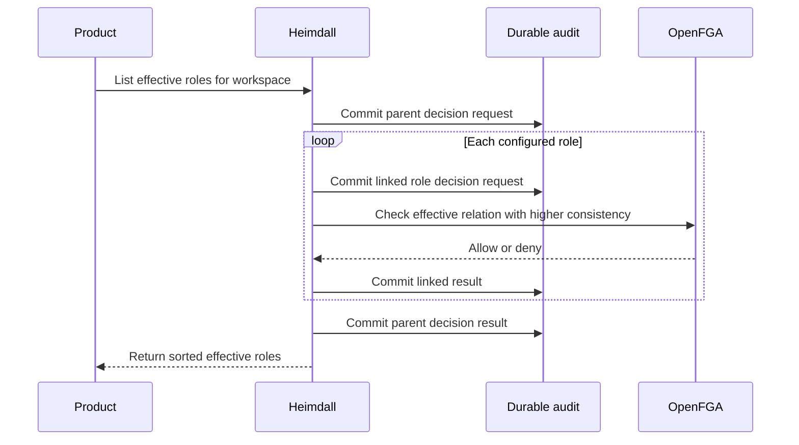

Both public SDKs list the effective roles of a verified principal within a workspace. They use the pinned model's membership-gated effective relations, evaluate product-defined roles in sorted order, and withhold the list if any check or required audit write fails.

The parent decision records whether any roles were effective. Each child request and outcome identifies its parent. An empty list represents a completed evaluation with no effective roles. The checks share a deadline and a failure returns an error without a partial list. Individual role checks can observe concurrent membership changes between requests to OpenFGA.

The PostgreSQL integration covers an effective approver, an empty result, an outage and durable parent-child correlation. Live probe `ada2d093-c806-444f-8ee3-2d6b3fb4b85c` verified a membership and owner grant in Acme and an owner grant alone in Globex for both products and both SDKs. Managed lifecycle enforcement and discovery are separate remaining integrations.
