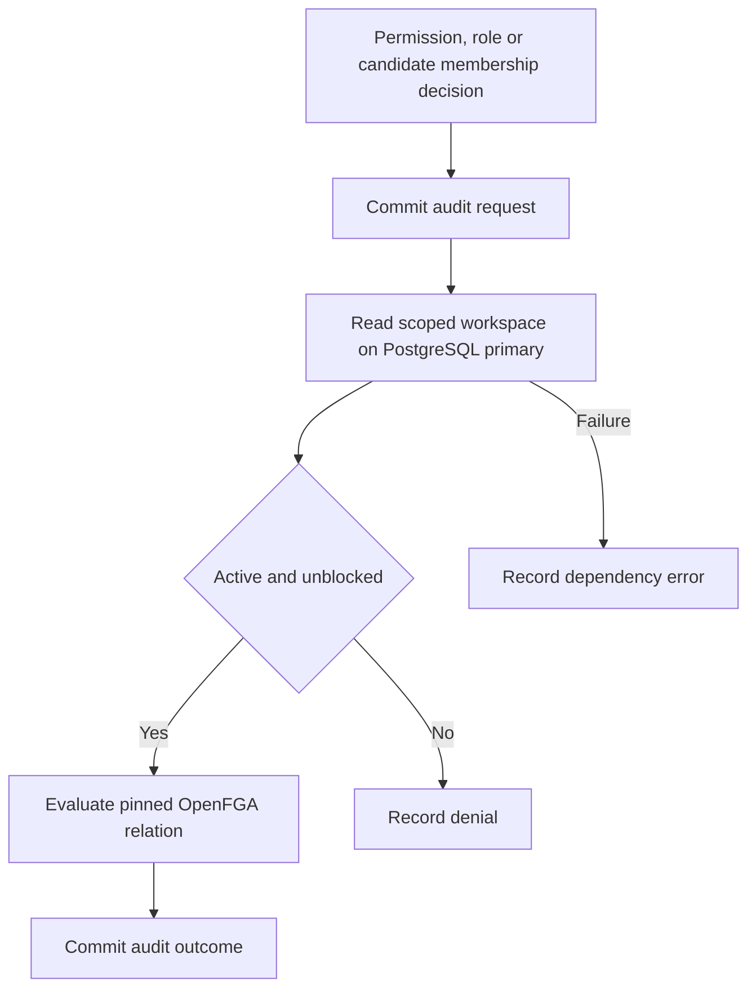

TypeScript's `createManagedPostgresStorage` and Go's `postgres.NewManagedStorage` attach the managed workspace lifecycle and candidate index to the runtime. Permission checks, effective role lookups and discovery use the same mandatory primary-database gate. Managed discovery uses the membership candidate index and rejects a product-supplied candidate source.

The pinned PostgreSQL runner installs managed schema v1 alongside audit v4. Both public SDK tests use a runtime role with read-only access to managed tables and a controlled OpenFGA endpoint. Each verifies permission, role and discovery results for an active workspace, sets its mutation block, and verifies that none of the three paths sends another OpenFGA check. This covers access reads. Managed provisioning, mutation recovery, and the deployed reference product flows remain open.
