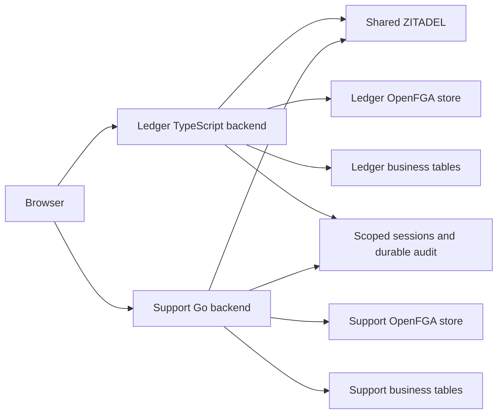
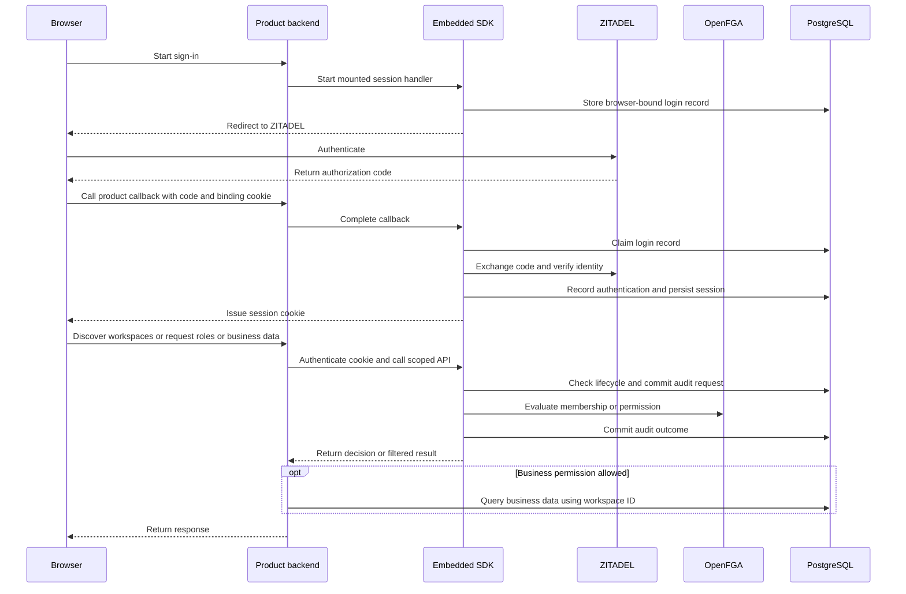

Ledger runs on TypeScript and reads invoices. Support runs on Go and reads tickets. Each product mounts the SDK's browser session routes, uses managed workspace discovery, exposes effective roles at `GET /workspaces/{workspace}/roles`, and calls the tenant permission check before running a parameterized business query scoped to the workspace ID.

Build the images from the repository root with `docker build -f examples/ledger/Dockerfile .` and `docker build -f examples/support/Dockerfile .`. Run each product's `schema.sql` with a deployment credential. Grant the product runtime read access to its business tables and configure its business connection separately.

Both applications take the SDK config and manifest from `HEIMDALL_CONFIG` and `HEIMDALL_MANIFEST`. Set `HEIMDALL_CALLBACK_URL`, `HEIMDALL_POLICY_VERSION`, `HEIMDALL_ZITADEL_API_AUDIENCE`, `HEIMDALL_CLIENT_SECRET` and `HEIMDALL_OPENFGA_KEY`. The session and audit connection uses `DATABASE_URL`. The key ledger uses `HEIMDALL_KEY_DATABASE_URL`. Set `HEIMDALL_RECORD_KEY_ID`, a JSON map of base64 keys in `HEIMDALL_RECORD_KEYS`, and a separate base64 key in `HEIMDALL_CURSOR_KEY`. Set `LEDGER_DATABASE_URL` or `SUPPORT_DATABASE_URL` for the corresponding business schema.

## Request flow

The developer mounts routes, configures clients, storage and keys, and scopes business queries by workspace. The SDK owns the OIDC exchange, session cookie, authentication, managed lifecycle checks, discovery, role evaluation and durable authorization audit.

## Railway verification

Probe `c8b5a340-167c-4781-b843-9245372a2098` exercised both deployed backends using source revision `d5d6156`. The probe waited for each HTTPS health response to report the current run and Railway deployment ID. It obtained the authorization code through the pinned ZITADEL Login API using a synthetic user. Each product had its own ZITADEL client, OpenFGA store and PostgreSQL runtime role.

| Backend | Railway deployment | HTTP results | Committed audit |
| --- | --- | --- | --- |
| [Ledger](https://reference-ledger-verification.up.railway.app/) | `2a37a00a-aec2-42ec-9f1a-a67a4752fa65` | Acme only in discovery, owner in Acme, no effective role in Globex, Acme invoice 200, Globex invoice 403, logged-out cookie 401 | 36 events, 15 matched authorization requests and outcomes |
| [Support](https://reference-support-verification.up.railway.app/) | `02fb4b49-6d9d-4a94-bff2-2fb93c516644` | Acme only in discovery, owner in Acme, no effective role in Globex, Acme ticket 200, Globex ticket 403, logged-out cookie 401 | 32 events, 13 matched authorization requests and outcomes |

Readback from Railway PostgreSQL matched requests and outcomes by decision ID for the synthetic subject in each product. It also confirmed parent links on role and discovery membership checks. Both deployments recorded one allowed business read, one denied business read, one allowed roles result, one denied roles result, and a discovery decision with one allowed and one denied membership evaluation. The Globex fixture deliberately had a stale owner tuple without membership.

`pnpm run check` passed, including all 222 generated Mermaid diagrams at the source revision. Both [push](https://github.com/techsavvyash/heimdall/actions/runs/43457352974) and [pull request](https://github.com/techsavvyash/heimdall/actions/runs/43457364347) workspace checks passed.

The probe covered the product HTTP boundaries using the ZITADEL Login API. Refresh/logout races and the distinction between a denial and a dependency failure are covered by the [[phase-4-session-refresh|pinned PostgreSQL session tests]] and [[phase-4-tenant-permission-checks|public permission tests]]. The synthetic provider organization and OpenFGA stores support the deployed configuration. A full repeat provisions a new synthetic user and new product configuration. The [[phase-4-custom-session-store|custom session-store checkpoint]] records the later repeat against the updated SDKs.

## Business mutations

Apply `examples/ledger/approval.sql` after the Ledger schema and `examples/support/assignment.sql` after the Support schema. Grant the business connections update access to `approved_at` and `approved_by` on `ledger.invoices`, or `assigned_at` and `assigned_to` on `support.tickets`, alongside their existing read permissions.

| Route | Permission | Product write |
| --- | --- | --- |
| `POST /workspaces/{workspace}/invoices/{invoice}/approve` | `invoice.approve` | Record the first approval and its actor |
| `POST /workspaces/{workspace}/tickets/{ticket}/assign-to-me` | `ticket.assign` | Assign the ticket to the authenticated subject if unassigned |

Both routes require the product origin and the browser session cookie. The SDK durably records the authorization decision before the product changes the row. The product keys every write by workspace and resource, so a resource ID from another workspace returns HTTP 404 after authorization. Repeat approval or assignment by the same actor returns HTTP 204. Support returns HTTP 409 when a ticket belongs to another assignee. The persisted business fields record the result of the update.
