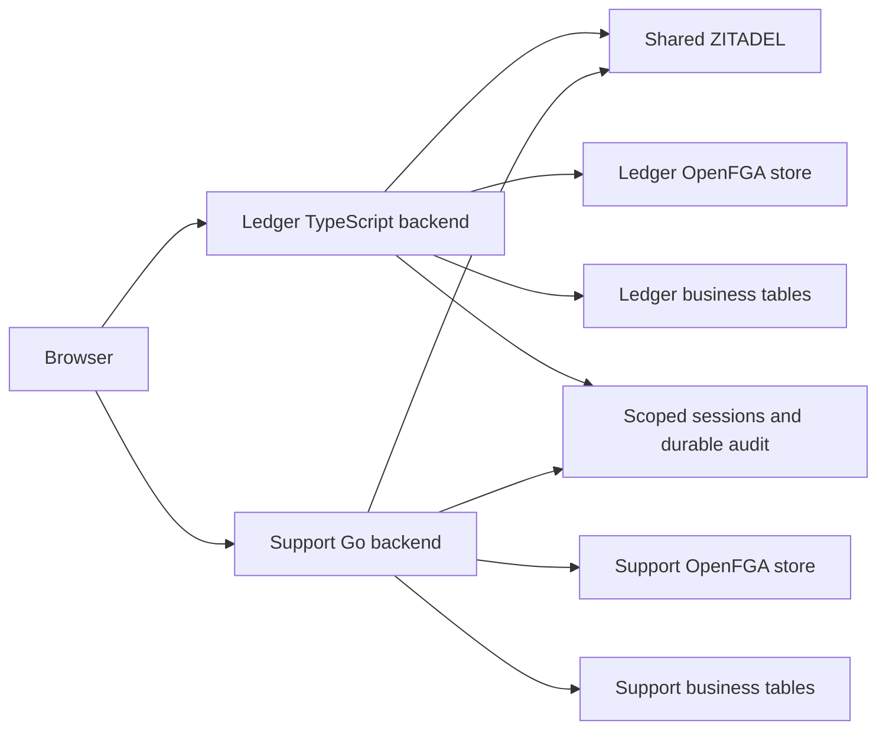

Ledger runs on TypeScript and reads invoices. Support runs on Go and reads tickets. Each product mounts the SDK's browser session routes, uses managed workspace discovery, and calls the tenant permission check before running a parameterized business query scoped to the workspace ID.

Build the images from the repository root with `docker build -f examples/ledger/Dockerfile .` and `docker build -f examples/support/Dockerfile .`. Run each product's `schema.sql` with a deployment credential. Grant the product runtime read access to its business tables and configure its business connection separately.

Both applications take the SDK config and manifest from `HEIMDALL_CONFIG` and `HEIMDALL_MANIFEST`. Set `HEIMDALL_CALLBACK_URL`, `HEIMDALL_POLICY_VERSION`, `HEIMDALL_ZITADEL_API_AUDIENCE`, `HEIMDALL_CLIENT_SECRET` and `HEIMDALL_OPENFGA_KEY`. The session and audit connection uses `DATABASE_URL`. The key ledger uses `HEIMDALL_KEY_DATABASE_URL`. Set `HEIMDALL_RECORD_KEY_ID`, a JSON map of base64 keys in `HEIMDALL_RECORD_KEYS`, and a separate base64 key in `HEIMDALL_CURSOR_KEY`. Set `LEDGER_DATABASE_URL` or `SUPPORT_DATABASE_URL` for the corresponding business schema.

Both container images built locally. The integration runner uses disposable Acme and Globex records. It exercises the published SDK entry points inside the product processes, obtains an authorization code from the pinned ZITADEL Login API, and verified an Acme-only workspace list, HTTP 200 with the Acme business record, HTTP 403 for Globex, and HTTP 401 when reusing the cookie after logout in both product processes. The reference services still require Railway deployment and acceptance against their deployed routes.
