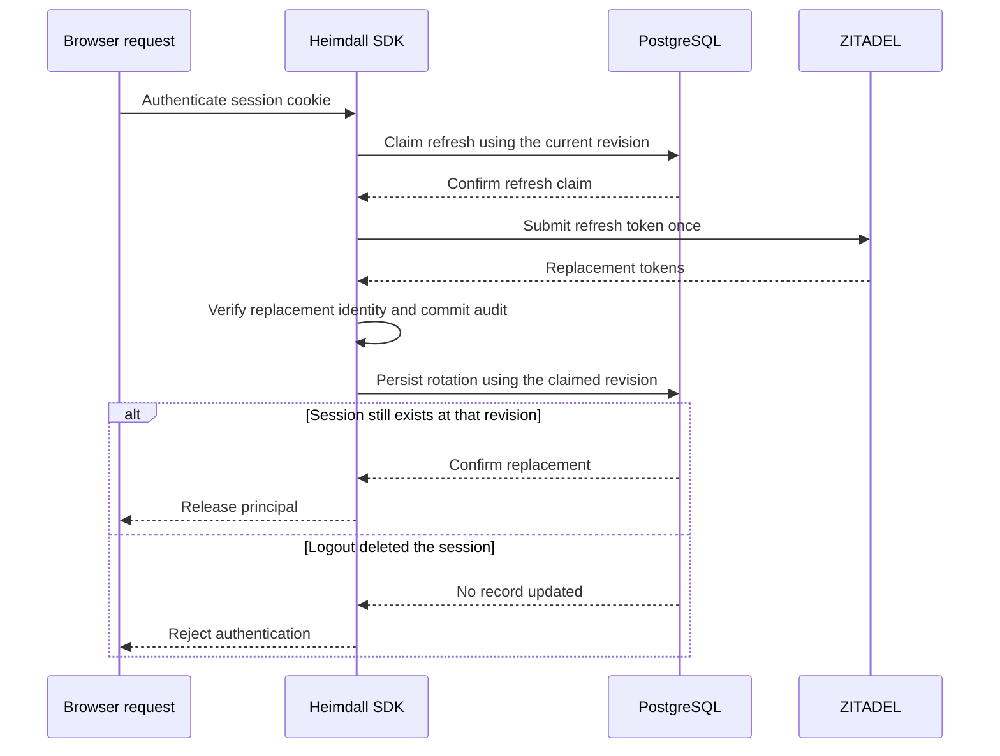

Both SDKs refresh an expired access token when the browser session is still within its idle and absolute lifetimes. The SDK claims the session revision in PostgreSQL before sending one refresh request. It checks the replacement access token through audited identity verification and compares the verified identity with the stored session identity. The replacement refresh token must differ from the submitted one.

A refresh claim lasts at most fifteen seconds and ends sooner when the session reaches its idle deadline. Concurrent requests can receive unavailable while the claim is active. If the token response or subsequent verification fails, the persisted claim prevents replay. After the claim expires, the SDK requires reauthentication.

The pinned PostgreSQL suite verifies one outbound refresh during overlapping requests, a confirmed token rotation, logout during the provider request, and reauthentication after an uncertain attempt. Live ZITADEL run `4f0dd5f9-15f7-4181-b6ba-1a690321ea06` verified refresh-token rotation and online identity checks for Ledger and Support in both SDKs. Public session constructors and end-to-end reference product acceptance remain pending.
