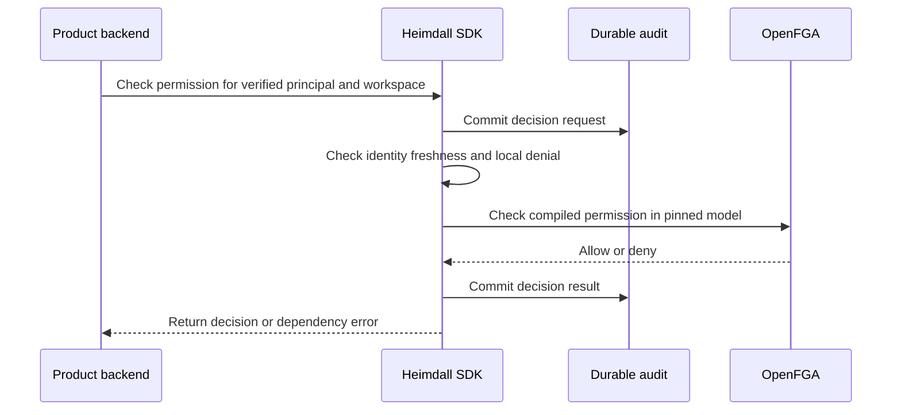

The public TypeScript and Go clients expose tenant-scoped permission checks. A check accepts a principal issued by the same client through bearer or session authentication. It resolves the product-defined permission against the verified manifest, uses the configured OpenFGA store and model, and requests higher consistency. Core callers supply the tenant ID from their own workspace lifecycle and scope business queries to it.

A definitive deny returns false from Can and forbidden from Require. An OpenFGA failure returns unavailable. Audit failure withholds the decision. A positive result also requires a current principal after audit completion. The pinned PostgreSQL suite exercises the public entry points and durable decision events for allow, deny and dependency failure in both SDKs.

Live verification run `fcc572d1-f4d6-490b-a6fd-7c470314dab7` exercised Ledger and Support in both SDKs against pinned ZITADEL and OpenFGA. It granted membership and a role in Acme, and granted the role alone in Globex. Both clients allowed Acme and denied Globex. This run used recording audit ports. The PostgreSQL tests verify durable audit separately.

Effective role listing, workspace discovery and managed lifecycle enforcement remain pending, along with end-to-end reference product deployment.
