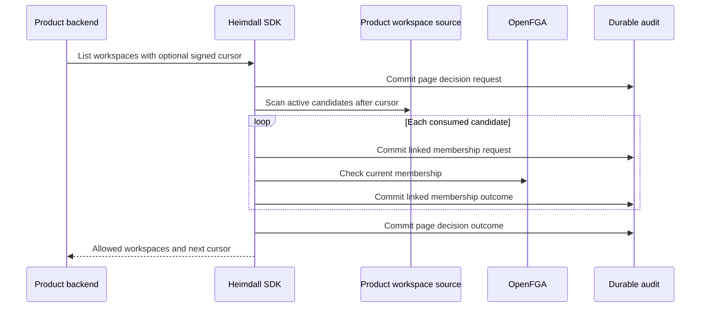

The TypeScript and Go SDKs now accept a product-owned source of active workspace candidates. The source supplies names and stable positions. Heimdall checks fresh membership in the pinned OpenFGA store and model, audits the page decision and each candidate decision, and returns only workspaces the user belongs to.

The default page holds 20 workspaces, with a maximum of 100. The SDK scans up to 500 candidates by default and the product can choose a smaller budget. Sparse membership can produce an empty page with a continuation. The cursor resumes after the last consumed candidate, binds the principal digest and deployment scope, and expires after 15 minutes. Its signing keys must be shared by the product replicas.

The PostgreSQL integration tests verify sparse continuation, tampering rejection, and withholding the page when a membership check fails. Live verification run `04e2a424-f9f3-4956-92e6-5b049a4f2ae2` exercised the public discovery API against live OpenFGA with a fixture candidate source and recording audit ports. Managed discovery and the deployed product flows remain pending.
