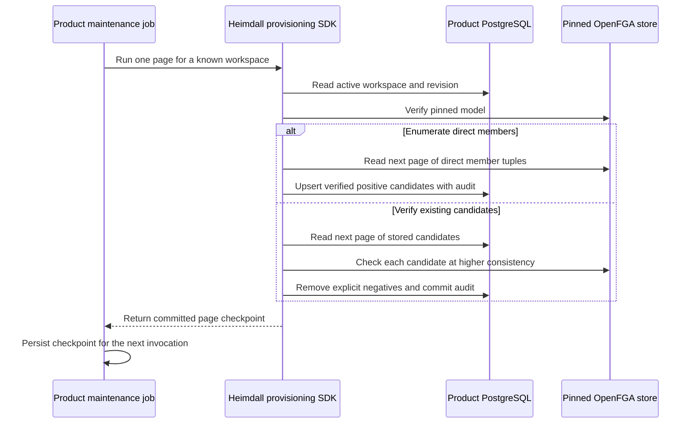

Use `rebuildDiscovery` in TypeScript or `RebuildDiscovery` in Go from the trusted provisioning process. Supply the pinned product configuration, an existing workspace ID, a PostgreSQL connection, and a credential for the product's OpenFGA store. Each call handles up to 20 entries and returns a checkpoint that either language can continue. Persist it in the operator's job storage after the call succeeds.

The write checks the revision observed before the remote reads. A managed membership change or another repair that advances the revision makes the current page conflict. Retry with the previous checkpoint to gather fresh evidence. A suspended or mutation-blocked workspace rejects repair, and an unknown workspace cannot be adopted from OpenFGA. A lost commit response leaves the previous checkpoint usable. Reprocessing a committed page may record an additional repair event.

The sweep repairs discovery hints. Authorization still evaluates current membership in OpenFGA. Direct service changes during a sweep can move behind a cursor, so repeat the sweep after those changes settle if a complete inventory is needed. The supported model uses direct user membership.

## Verification

The reference probe creates 23 direct members in each synthetic workspace. It removes the signed-in recipient's candidate, then alternates SDK languages across the two remote pages and two candidate pages. The recipient's workspace returns to discovery. The probe directly revokes a separate synthetic user's membership after enumeration and verifies that the candidate pass leaves 22 candidates. A blocked workspace and a checkpoint for a different workspace are rejected. PostgreSQL readback verifies four committed repair events per product.

Local PostgreSQL runs `heimdall-records-1346cf0ee0524463bc386fe174a29a23` and `heimdall-records-28f2b406b5ee480cbc15b83d81497d5f` passed with pinned ZITADEL and OpenFGA, before and after batching the candidate writes. The storage-level revision race, audit rollback, and commit response loss cases are recorded in [[phase-3-candidate-repair]].

The first Railway run exposed a transaction deadline in the Go repair over the verification SSH tunnel. The final implementation sends the candidate upserts and removals in one guarded SQL statement. PostgreSQL regression run `c04cb6bffb5f4eca956810ce2d5ddfb0` passed against that implementation, including stale revision, audit rollback and committed-response-loss cases.

Railway run `269b701f-9a63-422a-a039-99572ac60603` verified implementation commit `65867a4` against the deployed references and Railway PostgreSQL through a private SSH tunnel. Both products completed the same 23-member sweep, retained 22 candidates, and recorded four scoped repair events.

| Product | Railway verification deployment | Tested workspace |
| --- | --- | --- |
| Ledger | `c5afa0c2-ca2c-497b-9256-d9da12773b76` | `03b1fb39-6850-45d0-9281-7a53e54a9785` |
| Support | `e91c74aa-0501-4352-8413-9d201477409f` | `3e7341258c178c789201d4838fe8f2fa` |
