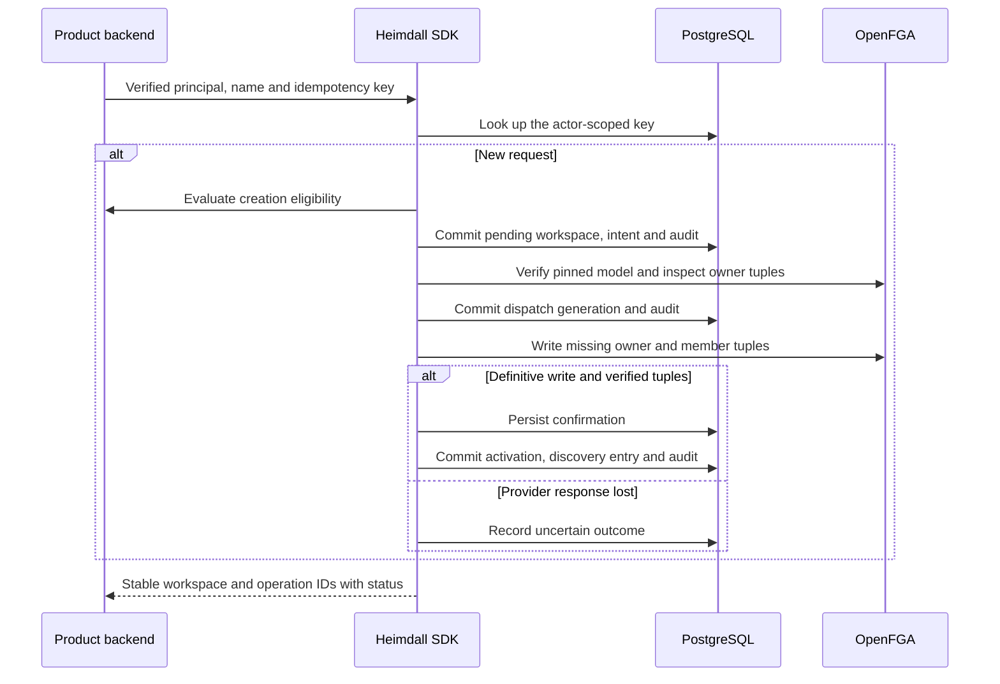

TypeScript and Go managed PostgreSQL runtimes expose workspace creation, actor-scoped operation status, and explicit per-operation retry. The initiating verified principal becomes the initial owner. A product startup callback decides creation eligibility for each new request. Missing policy denies new requests. The SDK validates the name and idempotency key and audits the decision before inserting the workspace.



## Product wiring

Use the managed storage factory with a migrated PostgreSQL pool and supply the creation policy in the runtime options. The product owns request authentication, CSRF protection for cookie-authenticated mutations, its eligibility decision and business readiness. Preserve the same idempotency key across retries of the same user action.

```ts
const result = await heimdall.onboarding!.create(
  actor,
  { name, idempotencyKey },
  { signal: request.signal },
);
const latest = await heimdall.onboarding!.get(actor, result.operationId, {
  signal: request.signal,
});
```

```go
result, err := client.Onboarding().Create(ctx, actor, heimdall.WorkspaceCreateInput{
    Name: name, IdempotencyKey: idempotencyKey,
})
if err != nil {
    return err
}
latest, err := client.Onboarding().Get(ctx, actor, result.OperationID)
```

A duplicate create returns the existing status. A changed name under the same key conflicts. `resume` / `Resume` retries known pre-dispatch failures and can finish activation from durable confirmation. A dispatch without durable confirmation remains blocked for new access and discovery. The status reason `recovery_required` tells the product to route the operation to operator recovery. An outstanding or lost response cannot be settled by polling current tuples.

## Verification

Run `heimdall-records-9209cec2e76c4887970fd641ac734a3b` passed. The shared scenario fixture is exercised in both SDKs by `tests/integration/postgres-records.py`. It uses a restricted runtime role on pinned PostgreSQL 17.11 and controlled OIDC/OpenFGA test endpoints. The suite checks policy denial, foreign runtime principals, duplicate and changed inputs, four-way concurrent create, pre-dispatch failure, lost response after the test endpoint applies the write, and a PostgreSQL trigger failure during activation. A second runtime retries with a newly verified principal. The tests assert the resulting lifecycle gate, provider write count, discovered workspaces and durable SIEM outbox rows.

Live Railway OpenFGA owner tuple behavior was tested separately in [[phase-5-tenant-owner]]. Reference product onboarding routes, operator recovery with verified quiescence, membership changes, invitations and ownership transfers remain part of Phase 5.
