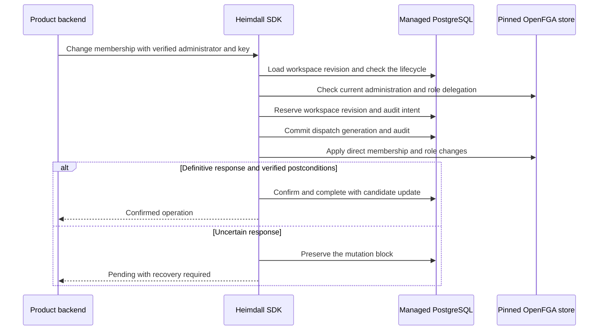

TypeScript exposes `tenant(id).memberships.add`, `assignRoles` and `remove`. Go exposes the same operations through `Tenant(id).Memberships()`. The product supplies the verified administrator, the recipient's issuer and subject, and a stable idempotency key. It resolves the intended human recipient before calling the SDK. Add creates membership with the supplied initial roles, assign replaces an existing member's role set, and remove deletes membership and direct roles. Owner changes use the dedicated ownership workflow.

The SDK requires active ownership or membership-gated delegation and checks each changed role against the manifest. It protects all owner assignments from ordinary membership mutations. The workspace revision prevents dispatch from a snapshot superseded by another managed mutation. OpenFGA receives a combined write when the changes fit one request. Larger changes use bounded batches within the same blocked workspace. Completion updates discovery in the local transaction. The runtime role needs delete access to `heimdall_managed.membership_candidates` in addition to the onboarding grants.

Retry the same command with its original key and input to inspect the result or finish durable confirmation. A reused key with changed input conflicts. An uncertain write keeps the workspace blocked and prevents conflicting mutations. Operator recovery for membership writes is still pending.

Run `heimdall-records-281fd3a0aed447028928831d90da702c` passed on PostgreSQL 17.11. The shared PostgreSQL scenario exercises both public SDKs with controlled OpenFGA responses. It verifies add, idempotency, role replacement, owner protection, removal and candidate cleanup, and the blocked gate after a committed write loses its response. Pinned-service and reference product administration checks, invitation acceptance, and ownership transfer remain Phase 5 work.
