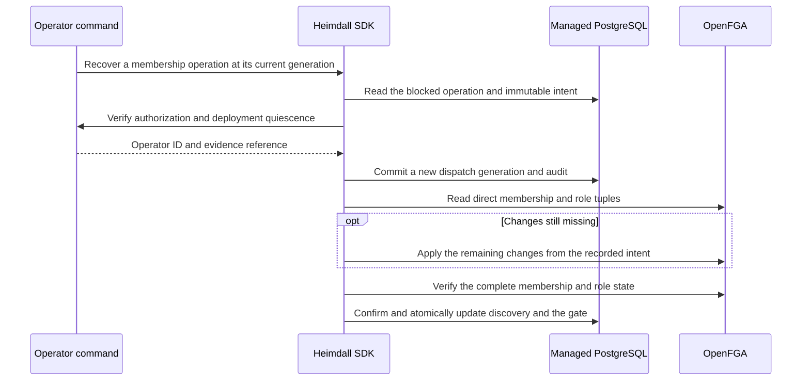

The TypeScript and Go provisioning packages expose `recoverMembership` and `RecoverMembership` for uncertain member additions, role replacements and removals. They use the same generation-bound operator verification as [[phase-5-workspace-recovery]]. The verifier receives the operation kind alongside its workspace, store, model and generation. The maintenance process keeps the old writers drained through completion.

The journal binds the original target and role set. Recovery can finish a previously authorized intent even if that mutation removed the administrator's own delegation. The operator verifier authorizes recovery for the current generation. The SDK refuses to modify an owner and refuses role replacement if the target membership has disappeared. A failed recovery claim or a failed postcondition keeps the gate closed. A workspace that was suspended remains suspended after completion.

PostgreSQL 17.11 run `heimdall-records-07ae3ff61c6643ebad05abfe82ce2402` passed. The shared tests cover an already-committed add, an interrupted role replacement and an already-committed removal. They verify missing-proof denial, stale-generation rejection, unchanged write counts for verified grants and revocations, one repair write for the interrupted role replacement, candidate index updates, and durable recovery audit. These tests use real PostgreSQL with controlled provider responses. See [[phase-5-membership-administration#pinned-service-verification]] for the pinned-provider repeat. [[phase-5-reference-administration]] records the two-product HTTP verification. [[phase-5-reference-invitations]] records subsequent invitation verification.
