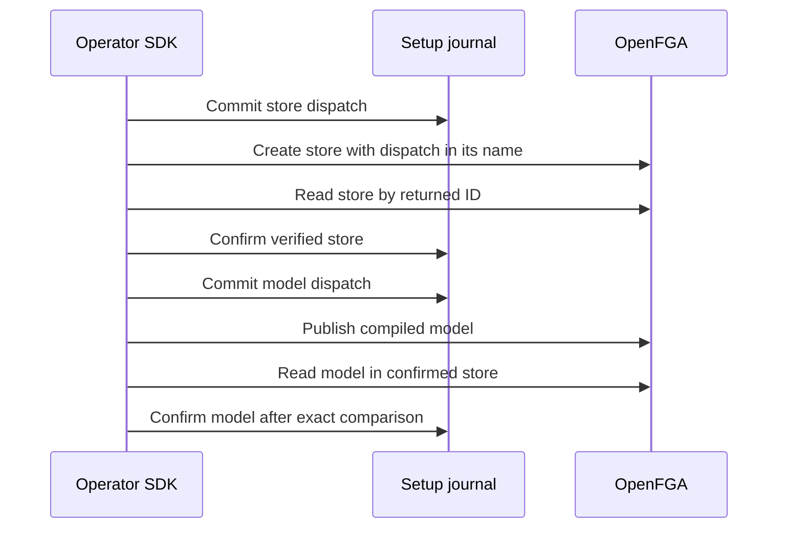

TypeScript and Go validate the deployment binding and compile the manifest before claiming either OpenFGA step. Setup creates a store named for the committed dispatch UUID, reads back the returned store ID, and verifies the store name before confirming it. It then publishes the compiled model, reads it by ID within the confirmed store, and applies the same exact model verification used at runtime. Existing store and model IDs can be supplied as part of an operator plan.

OpenFGA assigns both IDs. If a create response is lost, a repeat returns the unresolved dispatch until an operator supplies an exact recovery ID. The SDK checks the dispatch-specific name for a recovered store, and the store binding and complete model contents for a recovered model. A missing or incompatible resource leaves the journal unconfirmed. Recovery requires an existing dispatch. An ordinary retry never issues a duplicate create.

Live run `4a077af97f924b0fa58a664044a7a771` used the pinned Railway OpenFGA instance and a disposable PostgreSQL setup journal. Go created and resumed a store and model. TypeScript discarded both successful write responses, verified that a retry sent neither write again, and resumed using explicit IDs after rejecting an invalid model ID. Both tests delete their disposable stores.

This checkpoint covers the internal OpenFGA steps. The public product setup API, operator CLI and generated runtime configuration are still in progress. [OpenFGA store read API](https://openfga.dev/api/service/stores/get-a-store/)
