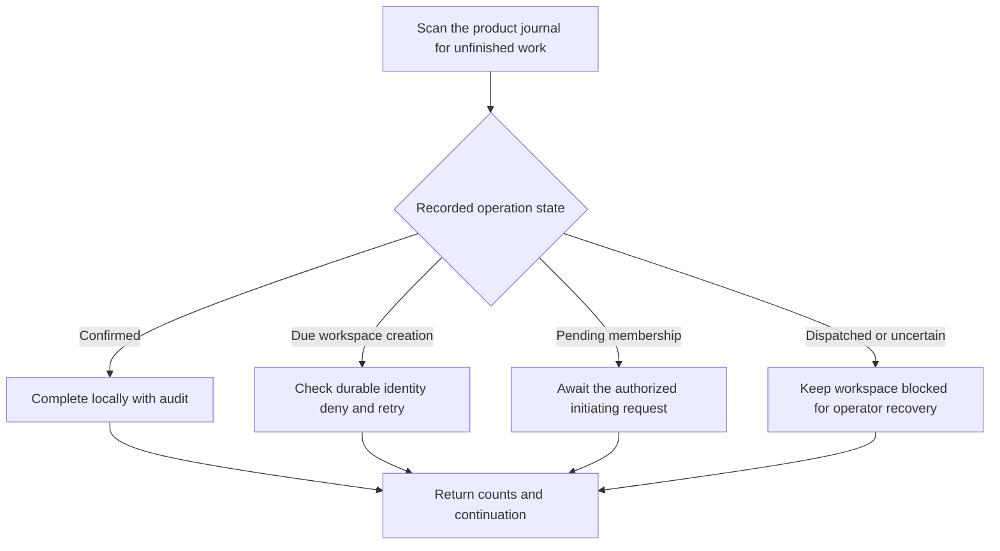

The product scheduler calls `auth.reconcile({ signal, maxOperations, after })` in TypeScript or `client.Reconcile(ctx, options)` in Go. The SDK processes one bounded batch and returns sanitized counts, per-operation dispositions and a continuation. The scheduler starts from the beginning on a new sweep so operations that become due behind an earlier cursor can be revisited.

The SDK records scheduled transitions as the `workspace-reconcile` system actor. The original human initiator stays on the immutable intent. Known pre-dispatch provider failures persist their next eligible time. A longer valid Retry-After takes precedence over the jittered backoff, subject to a one-day cap. After dispatch, the existing operator quiescence procedure governs unknown outcomes.

Undispatched membership requests require the original product path to recheck live delegation or validate the durable invitation claim. The scheduler reports `initiator_required` for these operations and `recovery_required` for uncertain dispatches. Both stay visible in the journal for authorized follow-up. Confirmed membership and ownership operations complete locally without another provider write.

## Verification

Both SDKs exercise the shared onboarding fault scenarios against PostgreSQL. A pre-dispatch 429 delays the next attempt by the supplied five seconds. A due retry writes the owner relationship once. An activation failure leaves a durable confirmation that the scheduler completes without a new provider write. Both lost-response cases remain quarantined until the separately verified recovery workflow is called.

The shared queue vectors verify one-row continuations and the exclusion of retries before their due time. Managed PostgreSQL run `ff6d923cea144ceeba0ee63de95e8f95` passed.

The reference routes are session-authenticated and limited to the configured product operator. The probe re-creates a confirmed operation before local activation, verifies a completed result, and checks that the next sweep excludes the completed operation. PostgreSQL audit readback identifies the scheduled completion and verifies that it added no dispatch.

Local reference run `heimdall-records-81d835a904e3412386203afa6128f561` passed against pinned ZITADEL and OpenFGA.

Session-only products can schedule the PostgreSQL `createRecordMaintenance` or `NewRecordMaintenance` port separately. Its `cleanupExpired` / `CleanupExpired` call deletes a bounded page of expired login and session records using the product's own database pool. The existing [[phase-3-acceptance]] evidence covers expiry cleanup, cancellation, concurrent workers and commit response loss.

Railway run `a2a0c541-3e5f-44cb-a9b4-061f808287de` verified reconciliation commit `89b367d` and read back the system-actor completion from Railway PostgreSQL. The first run stopped on a connection timeout to the Support endpoint. The subsequent run passed for both products.

| Product | Railway verification deployment | Reconciled operation |
| --- | --- | --- |
| Ledger | `8224cec6-a763-41e7-9e05-6cdcc6cb5d24` | `ecfc7635-1415-4939-9842-ae8ff84306fc` |
| Support | `60308c61-18f6-4070-a701-e09ff2d31671` | `b02e486c3c57d310328270e0df959504` |
