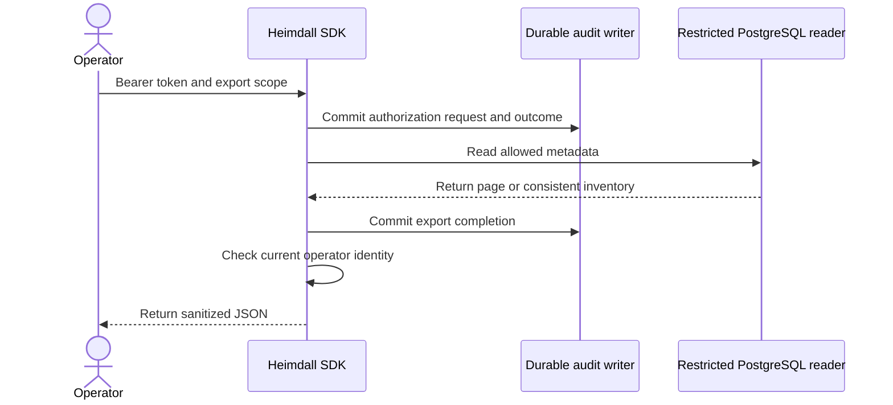

Configure a separate PostgreSQL export pool with the column grants in the managed export contract. Set `authorizeManagedExport` in TypeScript or `AuthorizeManagedExport` in Go to check the verified operator and exact scope. Both SDKs expose paged export and bounded snapshot inventory. Operation export requires a workspace ID. Workspace inventory can cover the product when the policy explicitly allows that scope.

The product owns the export destination and must protect the resulting identifiers. Export includes lifecycle and operation metadata. Keep the pinned manifest and relation mapping separately for an exit or migration. The export credential reads metadata through an explicit column allowlist.

The operator metrics API reports the age of the oldest unfinished operation, the number of dispatched or uncertain operations, and the sum of dispatch attempts on unfinished operations. The session maintenance port reports the age of the oldest expired record. The reference backends expose these values to the configured operator and report the most recent successful reconciliation call in that process. A restart resets that timestamp. A product running several workers can publish and retain the timestamp through its existing metrics system.

## Verification

The reference probe uses a restricted reader for export and a separate runtime audit writer. It verifies bearer authentication, the workspace filter for operation exports, a one-row page and a six-row repeatable-read inventory. It checks the allowlisted product and workspace scope and reads back each authorization pair and completion event. It also checks that the configured operator can read metrics and that another signed-in user receives HTTP 403.

Local PostgreSQL run `heimdall-records-12be8ec6975f4b0595563c683ccdbd68` passed with pinned ZITADEL and OpenFGA.

Railway run `3cb2da11-7a56-4db6-819c-8094adc08598` passed for implementation commit `a018f16`. Each product returned six scoped operations in the inventory and PostgreSQL confirmed both export completion receipts.

| Product | Railway verification deployment |
| --- | --- |
| Ledger | `4152a94c-d257-4a53-acab-afa1879a20c7` |
| Support | `a7783069-28c5-47b7-a5c5-797f33f4fb25` |
