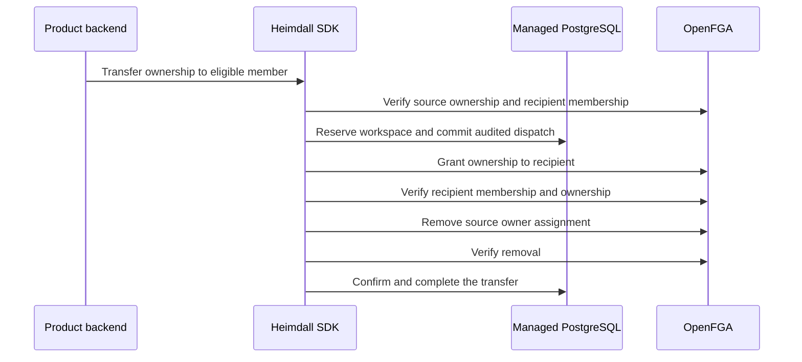

TypeScript exposes `tenant(id).memberships.transferOwnership` and Go exposes `Tenant(id).Memberships().TransferOwnership`. The product supplies the verified source principal, an eligible recipient's issuer and subject, and an idempotency key. The SDK checks effective ownership and verifies that the recipient is already a member of this workspace. Transfers to the acting principal are rejected.

The source retains membership and any other role assignments. The workspace stays blocked throughout the dispatch. If a response is lost, the owner count can temporarily be two and the journal reports recovery required. An operator uses `recoverOwnershipTransfer` or `RecoverOwnershipTransfer` with verified writer quiescence for the recorded generation. Recovery verifies the recipient before removing any remaining source owner assignment. Completion records the ownership outcome and releases the mutation block.

PostgreSQL 17.11 run `heimdall-records-654c3f810bf74b85ac3ca1b4a00b49b7` passed. The shared PostgreSQL scenario exercises both SDKs with controlled OpenFGA responses. It drops responses after the recipient grant and after the source removal. The tests assert that the first fault leaves two owners, the second leaves one, both keep access blocked, and recovery leaves one owner without repeating a committed write. They also verify rejection of a nonmember recipient and self-transfer, replay with the same key, and the former owner's effective roles. Pinned-service and reference-product administration checks and invitation acceptance remain open.
