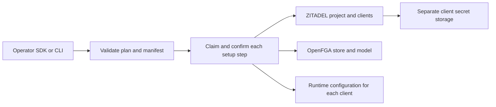

The TypeScript `@techsavvyash/heimdall-sdk/provisioning` and Go `provisioning` entry points accept a product plan, manifest, operator database connection, separate provider credentials and secret storage callbacks. Both validate the manifest and endpoints before claiming work. They provision a project, one application per manifest client in sorted key order, an OpenFGA store and a verified model. The returned configuration map is keyed by client and uses the existing portable runtime schema.



The journal fingerprint binds the product, environment, endpoints, organization, project name, exact manifest bytes and explicitly adopted IDs. Recovery IDs are supplied separately so an operator can reconcile an unresolved OpenFGA dispatch without changing the plan. A changed plan conflicts with the existing journal. Read-only status returns the expected step count, dispatched steps and verified resource IDs.

## Operator CLI

Install the independent [[phase-5-setup-journal|setup database schema]], then prepare a plan JSON with `productId`, `environment`, `issuer`, `organizationId`, `projectName` and `openfgaUrl`. For adoption, specify `existing.projectId`, `existing.applications` keyed by client, `existing.storeId` and `existing.modelId` as applicable. Inject `HEIMDALL_SETUP_DATABASE_URL`, `HEIMDALL_SETUP_ZITADEL_TOKEN`, `HEIMDALL_SETUP_OPENFGA_TOKEN` and `HEIMDALL_SETUP_SECRET_DIR` into the operator process.

```sh
heimdall-setup plan.json manifest.json > runtime-configs.json
heimdall-setup --status ledger production
```

The secret directory must be private to the operator and shared durably by any operators resuming that setup. The CLI publishes each new secret to a mode-0600 file named `<applicationId>.<clientId>.secret` using an atomic, no-overwrite link. An explicitly adopted application needs its corresponding secret file. The setup status command needs only the database URL. To resume an ambiguous OpenFGA write, supply `HEIMDALL_SETUP_RECOVER_STORE_ID` or `HEIMDALL_SETUP_RECOVER_MODEL_ID` after inspecting the provider. Product backends receive their selected config and runtime credentials separately.

Live run `a1fe5f7eed7945bfb7867c9145a51283` used pinned Railway ZITADEL and OpenFGA with a disposable PostgreSQL journal. It verified the TypeScript CLI, resumption through Go with the same manifest bytes, portable config and status parity, and TypeScript setup for two client applications. The CLI uses operator-managed secret files. Integrations that keep secrets in another backend can supply their own SDK callbacks.

The follow-up live setup run `a41e4b27153e4a65be96c791dfb06581` provisioned Ledger and Support on the same pinned services and shared setup journal. It verified distinct audiences, client IDs, stores and models. Go resumed the TypeScript Ledger plan, and the TypeScript CLI resumed the Go Support plan with matching runtime configuration.
