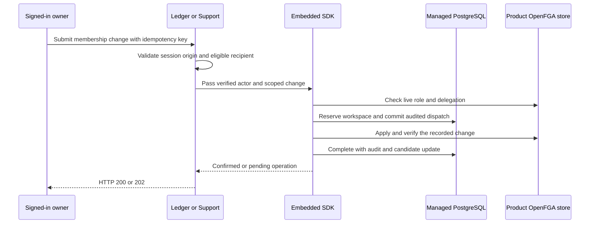

Ledger (TypeScript) and Support (Go) expose session-authenticated POST routes under `/workspaces/{id}/members/`. Each request sends a same-origin `Origin` header and an `Idempotency-Key`. The `add` and `assign-roles` routes take `subject` and `roles`. The `remove` and `transfer-ownership` routes take `subject`.

The reference products accept their configured creator and the subject in `HEIMDALL_REFERENCE_MEMBER_SUBJECT` as eligible recipients. They bind those subjects to the configured issuer. A deployed product supplies its own eligible-recipient lookup. The SDK verifies the acting principal, applies the manifest delegation rules, records each operation in the journal, and updates OpenFGA and discovery. The database role needs delete access on `heimdall_managed.membership_candidates`.

A replay uses the same key and input. Changed input under the same key returns HTTP 409. An uncertain operation returns a pending receipt and blocks further workspace access until operator recovery. See [[phase-5-membership-recovery]] and [[phase-5-ownership-transfer]] for the fault cases.

The product probe signs in two ZITADEL users in each product. It exercises cross-origin and non-admin denial, membership grant and replay, role replacement, removal, and ownership transfer. It checks the recipient's effective roles and protected reads before and after administration, and checks the former owner's loss of permission. The PostgreSQL verifier reads the intent, dispatch, confirmation and completion events for each reported operation.

## Railway verification

Run `fa468e22-ddbb-4f9a-a1d1-f81e4dc7d182` passed against the Railway verification services, using the normal product callbacks and ZITADEL Login API for two synthetic users. PostgreSQL confirmed four lifecycle events for each of the five administration operations in each product.

| Product | Verified deployment | Matched authorization decisions for the initiating user |
| --- | --- | --- |
| Ledger | `e8fe2c64-17a2-49d6-b42e-1b87df219032` | 43 |
| Support | `db312683-25b1-4b9a-9074-16e8f8ac2f2c` | 41 |

The local reference run `heimdall-records-3775038c78d4403f87d4819d1e4ca58b` also passed against live ZITADEL and OpenFGA with disposable PostgreSQL. See [[phase-5-reference-invitations]] for subsequent invitation coverage.
