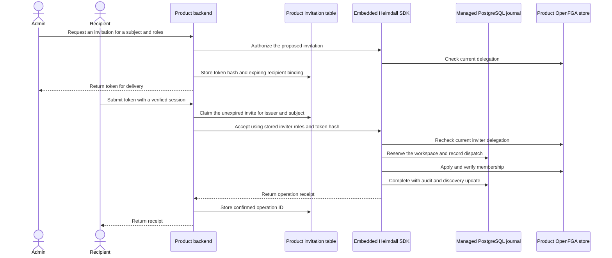

Ledger uses the TypeScript SDK and Support uses the Go SDK. The product provisions its invitation table, selects an eligible recipient by ZITADEL subject, mounts two session-authenticated POST routes, and delivers the resulting token. The examples accept the two configured reference subjects and return the token to the issuer for delivery. In both products the response is non-cacheable and acceptance takes the token in the request body.

| Route | Developer wires | SDK handles |
| --- | --- | --- |
| `/workspaces/{id}/invitations` | Same-origin check, recipient lookup, token generation, hash and expiry storage, delivery | Current session identity and audited delegation check for the proposed grant |
| `/invitations/accept` | Same-origin check, atomic claim bound to issuer and subject, receipt storage | Current recipient, inviter deny gate and delegation, serialized audited grant, candidate update and retry receipt |



The SDK evaluates the inviter's durable identity deny gate and current delegated authority before a new acceptance dispatch. The inviter can be offline during acceptance. The product binds delivery and acceptance to the intended identity and keeps the inviter on the invitation record. The recipient is the initiating actor in the membership audit. A claim made before expiry can resume with the same token hash. A confirmed replay returns the historical receipt. An uncertain dispatch returns HTTP 202 and follows the existing [[phase-5-membership-recovery|operator recovery procedure]].

## SDK calls

Call these methods from the backend after authenticating the request. `input` contains the stored recipient, the approved roles, and the token hash as the idempotency key. The product reconstructs acceptance arguments from its claimed row.

```ts
const memberships = heimdall.tenant(workspaceId).memberships
await memberships.authorizeInvitation(admin, input, { signal })
const receipt = await memberships.acceptInvitation(recipient, inviter, input, { signal })
```

```go
memberships := client.Tenant(workspaceID).Memberships()
if err := memberships.AuthorizeInvitation(ctx, admin, input); err != nil {
    return err
}
receipt, err := memberships.AcceptInvitation(ctx, recipient, inviter, input)
```

## Verification

The live probe signs in two ZITADEL users per product. Both products returned HTTP 201 for issuance, 404 for the wrong recipient and an expired invitation, 403 for cross-origin acceptance, and 200 for the recipient's acceptance and replay. A second outstanding invitation from the former owner was denied after ownership transfer. PostgreSQL confirmed each invitation authorization pair and exactly one membership intent, dispatch, confirmation, and completion for the successful acceptance.

Local run `heimdall-records-c8490e2f97034bcf980b5c0466cf8a98` used disposable PostgreSQL and the pinned provider services. Its acceptance operation IDs were `39f17798-4b70-4b04-9cb1-7a882517ae41` in Ledger and `62495dfe3529c49e8bd44ef303e5de6e` in Support.

Railway run `e6bcecf9-4dea-4db8-8566-a3479c08e062` verified both products after deploying commit `6870be1`. Audit readback matched the product, workspace, and initiating actor for each reported membership transition.

| Product | Railway verification deployment | Invitation membership operation |
| --- | --- | --- |
| Ledger | `ace9e68d-2971-4752-89d3-f4fdf8d07861` | `78333a1c-2b97-4c8b-9b50-b6fab9a77b55` |
| Support | `74d09771-6026-444f-a4aa-aa786887ec92` | `11ee2ce1d0cc9c1830c2090743b38f45` |
