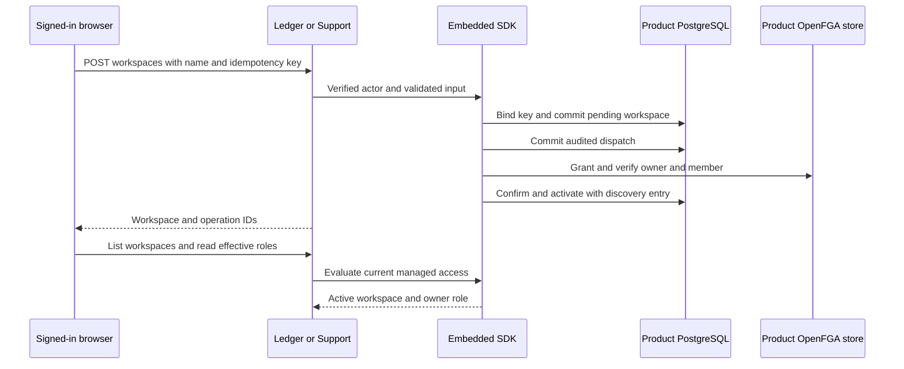

Ledger (TypeScript) and Support (Go) mount the managed onboarding API alongside the existing browser session, discovery and role routes. Both use separate product configurations and OpenFGA stores with the same ZITADEL deployment.

| Route | Product wiring | SDK behavior |
| --- | --- | --- |
| `POST /workspaces` | Require the session cookie, same-origin `Origin`, a JSON body with only `name`, and an `Idempotency-Key` header | Check creation policy, record intent and audited dispatch, grant owner and membership, activate and index the workspace |
| `GET /workspace-operations/{id}` | Authenticate the session and pass the operation ID | Return the initiating principal's status from the current product's journal |
| `POST /workspace-operations/{id}` | Authenticate the session and require the same-origin header | Retry a safe pre-dispatch failure or finish a confirmed local activation |

The examples authorize a single verified ZITADEL subject through `HEIMDALL_WORKSPACE_CREATOR_SUBJECT`. Leaving it unset denies new creation. Products provide their own eligibility policy and business readiness. Business reads continue to use the workspace ID in a parameterized query.

Create and resume return HTTP 200 for active results or 202 when pending. Status reads return HTTP 200 for an operation visible to the caller. Reusing a key with a different name returns HTTP 409. The operation ID and workspace ID are stable across an identical retry. When the result includes `recovery_required`, keep the operation ID for operator recovery. A product can retry a request whose response was lost using the same key.

The runtime database role needs `INSERT` and `UPDATE` on `heimdall_managed.workspaces`, `heimdall_managed.operations`, and `heimdall_managed.membership_candidates`, plus usage on the managed candidate sequence. Apply those grants with a deployment credential alongside the [[phase-4-reference-backends|existing reference setup]].

The HTTP probe is in `tests/integration/reference-products.mjs`. It verifies the session-backed request, CSRF and unauthenticated rejection, injected-owner rejection, same-key replay, changed-input conflict, status and resume, discovery, the owner role, and a scoped business read. Support also probes the newly created Ledger IDs using the same human identity, confirming that it cannot observe the Ledger operation or acquire any role in that workspace.

## Railway verification

Probe `7620818d-bcc9-4416-bf7b-99ec43957c8b` ran the complete HTTP flow with the pinned ZITADEL and OpenFGA services and Railway PostgreSQL. The probe matched each backend's health response to its deployment and run ID before signing in.

| Product | Deployment | Durable audit readback |
| --- | --- | --- |
| Ledger | `31d4456b-9376-4b80-9851-172bbb61f079` | One intent, dispatch, confirmation and activation. 30 matched decision pairs. |
| Support | `7802c1cf-18a7-4638-8a87-12a80a570a21` | One intent, dispatch, confirmation and activation. 29 matched decision pairs. |

The repeat includes the Ledger request cancellation fix in `fa223c0`. Readback used the exact operation IDs and initiating actors from this run. The probe used ZITADEL's Login API for the synthetic user and the products' normal session callbacks. [[phase-5-managed-onboarding]] covers fault injection for retryable and uncertain outcomes. Operator recovery and membership administration are still open in Phase 5.

[[phase-5-reference-administration]] covers member grants, role replacement, removal and ownership transfer in both products.
