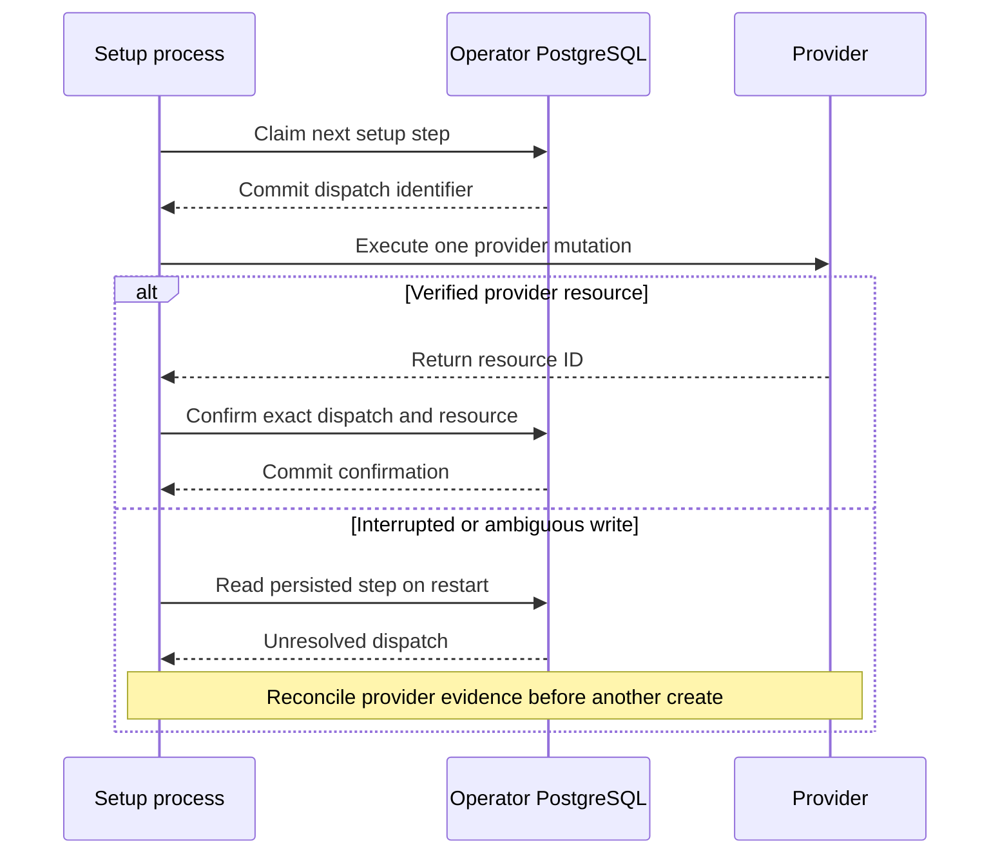

Product provisioning uses an independent PostgreSQL journal in the operator's database. The schema stores product and environment, a plan fingerprint, step order, a dispatch ID, timestamps, and the confirmed provider resource ID. Operator credentials and runtime client secrets stay outside the journal.



The database locks one plan row while claiming or confirming a step. Concurrent processes get one dispatch winner. An existing unresolved dispatch stays unresolved across process restart. A step can advance only after its predecessor has a confirmed resource. Replaying the exact confirmation is safe when its commit response was lost. Changed fingerprints or resource IDs conflict. The database grants the setup role read access and execution on the two transition functions. Table updates remain restricted to the schema owner and those functions.

Install the journal explicitly with the existing migration command. The operator supplies the database URL through `HEIMDALL_MIGRATION_DATABASE_URL`.

```sh
go run ./cmd/heimdall-migrate -initialize-setup-schema -sql ../../contracts/persistence/setup/0001.sql
go run ./cmd/heimdall-migrate -status setup
```

Run these commands from `sdk/go`. The catalog pins the SQL checksum, and both language suites check the migration artifact. This installation works in an empty database independently of session and managed workspace migrations.

## Verification

The local integration uses the pinned PostgreSQL 17.11 image, runs the installer twice and checks readiness. Run `daf9df0faff043bfb7627a933b3e46e0` also verified committed claims and confirmation replay through both SDK database adapters with the restricted setup role. The Railway verification probe applies the same SQL and catalog entry in a disposable database on the dedicated verification PostgreSQL service. Run `85435960072348e89baa51e9574c54ed` confirmed standalone installation, a single winner among four concurrent claims, persistent unresolved dispatch, ordered steps, fingerprint conflicts, confirmation replay, separate Ledger and Support plans, and restricted role access.

The journal can now coordinate provider writes. ZITADEL and OpenFGA setup operations, verification of provider-side correlation, sanitized status, and runtime configuration generation are the next provisioning work.
