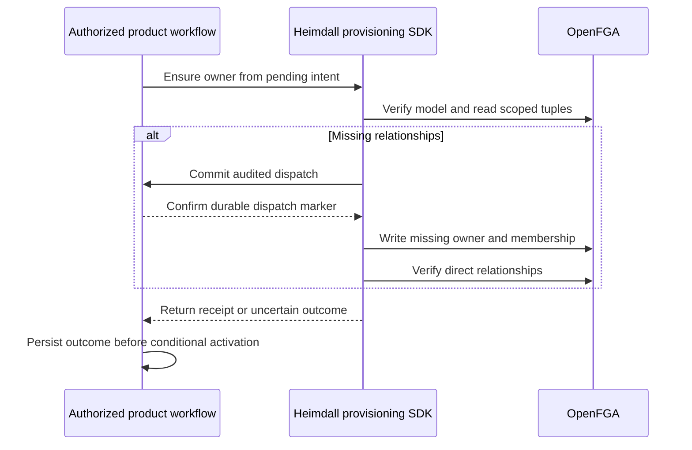

The operator-side provisioning packages expose an initial-owner operation for TypeScript and Go. The product supplies the recorded tenant and owner, the configured OpenFGA credential, and a callback that durably records the audited dispatch. The SDK verifies the pinned model, reads direct owner and membership tuples with higher consistency, rejects an unexpected owner, and writes only missing tuples in one request. The result binds operation, tenant, canonical principal, store and model.

A dispatch failure stops the write. A lost write response or an unconfirmed postcondition returns `outcome_unknown`. The caller keeps the workspace blocked and verifies quiescence before calling the operation again. Successful rereads prove current tuple state. The caller owns durable intent, cancellation, writer serialization and audited outcome recording.

Live run `a8a320d5a4f149b8adb3910f645def28` used pinned OpenFGA on Railway. It checks creation, idempotent repeat and conflicting ownership. TypeScript also refuses dispatch when the callback fails, discards a successful provider write response, and reconciles after the test has observed that write finish. The integration records the callback in memory. Managed PostgreSQL orchestration and reference onboarding remain separate Phase 5 work. [OpenFGA consistency](https://openfga.dev/blog/query-consistency-options-announcement) · [OpenFGA duplicate tuple writes](https://openfga.dev/blog/ignore-duplicate-writes-announcement)
