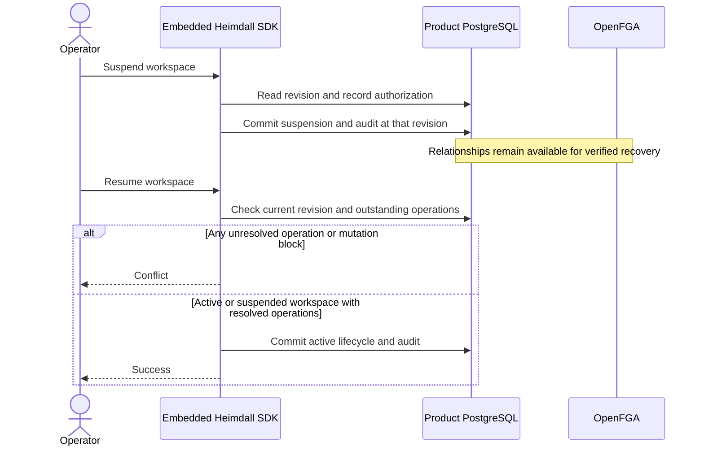

The TypeScript managed tenant exposes `suspend(actor, { signal })` and `resume(actor, { signal })`. Go exposes `tenant.Suspend(ctx, actor)` and `tenant.Resume(ctx, actor)`. The backend supplies a workspace-scoped lifecycle policy. With no policy, both commands deny. Ledger and Support wire that policy to their configured product operator and enforce same-origin requests on the session-backed routes.

Suspension updates the primary PostgreSQL lifecycle and commits the change with the audit event. It preserves the mutation block, candidate index and OpenFGA relationships. Protected reads, effective roles and discovery observe the closed gate. An already authorized request may finish under the existing revocation contract.

A changed workspace revision conflicts so the caller can retry against fresh state and policy. Resumption checks both the mutation flag and the operation journal in the guarded write. An acknowledgement lost at commit returns `outcome_unknown`. Retry the same command under current policy. The resulting state is idempotent, and each successful command can produce its own audit event.

## Verification

The reference probe uses two signed-in users per product. It rejects a caller outside the lifecycle policy and a cross-origin request. It then suspends while the mutation flag is set, confirms a conflict on resume, and observes denied protected reads, empty effective roles, and omission from workspace discovery. It separately injects an unresolved operation in the synthetic workspace with the flag clear and verifies that the journal guard still refuses resumption. After restoring the fixture to a resolved state, it resumes and verifies the existing owner's protected access and roles.

PostgreSQL readback requires one committed suspension event, one committed resumption event, and the audited policy decisions for all authorized and denied attempts. The two deliberate resume conflicts produce no lifecycle mutation event.

Local PostgreSQL run `heimdall-records-4da6bc7a697e404f90457708b57eb379` passed against pinned ZITADEL and OpenFGA. The fault injection exercises the two resumption guards independently. The existing [[phase-5-workspace-recovery]] and [[phase-5-membership-recovery]] probes provide evidence for resolving actual dispatched failures.

Railway run `f6481df8-c3ac-4741-aba7-9f2d63a59b64` verified commit `281b71c` against both reference deployments and read back the corresponding audit events from Railway PostgreSQL.

| Product | Railway verification deployment | Tested workspace |
| --- | --- | --- |
| Ledger | `021e2ed0-6c61-4eda-974e-8594326edbdb` | `f4247eb3-c726-4995-a578-d279069056bd` |
| Support | `0960affa-8972-4406-8b81-309c32e34044` | `0f1d8b80fe413b7f47f8938a1f8c7415` |
