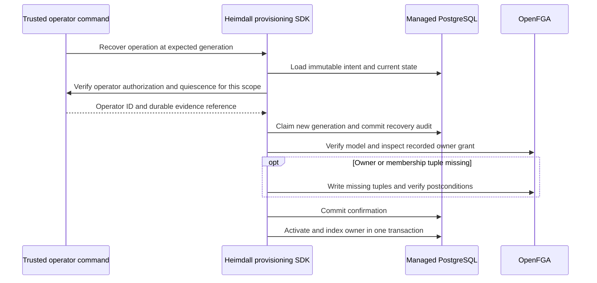

The TypeScript and Go provisioning packages expose `recoverWorkspaceCreation` and `RecoverWorkspaceCreation` for trusted maintenance commands. Supply the pinned product config, the initiating identity, operation ID, expected generation, recovery credential, and a deployment-specific verifier. The verifier authorizes the operator and checks that old writers and their outstanding requests have stopped. It returns a stable operator ID and a reference to the durable external evidence. Keep the maintenance controls in effect until recovery returns.

Keep the verifier in operator-controlled code. Its scope includes product, environment, store, model, workspace, operation, generation and the last journal update time. Verify quiescence for that specific attempt. A later uncertain attempt requires fresh proof. Store only opaque references in the SDK audit. Provider credentials and the external evidence contents stay outside the journal. The claim, confirmation and completion events carry the same evidence reference as their request ID.

The SDK uses generation CAS to admit one recovery attempt for a specific generation. Missing evidence, a stale generation, a mismatched initiating actor or a different owner blocks completion. A failure after claim leaves the workspace blocked until a fresh verified recovery or a durable confirmation allows local completion. Product-side resume preserves the quarantine while the operation is dispatching or uncertain.

Run `heimdall-records-042da65d7d5b4d11bcbdf7571aa48736` passed on pinned PostgreSQL 17.11. The shared PostgreSQL tests exercise both SDKs with controlled provider faults. One fault applies the owner grant and loses the response. Recovery verifies it without repeating the write. Another fault stops the original write before applying it. Recovery dispatches the missing grant once. Both check denial without proof, stale replay, managed discovery and the recovery audit.

The service-side drain and credential retirement procedure is documented in [[phase-2-railway-recovery]]. The complete maintenance procedure and SDK recovery still need a combined pinned-service fault test. Membership and ownership-transfer recovery remain part of Phase 5.
