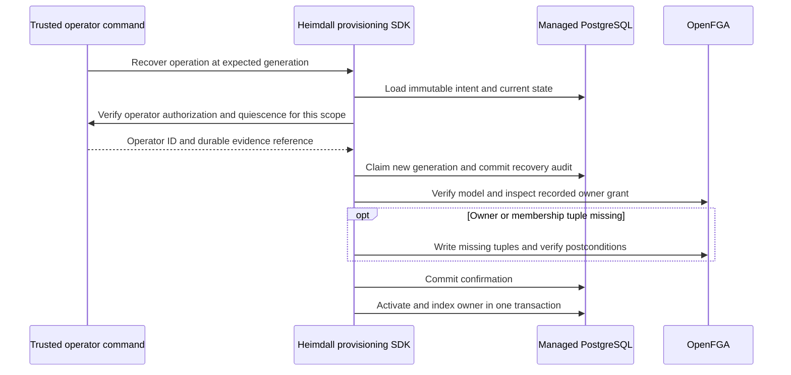

The TypeScript and Go provisioning packages expose `recoverWorkspaceCreation` and `RecoverWorkspaceCreation` for trusted maintenance commands. Supply the pinned product config, the initiating identity, operation ID, expected generation, recovery credential, and a deployment-specific verifier. The verifier authorizes the operator and checks that old writers and their outstanding requests have stopped. It returns a stable operator ID and a reference to the durable external evidence. Keep the maintenance controls in effect until recovery returns.

Keep the verifier in operator-controlled code. Its scope includes product, environment, store, model, workspace, operation, generation and the last journal update time. Verify quiescence for that specific attempt. A later uncertain attempt requires fresh proof. Store only opaque references in the SDK audit. Provider credentials and the external evidence contents stay outside the journal. The claim, confirmation and completion events carry the same evidence reference as their request ID.

The SDK uses generation CAS to admit one recovery attempt for a specific generation. Missing evidence, a stale generation, a mismatched initiating actor or a different owner blocks completion. A failure after claim leaves the workspace blocked until a fresh verified recovery or a durable confirmation allows local completion. Product-side resume preserves the quarantine while the operation is dispatching or uncertain.

Run `heimdall-records-042da65d7d5b4d11bcbdf7571aa48736` passed on pinned PostgreSQL 17.11. The shared PostgreSQL tests exercise both SDKs with controlled provider faults. One fault applies the owner grant and loses the response. Recovery verifies it without repeating the write. Another fault stops the original write before applying it. Recovery dispatches the missing grant once. Both check denial without proof, stale replay, managed discovery and the recovery audit.

## Pinned-service recovery drill

Run `02059ce4-e0ef-400d-a03e-d550b692faac` combined the SDK recovery with OpenFGA 1.22.0 and PostgreSQL 17.11 in an isolated Compose deployment. The probe committed two blocked journal entries before sending the owner and member writes. It dropped one response after commit and held the other write at a PostgreSQL table lock. It then stopped the OpenFGA container, drained the remaining database backends, replaced the API credential, and restarted the service.

| Check | Observed result |
| --- | --- |
| Before recovery | Both operations remained dispatching at generation 2. Workspaces were pending, blocked and absent from the candidate index. |
| Delayed old request | HTTP 401 after the credential replacement. The interrupted grant was still absent. |
| TypeScript recovery | Confirmed the committed owner and membership, then activated the workspace. |
| Go recovery | Repaired the interrupted owner and membership grant, then activated the workspace. |
| PostgreSQL readback | Both operations reached generation 5 with active, unblocked workspaces, a discovery candidate and three recovery events routed to the outbox. |

The fixture uses the journal and provider dispatch in separate steps to control the timing of each fault. Its operator callback uses observations from the owned deployment. The product runtime fault tests above cover the request path. The combined drill used Compose. [[phase-2-railway-recovery]] records the separate Railway service-control drill. [[phase-5-membership-recovery]] records the membership recovery API and its fault tests. Ownership-transfer recovery remains part of Phase 5.
