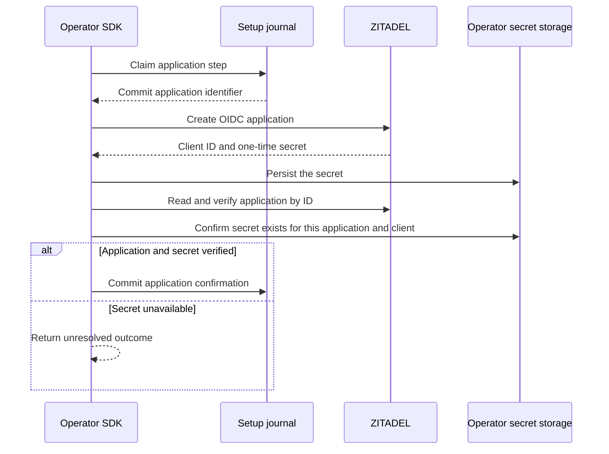

Both SDKs reserve an application ID in the operator setup journal, then create a confidential web client with authorization code and refresh grants, JWT access tokens and the declared redirect URIs. On repeat, they read the application by its exact ID and verify the project, active state and OIDC settings. A supplied existing application goes through the same verification.

The provisioning API hands the secret to an operator-supplied storage callback. The journal and application result carry IDs only. If the response containing the secret is lost, a repeat can find the application but requires the operator to restore or explicitly regenerate and store its secret before resuming. An ordinary retry performs neither a second create nor secret rotation. Storage callbacks should use durable, application-specific secret references and honor cancellation.

The runtime configuration and browser login validators in both languages accept ZITADEL's project-qualified client ID, such as `69629023906488334@ledger`. Other identifier fields keep their existing constraints. Shared fixtures exercise the qualified ID through configuration validation and the browser session lifecycle.

Live run `31db618446df43a38d1b554ec5f76bec` used pinned Railway ZITADEL and a disposable PostgreSQL setup database. Both SDKs created and resumed an OIDC application. TypeScript additionally discarded the live application create response and verified that a missing secret kept the step unresolved without another create. The test uses a recording secret callback and deletes its disposable provider organizations. Production secret storage integration and the complete setup CLI remain open. [Pinned ZITADEL Application v2 API](https://github.com/zitadel/zitadel/blob/v4.19.4/proto/zitadel/application/v2/application_service.proto)
