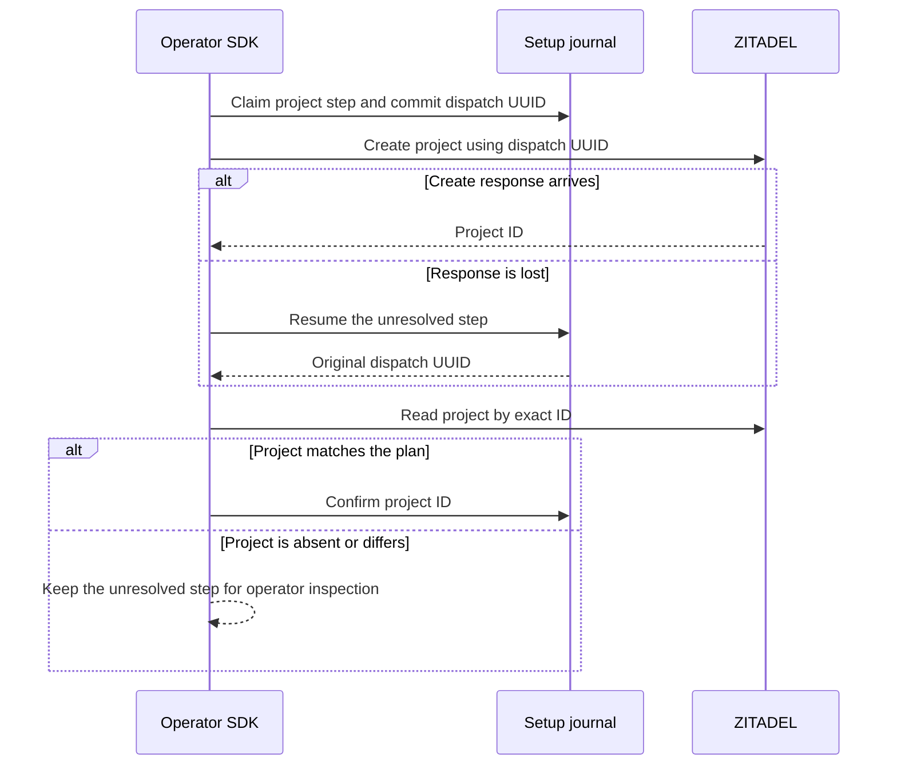

The TypeScript and Go provisioning code uses the setup journal's committed dispatch UUID as the ZITADEL project ID. The pinned ZITADEL Project v2 API accepts a caller-selected ID. Before confirming the journal step, the SDK reads the project by that ID and verifies its organization, name, active state and expected authorization settings. An explicitly supplied existing project ID follows the same read and validation path.

Restart reads the exact ID and never repeats the create. An absent project leaves the dispatch unresolved, including when the original request never reached ZITADEL. A mismatched project produces a conflict. Privileged credentials are sent only to the configured provider endpoint and are excluded from journal data and errors.

Integration run `6d7726e62c5c45e5b3832abe165a3b3c` used a disposable local setup database and the pinned Railway ZITADEL instance. It verified creation, repeat and drift refusal in Go. In TypeScript it also discarded a successful live create response, recovered the project by UUID and verified that an unresolved missing project does not trigger a second create. The runner deletes its disposable provider organizations after the tests.

This checkpoint covers the internal project step. Application and OpenFGA provisioning, the public setup API and CLI, and runtime configuration emission remain open. [Pinned ZITADEL Project v2 API](https://github.com/zitadel/zitadel/blob/v4.19.4/proto/zitadel/project/v2/project_service.proto)
