The TypeScript PostgreSQL adapter exposes `createAuditDelivery`. Go exposes `NewAuditDelivery`. The product runs the delivery call explicitly for each product, environment and sink. Configure an HTTPS endpoint, a bearer credential and the same sink ID used by the audit writer. The worker needs read access to the retained audit tables and permission to update only the delivery state, attempts, next attempt and delivered timestamp columns.

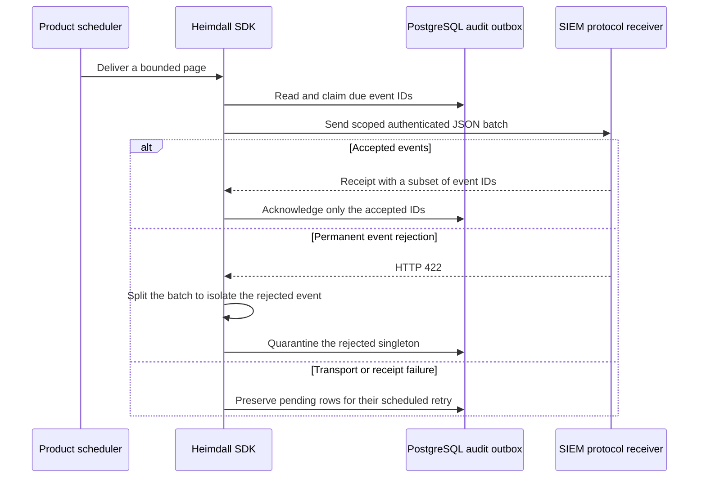

The request includes `productId`, `environment`, `sinkId`, `eventIds` and `events`. The receiver returns the same scope and a nonempty unique subset of accepted IDs after durable acceptance. Deduplicate by product, environment and event ID. Use HTTP 422 only for a permanently invalid event in an otherwise valid batch. Other failures retain pending rows. The exporter returns counts of claimed, delivered and quarantined events, and exposes a requeue operation for a known quarantined event and attempt counter.

Claims persist retry times before transport. Delivery retries use exponential backoff with jitter. A lost response can produce duplicate delivery. The configured custom-event validator is applied when reading product events. The receiver in the PostgreSQL integration is an HTTP loopback protocol fixture. Vendor compatibility and the independent ZITADEL collector remain part of Phase 6.

PostgreSQL run `heimdall-records-1b845d4ad1e64eb69e010cf6c48daa9d` exercised both SDKs against the loopback receiver. An outage and an invalid receipt kept events pending, a permanent rejection quarantined the bad event and delivered the healthy event in the same batch, and an explicit replay delivered it. The receiver fixture does not establish compatibility with a particular vendor.

## Custom event ingestion

TypeScript `createCustomAuditWriter` and Go `NewCustomAuditWriter` bind trusted product events to a configured product, environment and set of sinks. The writer fixes the event source and accepts only registered `product.*` event types, recognized schema versions and bounded, permitted attributes. The product backend supplies the authorized actor and tenant. Use the same event payload, identifier and timestamps on retry. A different payload under the same event ID conflicts.

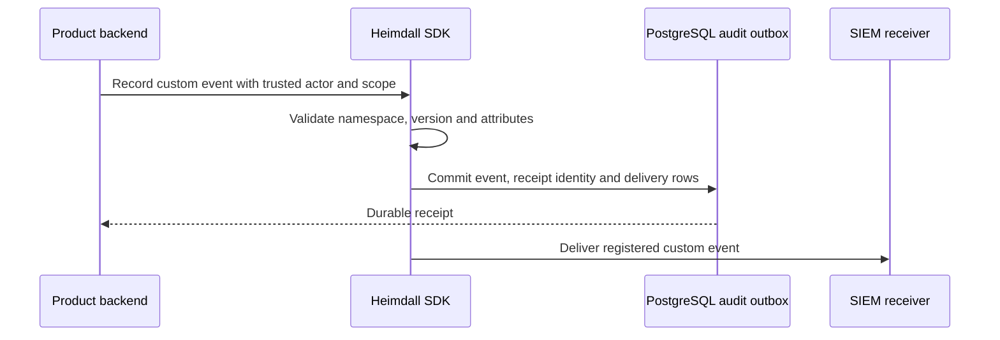

Keep validators for historical versions available to the delivery worker until its backlog drains. The product owns schema registration, authorization and any transaction that must bind the event to its business data.

PostgreSQL run `heimdall-records-9acedb7368ff4033a855e7330c735820` exercised both writers and exporters. The tests rejected reserved event types, unregistered versions and sensitive attributes, confirmed stable receipts on replay, rejected changed payloads and delivered a valid custom event.

## Backlog and capacity monitoring

TypeScript `delivery.metrics(signal)` and Go `delivery.Metrics(ctx)` read a single PostgreSQL snapshot. The result includes the number of pending, due and quarantined events for the configured sink and the age of its oldest pending event. Pending includes events waiting for their retry time. An empty pending queue has no oldest age.

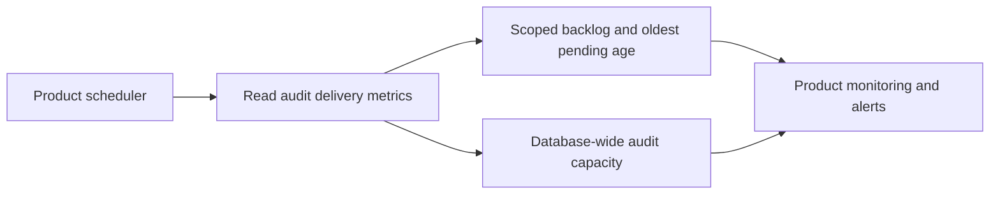

Capacity includes used and reserved events, envelope bytes, delivery rows and retained metadata rows alongside their limits. The retained-row limit accounts for both the configured row and byte limits. Capacity applies to the entire database. Expose it only to trusted operators. Record delivery call errors and outcome counts in the product scheduler to measure failure rate. The metrics query reads delivery metadata without decoding event payloads and inherits the PostgreSQL read deadline.

PostgreSQL run `heimdall-records-1d78bc12f4aa4fed97242bd62b32123d` verified both SDKs report deferred events during an outage, quarantined records after rejection, database capacity, empty metrics for another sink, and cancellation.

## ZITADEL historical event reader

The provisioning entry points expose `createIdentityEventReader(options).readWindow(since, until, signal)` in TypeScript and `NewIdentityEventReader(options).ReadWindow(ctx, since, until)` in Go. The product operator supplies a trusted issuer, an organization ID and a server-side event reader credential. The verified ZITADEL role is instance-wide. Keep the credential in a trusted worker and bind the organization ID to a verified product mapping before routing any records.

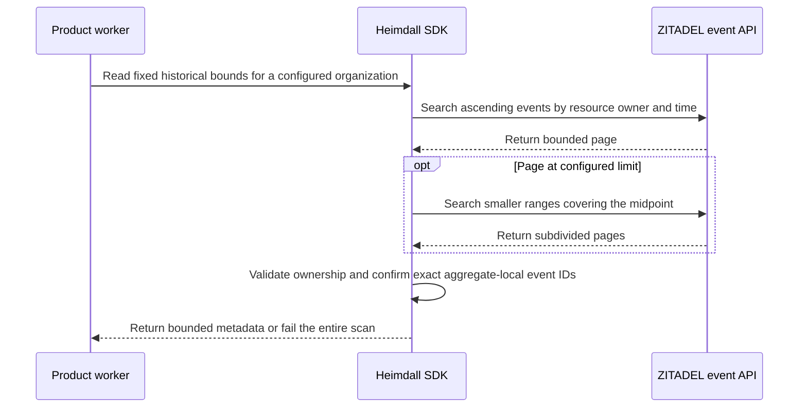

Both bounds are exclusive UTC timestamps at microsecond precision. Results contain the organization, aggregate type and ID, event type, creation time and exact decimal sequence. Provider payloads and editor fields are omitted. The readers enforce a maximum of 128 requests, a 30-second operation deadline and 5-second request deadlines. A saturated microsecond, a missing observation during subdivision or an exceeded request budget fails the scan. A credential or provider failure cannot produce an empty successful result. ZITADEL can represent a successful empty page as an empty JSON object.

Railway ZITADEL run `528c1ed3-b9d6-4a5c-873f-f926914b1428` matched all 22 events across four aggregates against an unsaturated baseline in both SDKs. Both returned an empty result for the exclusive-boundary query. Shared fixtures cover saturated and malformed pages, a wrong organization and the full uint64 range.

This reader supports explicit historical scans. The collector below adds a durable checkpoint for windows with operator-supplied coverage and explicit aggregate mappings.

## Durable historical collection

The PostgreSQL SDK adapters expose `createIdentityCollector` in TypeScript and `NewIdentityCollector` in Go. Configure an issuer, organization, product, environment, tenant, starting timestamp, sink IDs and a trusted list of aggregate types and IDs assigned to that tenant. The worker takes an exclusive provider retention floor, exclusive visibility ceiling and expiry from trusted deployment code. The expiry must cover the provider reads. Use the bounds only when the deployment can establish them independently of an empty API page. Apply `contracts/persistence/directory/0008.sql` after 0007 in a deployment-owned transaction. The worker needs select, insert and update on the checkpoint table alongside the retained audit writer privileges.

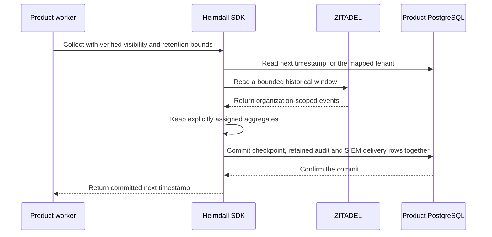

The checkpoint stores the next inclusive microsecond, so the next scan includes records exactly at the previous upper bound. A concurrent worker must match the previous checkpoint before it can write. Restart reads the committed checkpoint after a lost commit response. Provider failures, retention gaps, a changed aggregate mapping and failed outbox writes leave the checkpoint available for recovery. The mapping digest prevents silently reusing an advanced checkpoint after editing the allowlist. Use the explicit activation procedure below to change the mapping for future windows.

The SDK records only sanitized event metadata for assigned aggregate IDs. An organization shared by two products needs explicit mappings for both. An unmapped aggregate is omitted. Provider payloads and editor fields are discarded. The audit request ID identifies the imported event for correlation and carries no claim that an unrelated SDK request created it.

PostgreSQL run `heimdall-records-1edae3aaae274a6aac06d4052f88ab92` used the same provider fixture in both SDKs. It verified that a retention gap makes no upstream call, an upstream outage leaves the checkpoint unset, an injected delivery insert failure rolls back the checkpoint and event, and restart after commit does not re-read the completed window. Only the mapped event received a delivery row and the exact uint64 sequence survived storage.

Historical collection takes trusted coverage bounds as an input. Automatic live coverage and aggregate discovery remain Phase 6 work.

### Collector recovery and delivery after a lost commit response

PostgreSQL run `heimdall-records-7821ff13a104496e84210d432f95b412` used a wire proxy to withhold the response after PostgreSQL confirmed the collector commit. Both SDKs returned `outcome_unknown`. On a new connection they resumed at the committed checkpoint without reading the provider window again. Each exporter delivered the original mapped tenant event and its exact sequence to an authenticated HTTP receipt fixture. After the fixture acknowledged the event ID, another delivery pass sent no event. The shared provider fixture included an unmapped aggregate and a synthetic sensitive payload. The receiver got only the mapped event and its sanitized metadata.

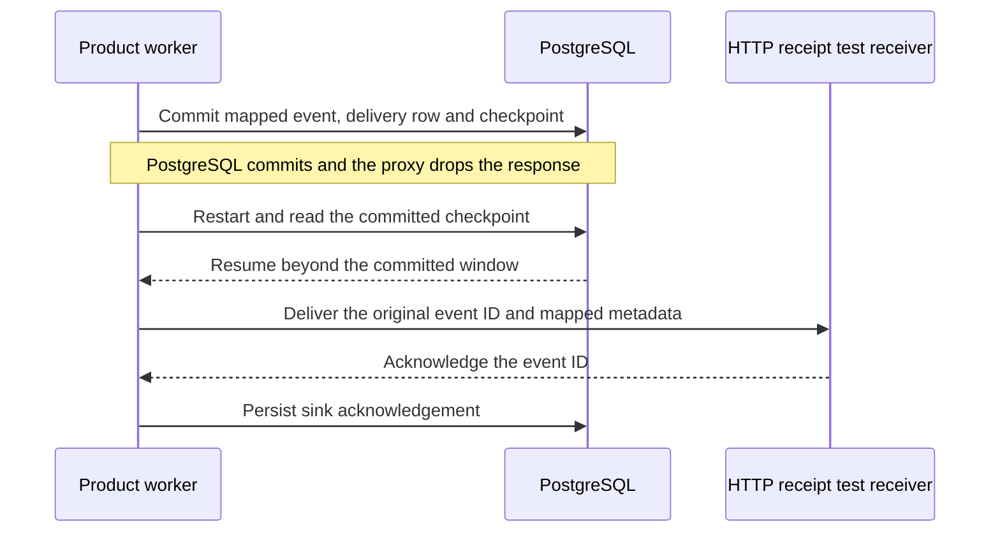

The provider and receiver in this fault test are fixtures. Production visibility and retention bounds and a compatible SIEM deployment still require qualification.

## Elasticsearch receipt verification

The reference integration mounts `examples/audit/elasticsearch_receipt.py` in an existing product or collector endpoint. The operator assigns one bearer credential and concrete Elasticsearch index to each product, environment and sink binding. The handler validates the batch and every event's scope before sending any documents. It derives each document ID from the product, environment and event ID. It uses create-only writes and returns a receipt for successful creates or verified identical replays. A conflicting payload under an existing ID remains pending for operator investigation.

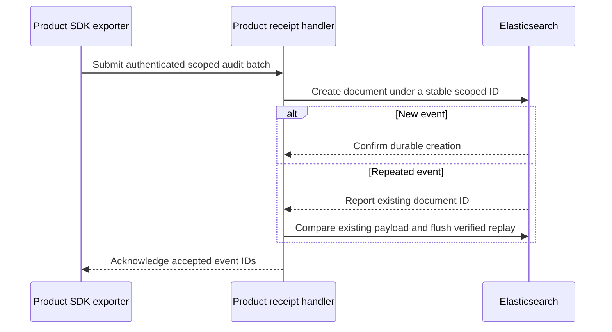

Precreate the index with request-level translog durability and deploy the handler behind the product's HTTPS endpoint. Give its Elasticsearch credential create, read and flush access for that index. Keep the index concrete and stable during the replay period. A replay must find the original document and match its payload. The handler flushes the index before acknowledging matches so a real-time read of a concurrent create alone cannot produce a receipt. [Create API](https://www.elastic.co/docs/api/doc/elasticsearch/operation/operation-create) · [Translog durability](https://www.elastic.co/docs/reference/elasticsearch/index-settings/translog) · [Flush API](https://www.elastic.co/docs/api/doc/elasticsearch/operation/operation-indices-flush)

Run `python3 tests/integration/elasticsearch-receipts.py` against a disposable Elasticsearch 8.19.0 node with `HEIMDALL_TEST_ELASTICSEARCH_URL` and protected `HEIMDALL_TEST_ELASTICSEARCH_CREDENTIALS`. The test creates and deletes one run-scoped index. Run `601e612b-9dc3-4ccf-a588-5515998a32f5` used the checksum-verified native Elastic distribution with authentication enabled. It rejected invalid credentials and cross-product batches, acknowledged an identical replay without adding a document, left a changed tenant payload pending and accepted the healthy product event in that same batch. Direct Elasticsearch reads confirmed that the index held exactly the two expected documents.

This run verifies the receipt handler against real Elasticsearch. The prior commit-loss run exercises SDK exporters against the receipt protocol. The combined live run below verifies both SDK exporters through the same receipt handler.

## Live ZITADEL to Elasticsearch recovery

The optional PostgreSQL integration run starts a disposable Elasticsearch 8.19.0 process and creates one index per product scope. It writes a deactivation event through Railway ZITADEL and imports the exact historical window through both SDKs. Ledger and Support map the same provider aggregate to different tenants. The test receiver withholds a successful receipt after indexing. Each SDK then attempts delivery while Elasticsearch is offline and retries after the same node restarts.

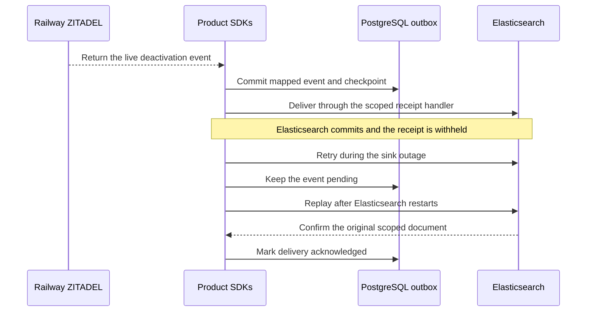

Run `tests/integration/postgres-records.py` with the protected Railway verification PAT, `HEIMDALL_TEST_ELASTICSEARCH_CREDENTIALS`, and `HEIMDALL_TEST_ELASTICSEARCH_START`. The last setting points to an executable that runs a disposable local node in the foreground on loopback port 19243. Configure its data path to persist across the two process starts. The probe starts and stops its own process and deletes its disposable organization and indexes. It makes pending rows due directly in the test database to avoid waiting for the production retry timer.

Run `c8581e63-b007-4920-9d3d-cda5dd272320` passed for both SDKs. Elasticsearch retained one document per product across restart, including the exact provider sequence and the mapped tenant. PostgreSQL recorded three delivery attempts and a final acknowledgement for each event.

The probe supplies a known historical timestamp from the live provider event. Automatic live coverage and end-to-end SCIM acceptance remain open.

## Tenant-scoped delivery and replay

Set `tenantId` in TypeScript or `TenantID` in Go when constructing the audit exporter for a tenant-specific destination. The product backend resolves the authorized tenant and configures the exporter with a matching destination and credential. Use separate sink IDs for separate destinations. The Elasticsearch handler accepts a matching `tenant` binding and verifies every event before sending any document to the index.

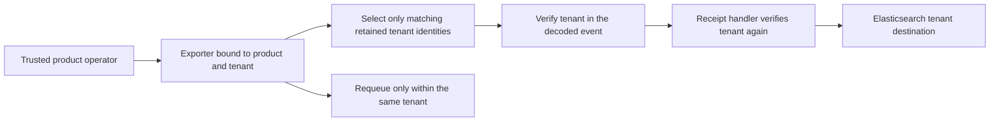

Delivery filters by immutable retained tenant identity before applying the page limit. It also checks the decoded envelope before transmission. Backlog counters and requeue use the same tenant scope. Capacity counters still describe the whole database and belong in trusted operator monitoring. Omitting the tenant preserves the existing product-wide export. Authorization of the operator and the initial sink configuration belongs to trusted product code.

PostgreSQL run `heimdall-records-2b841f5abe0f4069818f07677d35b988` verified in both SDKs that a tenant worker can requeue and deliver its own event while leaving another tenant’s quarantined event and the product-level event untouched. Live run `4323f456-2a05-442a-976e-6497535a9a5d` verified that the tenant-bound Elasticsearch receipt handler rejected a same-product, wrong-tenant batch and that the correct events survived a sink outage and restart.

## Changing an aggregate mapping

Apply directory migration `0009.sql` before upgrading collectors and drain older SDK workers during the upgrade. The migration gives existing checkpoints mapping revision zero. Upgraded workers include that revision when committing each page.

The operator reads `checkpoint(signal)` or `Checkpoint(ctx)`, reviews the next inclusive provider timestamp, and constructs a collector with the approved aggregate list for the same issuer, organization, product, environment and tenant. Call `activateMapping(expected, signal)` or `ActivateMapping(ctx, expected)` on that collector. The operation compares the timestamp, mapping digest and revision in a transaction. The new list takes effect at that timestamp. A worker using the previous list must reload configuration. If a concurrent collector already advanced the timestamp, activation conflicts and the operator must review the new boundary.

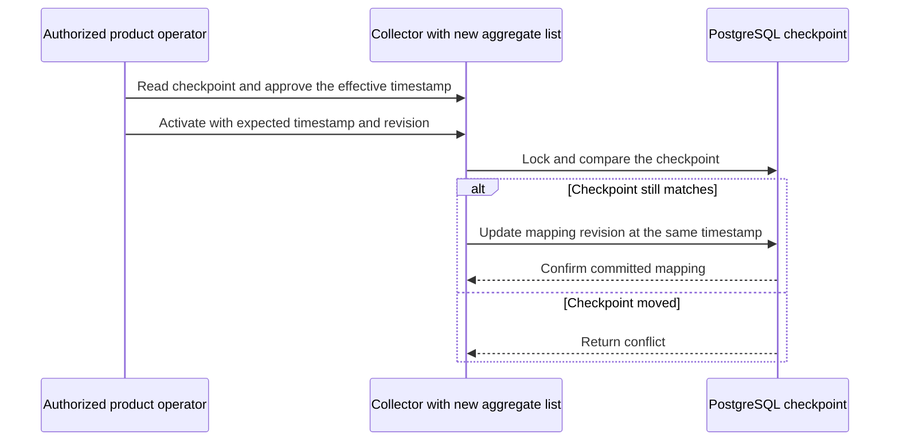

A repeated activation can confirm the same transition while its checkpoint remains at the approved boundary. After an uncertain response, read the current checkpoint before issuing a new activation. Returning to an earlier list increments the revision again, which fences in-flight pages from the earlier revision. Existing events and their outbox rows retain their original routing. Historical backfill and changing sink destinations require separate operator procedures.

PostgreSQL run `heimdall-records-363e5c173d584c208821c9ac4d05074e` verified the migration and both SDKs. The tests rejected a stale timestamp, retried an activation at the same boundary, and rejected a stale revision after a revert. They also changed the mapping twice during an in-flight provider read. The old page could not advance the checkpoint even though the mapping digest again matched, and the original event and delivery row remained intact.

## Deriving coverage for scheduled collection

TypeScript exports `deriveIdentityEventCoverage(policy)` and Go exports `DeriveIdentityEventCoverage(policy, time.Now())`. A product scheduler calls the helper immediately before `collect` or `Collect`. Configure the policy from verified deployment limits for maximum writer transaction duration, maximum absolute clock offset from the worker, and minimum effective Events API retention. The clock bound must apply to the database primary and all ZITADEL API replicas throughout the scan, including failovers. The retention bound must account for the effective instance override and remain valid for the full read.

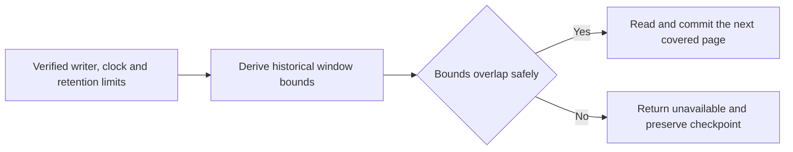

The helper subtracts the writer duration and three clock offsets from local time to get the exclusive visibility ceiling. The offsets cover slow time at write creation, fast time at position assignment, and slow time at the reader. The exclusive retention floor uses local time plus the 30-second coverage lifetime and one clock offset, minus minimum retention. This accounts for the latest provider read before expiry. The collector refuses to advance if its checkpoint falls outside retained history. Shared fixtures verify clock margin, an exhausted window, disabled bounds and exact microsecond conversion.

PostgreSQL run `heimdall-coverage-44e931ce79dc4a9992d9c5493c7e0863` confirmed that the pinned PostgreSQL 17.11 image applies a per-role transaction timeout, terminates an overlong writer, and rolls back its uncommitted event insert. Prepared transactions were disabled. [PostgreSQL transaction timeout](https://www.postgresql.org/docs/17/runtime-config-client.html#GUC-TRANSACTION-TIMEOUT) · [ZITADEL retention settings](https://zitadel.com/docs/self-hosting/manage/usage_control#limit-audit-trails)

Use a positive PostgreSQL transaction timeout for every event writer, reconnect older sessions after configuring the role, and keep prepared transactions disabled. The helper trusts the supplied limits. The PostgreSQL probe qualifies the timeout premise on a disposable node. The current Railway ZITADEL deployment has yet to be qualified for a continuously advancing checkpoint under these limits.
