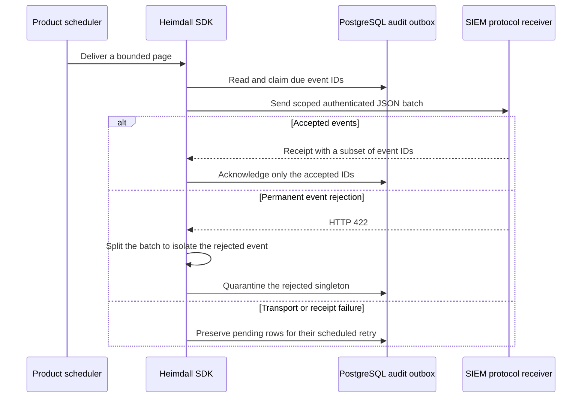
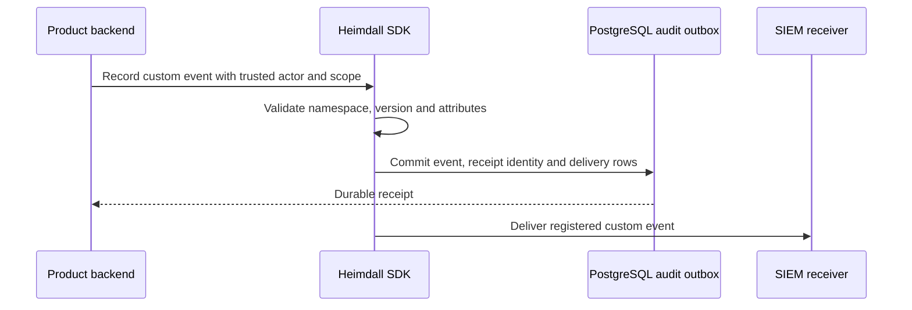
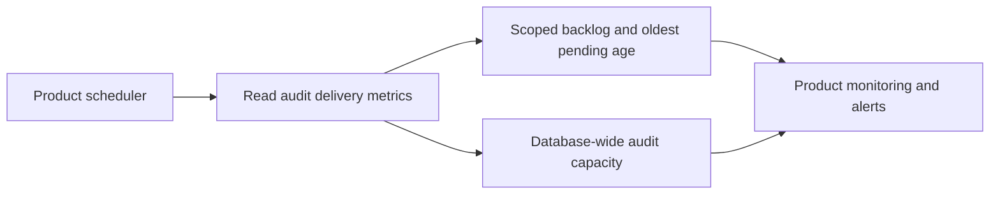

The TypeScript PostgreSQL adapter exposes `createAuditDelivery`. Go exposes `NewAuditDelivery`. The product runs the delivery call explicitly for each product, environment and sink. Configure an HTTPS endpoint, a bearer credential and the same sink ID used by the audit writer. The worker needs read access to the retained audit tables and permission to update only the delivery state, attempts, next attempt and delivered timestamp columns.

The request includes `productId`, `environment`, `sinkId`, `eventIds` and `events`. The receiver returns the same scope and a nonempty unique subset of accepted IDs after durable acceptance. Deduplicate by product, environment and event ID. Use HTTP 422 only for a permanently invalid event in an otherwise valid batch. Other failures retain pending rows. The exporter returns counts of claimed, delivered and quarantined events, and exposes a requeue operation for a known quarantined event and attempt counter.

Claims persist retry times before transport. Delivery retries use exponential backoff with jitter. A lost response can produce duplicate delivery. The configured custom-event validator is applied when reading product events. The receiver in the PostgreSQL integration is an HTTP loopback protocol fixture. Vendor compatibility and the independent ZITADEL collector remain part of Phase 6.

PostgreSQL run `heimdall-records-1b845d4ad1e64eb69e010cf6c48daa9d` exercised both SDKs against the loopback receiver. An outage and an invalid receipt kept events pending, a permanent rejection quarantined the bad event and delivered the healthy event in the same batch, and an explicit replay delivered it. The receiver fixture does not establish compatibility with a particular vendor.

## Custom event ingestion

TypeScript `createCustomAuditWriter` and Go `NewCustomAuditWriter` bind trusted product events to a configured product, environment and set of sinks. The writer fixes the event source and accepts only registered `product.*` event types, recognized schema versions and bounded, permitted attributes. The product backend supplies the authorized actor and tenant. Use the same event payload, identifier and timestamps on retry. A different payload under the same event ID conflicts.

Keep validators for historical versions available to the delivery worker until its backlog drains. The product owns schema registration, authorization and any transaction that must bind the event to its business data.

PostgreSQL run `heimdall-records-9acedb7368ff4033a855e7330c735820` exercised both writers and exporters. The tests rejected reserved event types, unregistered versions and sensitive attributes, confirmed stable receipts on replay, rejected changed payloads and delivered a valid custom event.

## Backlog and capacity monitoring

TypeScript `delivery.metrics(signal)` and Go `delivery.Metrics(ctx)` read a single PostgreSQL snapshot. The result includes the number of pending, due and quarantined events for the configured sink and the age of its oldest pending event. Pending includes events waiting for their retry time. An empty pending queue has no oldest age.

Capacity includes used and reserved events, envelope bytes, delivery rows and retained metadata rows alongside their limits. The retained-row limit accounts for both the configured row and byte limits. Capacity applies to the entire database. Expose it only to trusted operators. Record delivery call errors and outcome counts in the product scheduler to measure failure rate. The metrics query reads delivery metadata without decoding event payloads and inherits the PostgreSQL read deadline.

PostgreSQL run `heimdall-records-1d78bc12f4aa4fed97242bd62b32123d` verified both SDKs report deferred events during an outage, quarantined records after rejection, database capacity, empty metrics for another sink, and cancellation.
