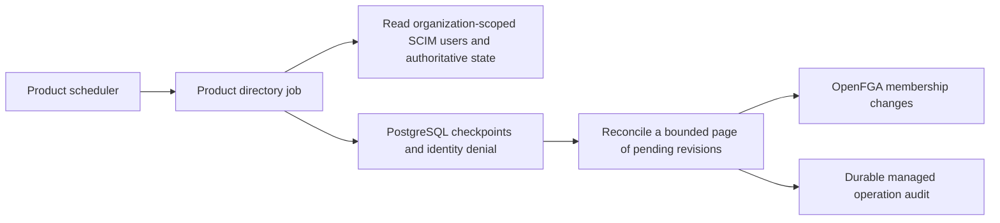
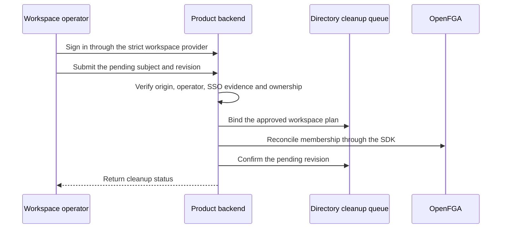
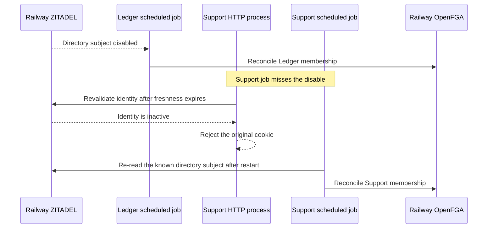

Ledger runs `pnpm --filter @heimdall/ledger directory:run`. Support runs `support directory-job` using its built product binary. Run either command from the product's scheduler and configure one active job per product, environment and directory. Each invocation has a 45-second deadline. Configure the scheduler to retry failures with backoff and alert when runs fail repeatedly. A product's HTTP process starts independently.

Supply the product's existing database, manifest, deployment, policy version, client secret and OpenFGA credential. Use the same strict SSO settings as the HTTP process. The directory job additionally reads:

| Environment variable | Product responsibility |
| --- | --- |
| `HEIMDALL_DIRECTORY_ORGANIZATION` | Trusted ZITADEL organization for this product directory |
| `HEIMDALL_DIRECTORY_READER_TOKEN` | Organization-scoped read credential with provisioning-domain provenance |
| `HEIMDALL_DIRECTORY_WORKSPACES` | JSON array of one to 100 workspace IDs that the product has approved for directory cleanup |
| `HEIMDALL_DIRECTORY_OPERATOR_TOKEN` | Fresh product-audience user token for an authorized administrator of the mapped workspaces. Inject it through the scheduler's credential handling. |

Install the directory migrations and grant the worker the documented PostgreSQL runtime and directory permissions. The reader and the administrator use distinct credentials. The administrator is needed when cleanup is pending. Strict workspaces require the corresponding SSO evidence, so an ordinary bearer token cannot authorize their managed membership changes. The reference commands leave those revisions pending for authorized reconciliation. The product's normal identity checks and durable denial continue to protect requests. See [[phase-6-scim-polling]] and [[phase-6-scim-deactivation]].

## Reconcile a strict workspace

Set `HEIMDALL_DIRECTORY_OPERATOR_SUBJECT` on the reference HTTP process to enable `POST /directory/cleanup`. Configure the same trusted directory organization and workspace mapping on the HTTP process and job. The reference route covers one strict workspace per directory mapping because a verified browser session binds its SSO evidence to a single workspace. The job can still record identity denial using its organization-scoped reader. The HTTP process needs access to read deactivation rows and update their cleanup plan and completion fields.

The configured operator signs in through that workspace's federation flow. From the product origin, submit the pending `subject` and `revision` obtained from the directory cleanup queue. The route uses the product session cookie, requires the operator to be an effective owner, and takes the workspace mapping from server configuration. The SDK verifies that the identity is durably denied, binds the plan to the actor, and applies the managed membership operation. HTTP 200 confirms cleanup. HTTP 202 retains a pending operation for the existing managed recovery workflow.

Each invocation discovers one page of up to 25 entries, checks known subjects in pages of 10, then reconciles up to 10 pending revisions. Known-subject scanning restarts from the beginning after a process restart. Measure full scan time with production directory sizes before setting a job interval. A directory too large to complete within the deadline needs a product scheduler that persists its scan position or partitions the work. The managed revision binds the approved workspace plan on its first reconciliation attempt. Keep that mapping and administrator stable while retries are pending. Uncertain writes remain subject to the managed recovery gate.

The job reports counts for discovery, observation, revoked sessions and cleanup. It reports the age of the oldest revision it processed, in milliseconds, and emits a sanitized error code on failure. Reactivation still requires the separate approved enrollment flow.

## Live recovery after a missed observation

PostgreSQL run `heimdall-records-7fbabfd034854dd49df3540736b42d12` ran the reference commands with Railway ZITADEL and OpenFGA. Both jobs discovered the same subject while active. After one SCIM disable, Ledger observed and cleaned up the membership in 2,974 ms. The probe kept the Support job stopped for 61 seconds. Support then returned HTTP 401 after authoritative identity revalidation, with its old OpenFGA grants still present and no directory cleanup revision. A new Support job discovered the disabled state and removed the grants. The test observed confirmed cleanup at 63,893 ms. A further invocation found no pending cleanup. Both workspaces had one audited removal and required approved re-enrollment before a fresh session could access the resource.

Run `tests/integration/postgres-records.py` with `HEIMDALL_PROBE_REFERENCE_PRODUCTS=1`, `HEIMDALL_PROBE_SCIM_BROWSER=1` and `HEIMDALL_PROBE_DIRECTORY_JOB=1` plus the protected verification credentials. This probe uses a small disposable directory and real product sessions. It takes the Support denial sample after the freshness window, so the sample is an upper bound on when the original cookie became unusable under these test conditions.

## Deployment verification

Source commit `5d463cd` passed the workspace gate and both GitHub workspace checks. Railway reference deployments `b9bc2bc3-9dac-4124-bb68-68c0b3c39c70` for Ledger and `5493fd9a-ba25-47df-ae9b-f5544a310995` for Support passed live SAML-to-OIDC workspace switching after the product and job began sharing the same policy configuration. The SCIM job probe ran as separate local processes against the pinned Railway identity and authorization services. Railway docs deployment `0ed0869a-01de-4ed8-af47-e1db9bb203f9` served the guide, and Chromium rendered the sequence diagram.
