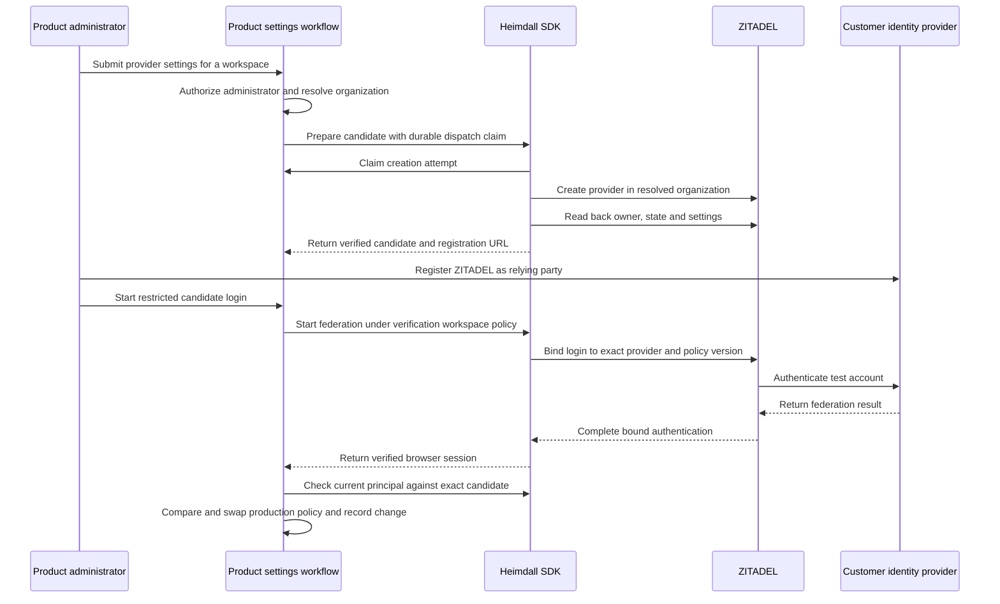

Both SDKs can prepare and read back a ZITADEL identity provider scoped to a verified organization. The product owns the settings route, administrator authorization, tenant-to-organization mapping and publication of a versioned login policy. The SDK owns provider request defaults, readback, uncertainty handling and verification of the test login.

## Product wiring

1. Authorize the initiating administrator and resolve the target organization from trusted workspace storage. Store the candidate version and creation intent durably. Pass a privileged credential from secret storage. The dispatch callback must claim an unused attempt atomically and return an error for a prior claim. Keep the settings credential out of login handlers and client code.
2. Call TypeScript `prepareEnterpriseProvider` from `@heimdall/sdk/provisioning`, or Go `provisioning.PrepareEnterpriseProvider`. Supply the HTTPS OIDC issuer and client registration, or the SAML IdP metadata XML bytes. The SDK requests PKCE for OIDC and signed Redirect requests for SAML. It disables automatic creation, linking and updates. The customer registers the returned OIDC callback URL or imports the SAML service-provider metadata URL. The provider is active in ZITADEL after creation. Product policy publication is a separate step.
3. Use an administrator-restricted verification workspace ID and a unique candidate policy version. Give this workspace no application memberships or resources. Make its policy available to the existing federation start and callback handlers while the candidate is pending. Use a test account in the intended organization with a verified provider link. Reserve the verification workspace ID for this workflow and use a separate browser context for the test account so an operator session can still authorize publication.
4. Authenticate the test session through the SDK. Call TypeScript `heimdall.verifyEnterpriseProviderTest` or Go `client.VerifyEnterpriseProviderTest` with the resulting principal, verification workspace ID and server-stored candidate policy. Both SDKs require fresh evidence from that runtime and cap test login age at five minutes. Recheck administrator authority and compare and swap the expected production policy version and candidate version before publishing. Record the change through the product's durable audit integration. Retire the verification mapping and log out the test session. Evidence from that workspace cannot authorize a production workspace.

After an ambiguous create, recover the exact provider ID from ZITADEL and pass it explicitly for read-only reconciliation. The SDK verifies organization, provider ID, name, active state, protocol and returned public settings. If the ID is unknown, stop and reconcile the original creation attempt before authorizing another. ZITADEL readback omits the OIDC client secret and PKCE setting. The live login exercises the registration in use. For SAML, the SDK verifies the uploaded XML bytes and returned signature, binding and NameID settings.

## Acceptance evidence

Each SDK created and recovered a provider for each protocol against the pinned Railway ZITADEL deployment with a disposable Keycloak directory. All four runs rejected readback under another organization.

| Provider creation | OIDC | SAML |
| --- | --- | --- |
| TypeScript | `66c3c9a2-3724-4191-9f4e-2d193a697029` | `09e4ce9a-85d7-4b7a-8f9a-2fdcef5779a3` |
| Go | `816943f8-59a2-4a53-b9ee-c11b64d5a85e` | `32afeaea-f3b3-4e6f-9fdc-c9d2e0251fe0` |

OIDC run `65b7753d-7039-4a93-b74e-a83d261e0f4a` and SAML run `6f5ea804-3267-4eef-a1a7-50d12018dcb3` exercised both SDKs' browser callbacks and candidate verification. Both accepted the matching login and rejected a different verification workspace, rotated candidate version, wrong intent, missing browser cookie and replay. The harness used temporary session storage for these SDK checks. [[phase-6-tenant-sso-gate]] records deployed browser login, encrypted PostgreSQL session persistence and account switching in the reference products.

Run `tests/integration/federation.mjs` with the protected variables described in [[phase-2-browser-federation]], plus `HEIMDALL_PROBE_ENTERPRISE_SETUP=typescript` or `go` and `HEIMDALL_PROBE_SDK_FEDERATION_HTTP=1`. The probe creates and removes its own organizations, directory realm and sessions. The production policy compare and swap is product-owned and the harness exercises the SDK check preceding it.
