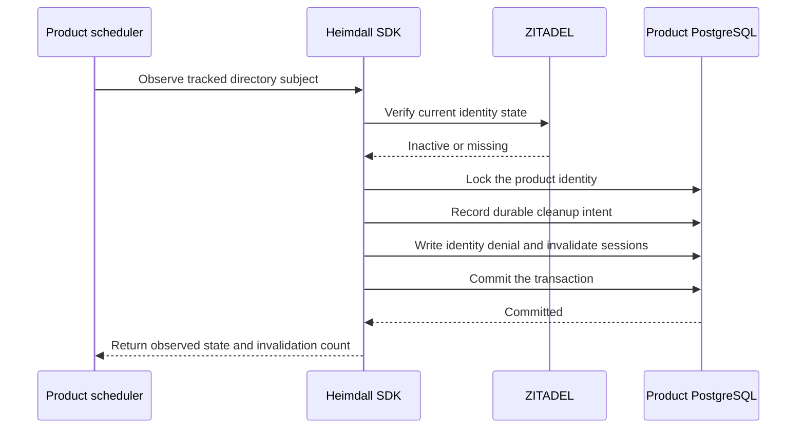

The TypeScript PostgreSQL entry point exposes `createDirectoryDeactivation`. The Go PostgreSQL package exposes `NewDirectoryDeactivation`. The product scheduler calls the observer with a previously tracked issuer and subject under its trusted directory configuration. Each call reads current state through the [[phase-6-scim-reader|directory reader]].

Install the directory schema once using the product's deployment migration tooling and one transaction. The directory schema is installed independently of the runtime audit protocol. Grant the worker role schema usage and select, insert and update access to the deactivation table, alongside the runtime permissions for identity denial and session invalidation. The normal authorization runtime does not require access to the directory table. [Directory schema SQL](https://github.com/techsavvyash/heimdall/blob/feat/docs-website/contracts/persistence/directory/0001.sql)

One transaction persists the deactivation intent, denies the identity and invalidates its sessions. It uses the same identity lock as the session store. Product and environment scopes are independent. A retry can confirm local denial again without duplicating the intent. An existing intent cannot be rebound to another organization. Deleted status dominates inactive status on retry. An active or initial state leaves an existing denial in place.

The disposable PostgreSQL regression invokes both public SDK adapters under the restricted runtime role. It verifies that an injected session-deletion failure rolls back both the intent and the deny, and that a successful retry, an initial state, a mismatched organization and an unrelated environment preserve their expected boundaries. Reproduce with `tests/integration/postgres-records.py`.

This checkpoint implements the durable local deny. Membership cleanup, checkpoint advancement, activation after cleanup, lifecycle audit export and the measured end-to-end worker latency remain part of Phase 6.
