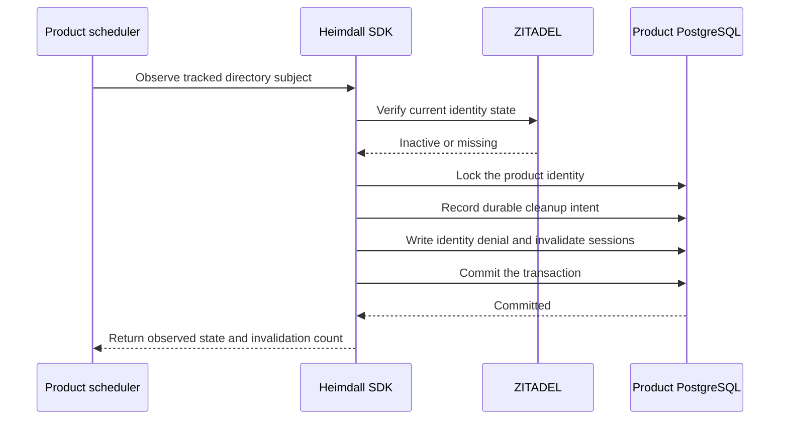
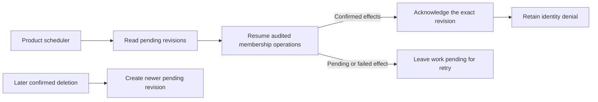

The TypeScript PostgreSQL entry point exposes `createDirectoryDeactivation`. The Go PostgreSQL package exposes `NewDirectoryDeactivation`. The product scheduler calls the observer with a previously tracked issuer and subject under its trusted directory configuration. Each call reads current state through the [[phase-6-scim-reader|directory reader]].

Install directory migrations `0001.sql` and `0002.sql` in order using the product's deployment migration tooling. The directory schema is installed independently of the runtime audit protocol. Grant the worker role schema and sequence usage and select, insert and update access to the deactivation table, alongside the runtime permissions for identity denial and session invalidation. The normal authorization runtime does not require access to the directory table. [Directory schema SQL](https://github.com/techsavvyash/heimdall/tree/feat/docs-website/contracts/persistence/directory)

When upgrading an existing directory worker, stop its observation loop before installing `0002.sql` and restart it with the revision-aware SDK. Existing intents receive a pending revision during migration.

One transaction persists the deactivation intent, denies the identity and invalidates its sessions. It uses the same identity lock as the session store. Product and environment scopes are independent. A retry can confirm local denial again without duplicating the intent. An existing intent cannot be rebound to another organization. Deleted status dominates inactive status on retry. An active or initial state leaves an existing denial in place.

The disposable PostgreSQL regression invokes both public SDK adapters under the restricted runtime role. It verifies that an injected session-deletion failure rolls back both the intent and the deny, and that a successful retry, an initial state, a mismatched organization and an unrelated environment preserve their expected boundaries. Reproduce with `tests/integration/postgres-records.py`.

## Recovering pending cleanup

The product scheduler can scan pending deactivations through TypeScript `createDirectoryCleanup` or Go `NewDirectoryCleanup`. These APIs bind the worker to a product, environment, issuer and organization. The first page starts at the oldest pending revision. A page returns up to 100 items, each with a subject, revision, reason and observation timestamp. Use the last revision to continue the current scan and restart from the beginning on the next run. Concurrent transactions can commit out of allocation order, so a page cursor is unsuitable as a persistent ingestion checkpoint.

The scan does not claim work. Concurrent callers can see the same revision and must use the same idempotency keys for downstream operations. After those operations are confirmed, call `complete` in TypeScript or `Complete` in Go. Retrying the same acknowledgement succeeds. A later deletion supersedes an inactive revision, so a stale acknowledgement cannot close the new work. Acknowledgement leaves the identity denial in place.

PostgreSQL run `heimdall-records-a015b93916eb4f339d8bb6e1a6e78e7b` passed the directory tests for pending scans, cursor advancement, organization isolation, repeated acknowledgement and stale-revision refusal in both languages. Automated membership cleanup, ingestion checkpoint advancement, activation after cleanup, lifecycle audit export and the measured end-to-end worker latency remain part of Phase 6.
