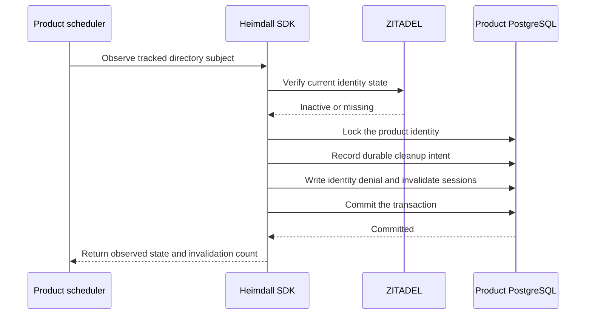
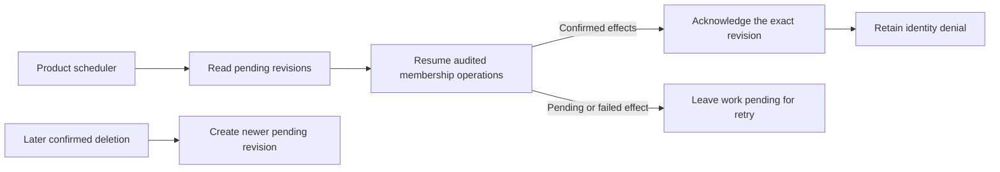
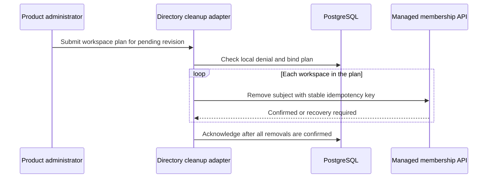
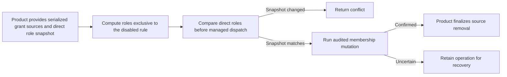
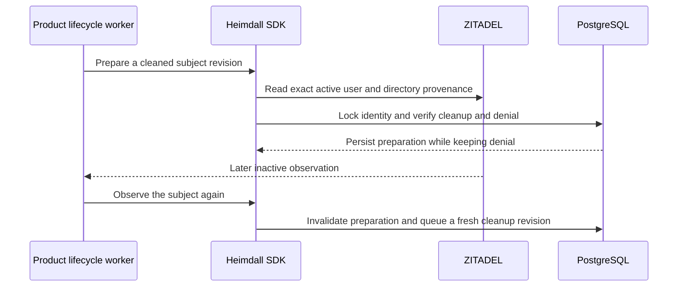
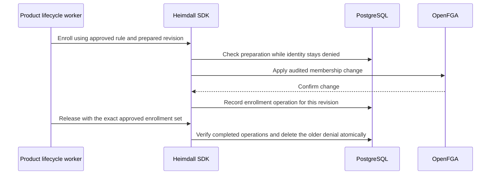
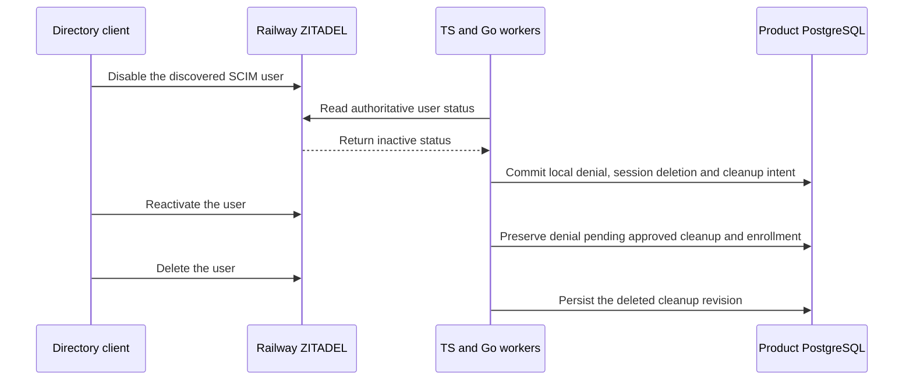
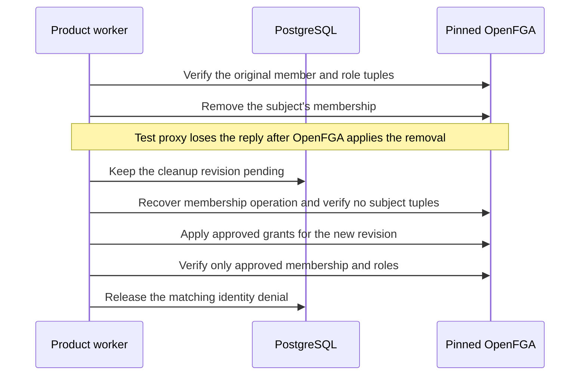
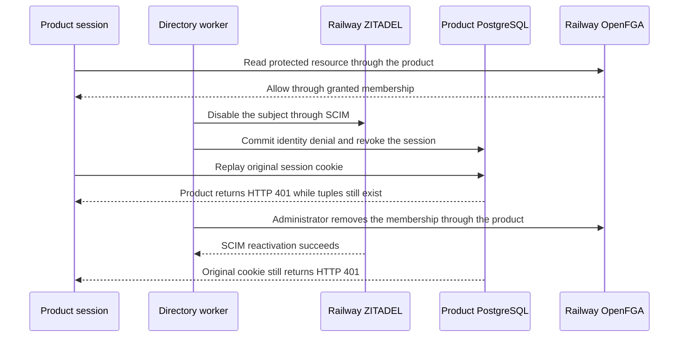

The TypeScript PostgreSQL entry point exposes `createDirectoryDeactivation`. The Go PostgreSQL package exposes `NewDirectoryDeactivation`. The product scheduler calls the observer with a previously tracked issuer and subject under its trusted directory configuration. Each call reads current state through the [[phase-6-scim-reader|directory reader]].

Install directory migrations `0001.sql` through `0003.sql` in order using the product's deployment migration tooling. The directory schema is installed independently of the runtime audit protocol. Grant the worker role schema and sequence usage and select, insert and update access to the deactivation table, alongside the runtime permissions for identity denial and session invalidation. The normal authorization runtime does not require access to the directory table. [Directory schema SQL](https://github.com/techsavvyash/heimdall/tree/feat/docs-website/contracts/persistence/directory)

When upgrading an existing directory worker, stop its observation loop before installing `0002.sql` and restart it with the revision-aware SDK. Existing intents receive a pending revision during migration.

One transaction persists the deactivation intent, denies the identity and invalidates its sessions. It uses the same identity lock as the session store. Product and environment scopes are independent. A retry can confirm local denial again without duplicating the intent. An existing intent cannot be rebound to another organization. Deleted status dominates inactive status on retry. An active or initial state leaves an existing denial in place.

The disposable PostgreSQL regression invokes both public SDK adapters under the restricted runtime role. It verifies that an injected session-deletion failure rolls back both the intent and the deny, and that a successful retry, an initial state, a mismatched organization and an unrelated environment preserve their expected boundaries. Reproduce with `tests/integration/postgres-records.py`.

## Recovering pending cleanup

The product scheduler can scan pending deactivations through TypeScript `createDirectoryCleanup` or Go `NewDirectoryCleanup`. These APIs bind the worker to a product, environment, issuer and organization. The first page starts at the oldest pending revision. A page returns up to 100 items, each with a subject, revision, reason and observation timestamp. Use the last revision to continue the current scan and restart from the beginning on the next run. Concurrent transactions can commit out of allocation order, so a page cursor is unsuitable as a persistent ingestion checkpoint.

The scan does not claim work. Concurrent callers can see the same revision and must use the same idempotency keys for downstream operations. After those operations are confirmed, call `complete` in TypeScript or `Complete` in Go. Retrying the same acknowledgement succeeds. A later deletion supersedes an inactive revision, so a stale acknowledgement cannot close the new work. Acknowledgement leaves the identity denial in place.

PostgreSQL run `heimdall-records-a015b93916eb4f339d8bb6e1a6e78e7b` passed the directory tests for pending scans, cursor advancement, organization isolation, repeated acknowledgement and stale-revision refusal in both languages.

## Managed membership removal

The TypeScript `reconcile` and Go `Reconcile` methods take the pending subject and revision, a workspace list selected by the product, and an authorized administrator principal from that product runtime. Supply only workspaces where the product policy requires complete removal of the subject. The first call checks for durable identity denial and binds the sorted workspace plan and initiating principal to the revision. Calls with a different plan or principal fail with a conflict. Each workspace removal uses the existing audited, idempotent membership path. Ownership transfer remains a separate authorized operation.

If OpenFGA may have applied a removal and the response is lost, the SDK returns the pending membership operation and leaves directory cleanup pending. Resolve it using the existing recovery procedure and retry the same plan. Once every removal is confirmed, the SDK acknowledges the directory revision. A replay after acknowledgement returns success for the same plan.

PostgreSQL run `heimdall-records-5f9ccfdd51d04f9a847405c0fe28446f` exercised both public SDKs with a fault-injected OpenFGA fixture. The tests covered denial required before removal, a lost response after apply, a conflicting plan, retry of the original operation, recovery and final acknowledgement.

This path covers administrator-driven whole-membership removal. Unattended scheduling authority, reactivation, lifecycle audit export and measured end-to-end worker latency remain part of Phase 6.

## Selective rule revocation

TypeScript exposes `revokeDirectoryGrant`, and Go exposes `Memberships.RevokeDirectoryGrant`. Supply the disabled rule, the subject's current direct roles, and the product's grant sources for that subject and workspace. Include independent membership sources even when they grant zero roles. The SDK removes roles exclusive to the disabled rule and preserves shared roles, independent membership, and current roles outside that rule. It never reintroduces a role from historical source data. An owner needs the separate ownership workflow.

The product serializes edits to grant provenance for the subject and workspace until the result is confirmed. Preserve the input snapshot and idempotency key across retries. The SDK checks the current direct role snapshot before dispatch and uses the managed workspace revision to serialize supported writes. A new operation based on a stale role snapshot returns a conflict. The product finalizes its source change after confirmation. The helper accepts product-owned provenance and does not automatically build a full grant-source ledger from legacy membership writes.

The shared TypeScript and Go fixtures cover overlapping rules, independent sources, ownership and missing provenance. PostgreSQL run `heimdall-records-dd5b1989d3644be3a43b27184c4a8eb2` exercises stale-snapshot rejection, removal of a directory-only role while retaining an independently sourced membership, and idempotent replay.

## Preparing reactivation

Install directory migration `0006.sql` before upgrading the worker. The PostgreSQL SDK entry points `createDirectoryReactivation` and `NewDirectoryReactivation` prepare an exact cleanup revision after reading an active user with directory provenance. Preparation requires completed cleanup and an inactive denial older than the provider read. A deleted identity cannot be prepared. Repeating preparation returns the same record.

Preparation keeps the identity denied and leaves sessions and roles untouched. A subsequent inactive or deleted directory observation invalidates the preparation and opens a fresh cleanup revision. A newer local denial also prevents reuse of the prepared record.

PostgreSQL run `heimdall-records-4db02028f58f40a092bb543575667a09` exercised both SDKs. The tests covered pending cleanup rejection, preparation replay, retained denial, invalidation by a new deactivation, and rejection of a deleted identity.

## Applying approved grants and releasing the denial

Install directory migration `0007.sql` and give the trusted lifecycle worker delete permission on the identity-denial table. The product supplies its current approved rules, calls the audited enrollment API with the preparation's reactivation revision, and then calls `createDirectoryReactivationRelease` in TypeScript or `NewDirectoryReactivationRelease` in Go. The product must complete cleanup of stale directory grants before preparation and keep approvals stable while applying the plan. Rule identifiers must identify the approved rule version.

Enrollment for a prepared revision uses new operation keys, including when a rule was used previously. Release rechecks active status and directory provenance with ZITADEL. The transaction compares the approved workspace and rule pairs to the exact enrollment set for that revision, verifies the completed managed operations, and removes only the inactive denial that predates preparation. A replay leaves a later denial intact. Sessions revoked during deactivation remain revoked.

PostgreSQL run `heimdall-records-e4b609d8190e4fe2b1357746524a362a` exercised revision-bound enrollment, refusal before confirmation and with an incomplete approval set, retained denial until release, release replay, and rejection after a newer local denial in both SDKs.

## Live SCIM worker verification

Railway ZITADEL run `888542c3-5aa5-4807-9f3f-9a8c84d708f3` used the organization-scoped SCIM credentials and disposable PostgreSQL run `heimdall-records-8fe4a3ef49bd429fb6e90e88e4d9b841`. Both SDKs discovered the active subject through SCIM and re-read authoritative status before applying each lifecycle change. After a live SCIM disable, each worker persisted the identity denial, deleted its product-scoped synthetic session row, and queued an inactive cleanup revision. The other environment’s row survived. The disable request and both worker checks completed within 60 seconds. A later reactivation read preserved the pending cleanup and denial. Deletion superseded the pending reason with a deleted revision.

Set `HEIMDALL_PROBE_SCIM_WORKER=true` and supply the protected verification credentials when running `tests/integration/postgres-records.py`. The worker probe verifies durable session-row deletion and the identity gate. Live browser session issuance, permission enforcement, and managed cleanup against live OpenFGA remain separate acceptance checks.

## Managed cleanup against pinned OpenFGA

PostgreSQL run `heimdall-records-3286711d52a14756909a25b35eca7796` ran both SDK administration suites against the pinned OpenFGA 1.22.0 image with separate stores. The suites checked the subject’s direct tuples using higher-consistency reads before deactivation cleanup, after uncertain-write recovery, and after revision-bound re-enrollment. The initial membership and role existed, cleanup removed every direct tuple for that subject in the workspace, and only the approved roles and membership returned. The SDK also required confirmed enrollment before releasing the local denial.

Reproduce with `HEIMDALL_PROBE_PINNED_ADMIN=1` and `tests/integration/postgres-records.py`. This test uses synthetic provider status and loss of the OpenFGA write response. The live SCIM verification above separately exercises the provider status and durable deny transaction. A single live run connecting browser login, SCIM mutation and OpenFGA enforcement remains open.

## Live SCIM disable with product browser sessions

PostgreSQL run `heimdall-records-8372d6b9ed3345a0ada97ce07f19887a` connected the local Ledger and Support reference applications to Railway ZITADEL and OpenFGA. It created the recipient through SCIM and used the ZITADEL Login API to complete the applications' authorization-code callbacks. Both applications issued real cookies backed by PostgreSQL. The recipient read the protected resource after an authorized membership grant.

The disable-to-denial check took 1,360 ms for Ledger and 2,904 ms for Support, including the SCIM call and test worker startup. Each worker removed one real session row. The probe checked that both direct tuples still existed at the first denial and that the product's managed removal subsequently cleared them.

Run `tests/integration/postgres-records.py` with `HEIMDALL_PROBE_REFERENCE_PRODUCTS=1` and `HEIMDALL_PROBE_SCIM_BROWSER=1` plus the protected verification credentials. The probe drives HTTP cookies and callbacks programmatically. This run uses the managed membership endpoint for removal. The preceding pinned OpenFGA test covers cleanup revision acknowledgement and approved re-enrollment. A live run applying those worker operations together and qualifying a new session after approved re-enrollment remains pending.
