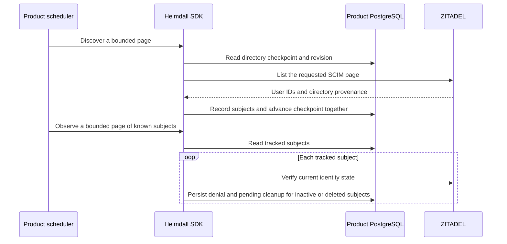

The TypeScript PostgreSQL entry point exposes `createDirectoryPolling`. The Go PostgreSQL package exposes `NewDirectoryPolling`. The product schedules discovery and known-subject observations explicitly for each configured directory. Install directory migration `0004.sql` after the first three migrations. The worker needs select and insert access to the subject registry and select, insert and update access to the polling table.

`discover` and `Discover` store subject IDs with provisioning-domain evidence and advance the page offset in one transaction. The revision prevents two concurrent workers from advancing the same checkpoint. Discovery restarts at the beginning after reaching the end. The provider's offset listing can skip or repeat subjects during concurrent directory changes, so the scheduler repeats complete scans. A missing list entry never deactivates a user.

`observeKnown` and `ObserveKnown` read tracked identities individually, including those absent from the current list. The scheduler can continue a pass with the returned subject cursor and restart from the beginning for the next pass. If a read or write fails, the page returns an error and a retry can repeat its completed observations safely. The subject registry records who to check. Active users still require explicit enrollment rules before any grant is made.

PostgreSQL run `heimdall-records-7c01cae43d3a48fe9166ac4b790ee32b` exercised restart from a saved offset, an upstream page failure followed by a retry, scan wraparound, deduplication and discovery followed by durable deactivation in both SDKs. End-to-end scheduler latency, enrollment, reactivation, grant provenance and SIEM remain part of Phase 6.
