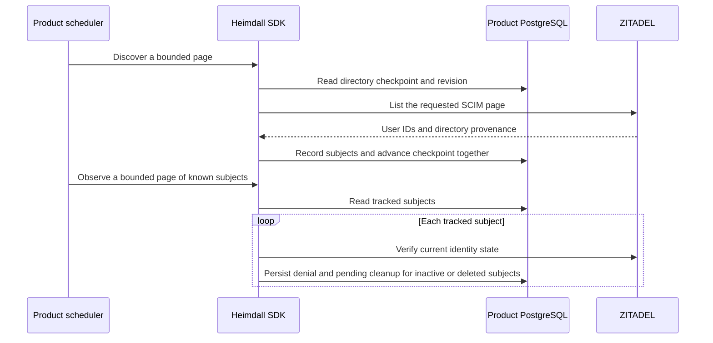
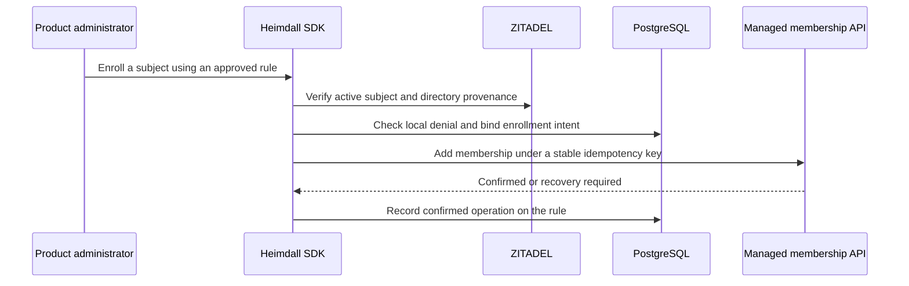

The TypeScript PostgreSQL entry point exposes `createDirectoryPolling`. The Go PostgreSQL package exposes `NewDirectoryPolling`. The product schedules discovery and known-subject observations explicitly for each configured directory. Install directory migration `0004.sql` after the first three migrations. The worker needs select and insert access to the subject registry and select, insert and update access to the polling table.

`discover` and `Discover` store subject IDs with provisioning-domain evidence and advance the page offset in one transaction. The revision prevents two concurrent workers from advancing the same checkpoint. Discovery restarts at the beginning after reaching the end. The provider's offset listing can skip or repeat subjects during concurrent directory changes, so the scheduler repeats complete scans. A missing list entry never deactivates a user.

`observeKnown` and `ObserveKnown` read tracked identities individually, including those absent from the current list. The scheduler can continue a pass with the returned subject cursor and restart from the beginning for the next pass. If a read or write fails, the page returns an error and a retry can repeat its completed observations safely. The subject registry records who to check. Active users still require explicit enrollment rules before any grant is made.

PostgreSQL run `heimdall-records-7c01cae43d3a48fe9166ac4b790ee32b` exercised restart from a saved offset, an upstream page failure followed by a retry, scan wraparound, deduplication and discovery followed by durable deactivation in both SDKs. End-to-end scheduler latency, enrollment, reactivation, grant provenance and SIEM remain part of Phase 6.

## Explicit enrollment

The TypeScript PostgreSQL adapter exposes `createDirectoryEnrollment`, and Go exposes `NewDirectoryEnrollment`. Install directory migration `0005.sql` and grant the enrollment worker select, insert and update access to the enrollment table. The product supplies a previously approved rule ID, workspace and roles and an authorized administrator from the product runtime.

The adapter checks the exact active user and provisioning-domain external ID. The product stores the enrollment policy and determines when to call the adapter. A local identity denial blocks a new enrollment attempt. The audited managed add operation checks administrator delegation and rejects the owner role. A second rule cannot claim an existing membership. Retrying the same plan uses the original operation and records its ID after confirmation.

For an existing member, supply `expectedDirectRoles` in TypeScript or a non-nil `ExpectedDirectRoles` slice in Go. The SDK binds the supplied snapshot to the rule's enrollment intent and uses the managed membership path to add the rule's roles while preserving the current direct roles. A stale snapshot conflicts before dispatch. The enrollment record preserves the roles contributed by the rule separately from the direct role snapshot. Products serialize provenance changes and keep independent grants in their own source records.

A recorded rule identifies what the enrollment operation contributed at the time. Later membership changes can alter the user's current roles. See [[phase-6-scim-deactivation]] for selective revocation. Reactivation and unattended scheduling remain Phase 6 work.

PostgreSQL run `heimdall-records-b131c24daa464b13914279eaa4c9177b` exercised both public SDKs. The integration tests confirmed enrollment, checked the stored operation ID, retried the same request and rejected a changed role plan or an attempt by another rule to adopt the membership.

PostgreSQL run `heimdall-records-55c7f432d717454d8f0d3661e7e6bcff` exercised the existing-member path. The second rule added an approver role alongside the existing viewer role. Both SDKs rejected a stale snapshot, replayed the enrollment, and preserved the shared viewer role when the first rule was revoked.
