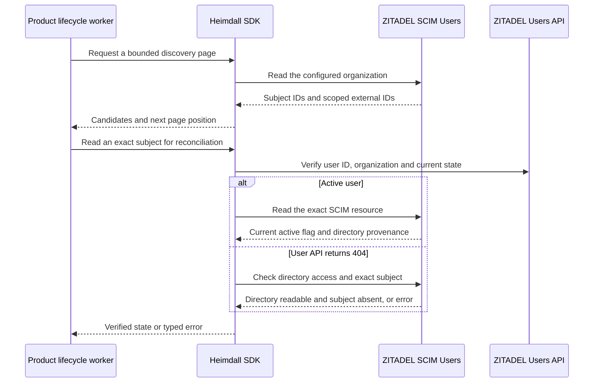

The TypeScript provisioning entry point exposes `createDirectoryReader`. The Go provisioning package exposes `NewDirectoryReader`. Each reader is bound to a server-configured ZITADEL issuer, organization and read credential with the directory's provisioning-domain metadata. The credential used in the reference probe is separate from the SCIM write credential. See [[phase-2-scim-credentials]].

Discovery pages use the provider's offset pagination. The scan can miss or repeat a subject when the directory changes between pages. Use repeated bounded scans for new-user discovery, deduplicate by issuer and subject, and re-read known identities independently for deactivation and deletion. Page membership and external IDs are discovery inputs. Enrollment requires an exact current read, directory provenance and an explicit product rule. Persist the identity under issuer and subject.

The exact read verifies the organization and human user type. For active users, it also checks the exact SCIM resource and its active flag. An active result without a directory external ID has no enrollment provenance. For a user API 404, the reader requires successful directory access and an exact SCIM 404 before returning `missing`. Use that state for a previously tracked identity whose organization is already established. Disagreeing APIs and unexpected responses return a typed failure.

## Verification

Shared fixture `directory-reader-v1.json` runs in both SDKs. It covers active users with and without provenance, inactive and locked users, initial state, unknown states, mismatched organization and subject, ambiguous 404s, and disagreement between SCIM and user API state.

Railway verification run `e2460d59-d43d-4739-ae02-dcc9c465bbc9` exercised both SDKs against ZITADEL with a read-only organization viewer. Both read the active user and its scoped external ID, then observed the SCIM deactivation and the later deletion. The run also verified a nonempty discovery page and the empty page after deletion. It removed the disposable organizations. Reproduce with `HEIMDALL_PROBE_SCIM_SDK=true` in the protected SCIM probe environment described in [[phase-2-scim]].

This checkpoint covers provider reads. Durable ingestion, local session denial, role reconciliation and end-to-end deactivation latency remain Phase 6 acceptance work.
