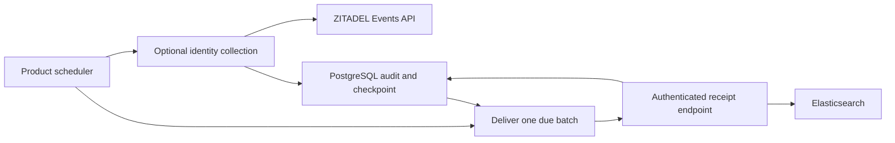

Schedule `pnpm --filter @heimdall/ledger audit:run` for Ledger or `support audit-job` for Support. Each invocation has a 45-second deadline and delivers at most 20 due events. Run one invocation at a time per destination. Schedule the next run after a failure and use the SDK's persisted retry times. The HTTP process operates independently.

Supply `HEIMDALL_CONFIG` and the job's `DATABASE_URL`. Configure the recipient with `HEIMDALL_AUDIT_ENDPOINT`, `HEIMDALL_AUDIT_TOKEN` and `HEIMDALL_AUDIT_SINK`, which defaults to `siem`. The reference HTTP processes write their audit events to that sink when `HEIMDALL_REFERENCE_SIEM=1`. Set `HEIMDALL_AUDIT_TENANT` for a tenant-specific destination and assign the same tenant in the receipt handler. Keep product-wide authentication events in a product-wide destination with operator-only access. The loopback transport setting is for local verification.

To collect ZITADEL events in the same invocation, provide a tenant, `HEIMDALL_IDENTITY_READER_TOKEN`, and `HEIMDALL_IDENTITY_MAPPING`. The mapping is trusted deployment configuration containing `organizationId`, a decimal-string `startMicros`, an array of exact `aggregates` with `type` and `id`, and the verified `coverage` policy. The job derives the time bounds at invocation. Configure the source, permissions, checkpoint migrations, clock and transaction bounds as described in [[phase-6-audit-delivery]]. A collection failure still allows delivery of earlier durable events and reports a failed invocation for monitoring. Each mapped tenant has its own checkpoint.

The job prints counts and backlog metrics. Monitor failures, due and quarantined counts, oldest pending age and database capacity. Capacity is database-wide and belongs in operator monitoring. Use the SDK's tenant-bound requeue operation with the current attempt count after investigating and fixing a quarantined event. Keep Elasticsearch indexes and receiver credentials bound to the configured destinations.

## Export SSO policy publications

The HTTP process writes the product's publication row. The tenant audit job reads that row using the product database connection, stages the retained event using its stable ID, and marks the product row exported. Then it delivers the retained event and records the receiver's acknowledgement. The product row's exported flag means the retained event is available for delivery. The SDK delivery row records the receipt.

For this path, give the tenant job access to its product database through `LEDGER_DATABASE_URL` or `SUPPORT_DATABASE_URL`. Supply `HEIMDALL_PROVIDER_SETTINGS` to enable staging, together with `HEIMDALL_AUDIT_TENANT` and the `siem` destination. Keep the staging setting active until pending publications have drained, including after disabling the settings routes on the HTTP process. The job uses neither the provider settings token nor the federation credential.

Use a distinct job login for `DATABASE_URL`. It needs retained audit writer access for staging and update access to the delivery state, attempt count, next attempt and delivered timestamp for claiming and acknowledging batches. The Railway verification grants in `deploy/verification/policy-audit-job-grants.sql` inherit the product's verification runtime role and add only those delivery-column updates. The HTTP login keeps its existing privileges. The grant file takes the existing verification role as `runtime_role` and the new scheduled job role as `audit_role`. Keep the receipt endpoint, token and index tied to the job's product, environment and tenant.

## Verification

- Run `cae27495-ed0e-4264-99fa-fd29ba94379b` invoked the product commands in separate processes to deliver 91 Ledger and 93 Support events. The probe matched all indexed IDs to acknowledged PostgreSQL rows and traced the owner and recipient workflows.
- Run `aee816fa-f87a-4188-abb0-a0709735810c` verified the commands' tenant-scoped collection path against Railway ZITADEL and Elasticsearch. After a live reactivation, each command advanced its earlier durable checkpoint and delivered the new event to its mapped destination. Each index held the deactivation and reactivation records.

Both runs used disposable local PostgreSQL and Elasticsearch. Reproduce using the live SIEM settings in [[phase-6-audit-delivery]], with `HEIMDALL_PROBE_PRODUCT_SIEM=1` for the product workflow or `HEIMDALL_TEST_SCHEDULED_IDENTITY=1` for the scheduled collection workflow.

### Live publication and receipt

Run `19dccb55-0b62-40ed-a2ce-3274e0bb540e` exercised Ledger deployment `bec587ec-1f6e-493b-9189-f236e0e54e75` and Support deployment `753d553f-47e0-4b90-9d73-1fa38e84a4c3` at source commit `4ebbf3e`. Both products completed browser tenant switching and confirmed and replayed strict-workspace directory cleanup. The deployed settings routes then activated Ledger Acme SAML and Support Globex OIDC. The probe matched each HTTP activation event ID to its original product outbox row, retained delivery acknowledgement and one Elasticsearch 8.19.0 document with the expected policy versions and tenant. Both receipt handlers rejected a batch with the other tenant.

The audit job commands ran as separate processes from the verifier. They connected to Railway PostgreSQL 17.11 through an SSH tunnel with dedicated audit credentials and used disposable loopback receipt endpoints and indexes. Railway supplied ZITADEL and its login service at 4.19.4, OpenFGA at 1.22.0 and the Keycloak 26.8.2 test directory. The observed Railway image digests matched `deploy/verification/versions.json`.

| Product and tenant | Publication event |
| --- | --- |
| Ledger Acme | `b6385423-f8cb-4256-be66-496d3731a449` |
| Support Globex | `e4c6ab39faaa0d17b588f057df851266` |

The first run proved that the verification HTTP roles could stage events but could not claim delivery attempts. The passing run used the separate job roles above. Between runs, the verification database filled its 10,000 retained metadata slots and returned `audit_unavailable` on protected requests. The verification operator raised the retained metadata quota to 20,000 slots under the existing retention lock, preserving existing rows and mandatory audit admission.

Reproduce by building the TypeScript SDK and the Support binary and running `tests/integration/federation-switch.mjs` with `HEIMDALL_PROBE_PROVIDER_SETTINGS=1`, `HEIMDALL_PROBE_POLICY_PUBLICATION_SIEM=1` and `HEIMDALL_PROBE_STRICT_DIRECTORY_CLEANUP=1`. Supply the usual protected Railway fixture settings, `HEIMDALL_REFERENCE_SUPPORT_BINARY`, the disposable Elasticsearch credentials, the PostgreSQL tunnel port in `HEIMDALL_REFERENCE_POSTGRES_TUNNEL_PORT` and the two job DSNs in `HEIMDALL_REFERENCE_LEDGER_AUDIT_DATABASE` and `HEIMDALL_REFERENCE_SUPPORT_AUDIT_DATABASE`. For fixture SQL through the same tunnel, supply a separate operator DSN in `HEIMDALL_REFERENCE_SQL_DATABASE_URL`. The sanitized run is in `tests/integration/evidence/policy-publication-siem-2026-11-14.json`.
