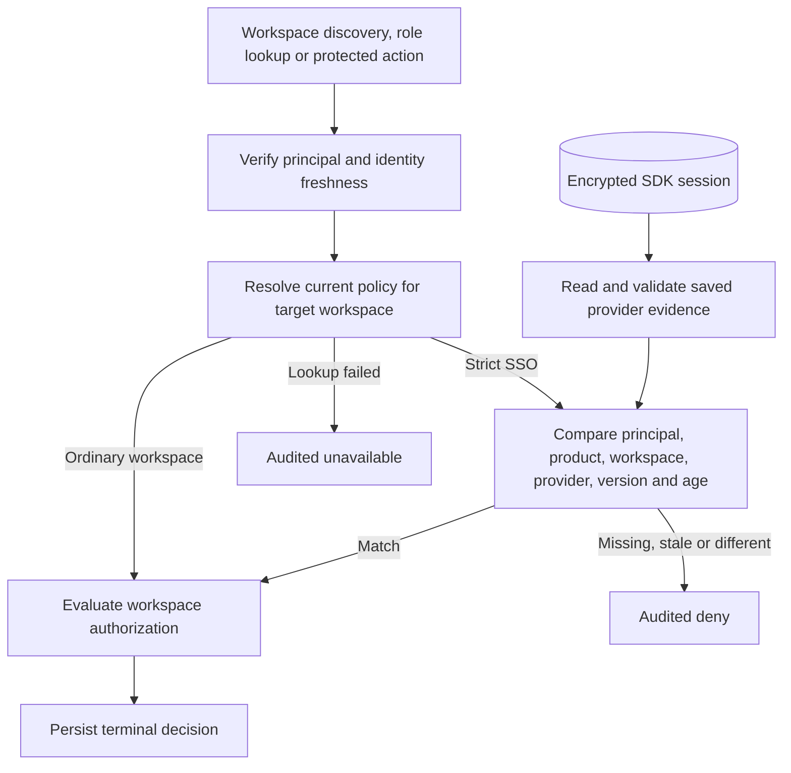

TypeScript and Go accept a server-side tenant SSO policy resolver on the runtime. A configured resolver returns the current organization, provider, protocol, policy version and maximum authentication age for a strict workspace. A null policy means ordinary product authentication is sufficient to proceed to the workspace authorization checks. Policy lookup errors stop the decision.

Evidence is attached to the session principal after the session store accepts the authenticated revision. A bearer principal has no stored provider evidence. The strict policy is evaluated per workspace decision. Changing the provider, protocol or policy version takes effect on the next decision. Earlier authorized work can finish under the release contract.

The reference harness seeds a member and owner for both Acme and Globex, verifies the Globex membership directly in OpenFGA, then marks Globex strict. It expects the ordinary session to discover only Acme, resolve no Globex roles and receive HTTP 403 on the Globex resource. SDK tests also exercise a matching saved SAML record, an OIDC workspace mismatch and policy rotation. These tests supply trusted saved evidence directly. Provider login and evidence issuance, atomic account switching, provider configuration, SCIM reconciliation and SIEM remain Phase 6 work.
