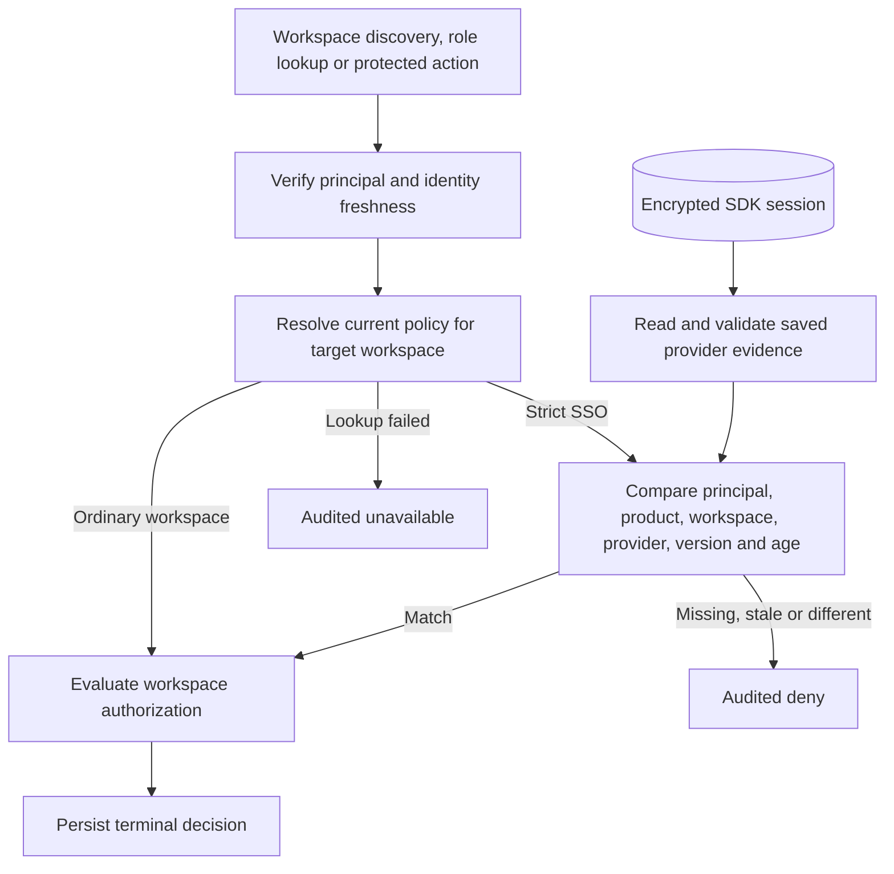
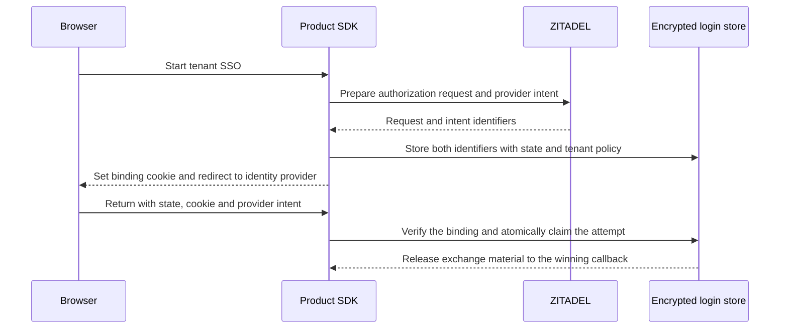
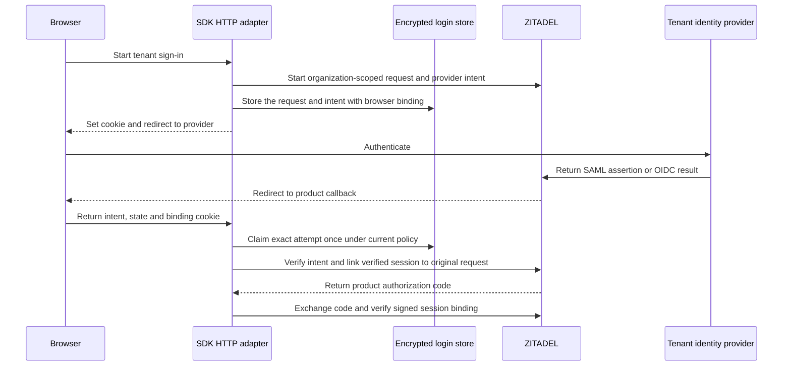
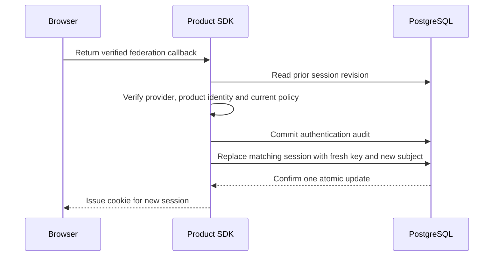

TypeScript and Go accept a server-side tenant SSO policy resolver on the runtime. A configured resolver returns the current organization, provider, protocol, policy version and maximum authentication age for a strict workspace. A null policy means ordinary product authentication is sufficient to proceed to the workspace authorization checks. Policy lookup errors stop the decision.

Evidence is attached to the session principal after the session store accepts the authenticated revision. A bearer principal has no stored provider evidence. The strict policy is evaluated per workspace decision. Changing the provider, protocol or policy version takes effect on the next decision. Earlier authorized work can finish under the release contract.

The reference harness seeds a member and owner for both Acme and Globex, verifies the Globex membership directly in OpenFGA, then marks Globex strict. It expects the ordinary session to discover only Acme, resolve no Globex roles and receive HTTP 403 on the Globex resource. SDK tests also exercise a matching saved SAML record, an OIDC workspace mismatch and policy rotation. These tests supply trusted saved evidence directly. Provider login and evidence issuance, atomic account switching, provider configuration, SCIM reconciliation and SIEM remain Phase 6 work.

## Verification

Source commit `40fb81aa7c228af1fe79d7a1dcc5b958e012a35c` passed the full workspace gate with 1,774 Vitest tests, Go race tests, package checks and 244 Mermaid diagrams checked in both Markdown and generated HTML. GitHub Actions runs `43504729790` and `43504720427` passed. Chromium rendered this page's flowchart from Railway docs deployment `74e31f9a-79e3-4ada-843d-b45ab7748e30`.

The pinned-service reference run `1c53781a-a8fd-490c-88ae-d91795e3956e` tested both deployed products. The ordinary browser session retained Acme access. Globex remained absent from discovery, returned an empty role list and returned 403 for its resource. PostgreSQL readback matched each authorization request to its terminal decision and confirmed a durable Globex deny for each of the three checks.

| Reference product | Railway deployment | Matched authorization decisions |
| --- | --- | --- |
| Ledger TypeScript | `a4879acf-07a8-4dc4-8b1b-b0b9b948b6e4` | 45 |
| Support Go | `79b658cf-6dca-42cf-ad99-1b5829724259` | 44 |

The local PostgreSQL run `heimdall-records-748e9f26d16941a39609eb5a41d74e80` also passed the reference and storage suites. An earlier local run stopped in discovery repair after the strict SSO assertions. The full retry passed, including both products' discovery repair checks.

## Signed product token binding

Both SDKs can scope an OIDC authorization request to the trusted target organization and require the signed product ID token to match a verified federation session. The verifier checks the issuer, audience, nonce, upstream-linked ZITADEL subject, session ID and authentication time. A provider session's verified timestamp is rounded down to seconds for comparison with the signed claim. Normal product login continues through the existing exchange path.

The live federation probe created fresh codes for each SDK and assertion against Railway ZITADEL and the Keycloak fixture. Each language accepted the matching SAML and OIDC session and rejected a code checked against a different session ID. Shared exchange fixtures additionally reject a missing or incorrect authentication time and a different subject.

| Upstream protocol | Live run |
| --- | --- |
| OIDC | `128e9606-2a24-46ba-a807-60341791fac6` |
| SAML | `2d2291e5-71e5-4436-994a-4963842d9ceb` |

Run the federation probe with `HEIMDALL_PROBE_SDK_FEDERATION=1` and the protected verification configuration described in [[phase-2-browser-federation]]. The probe supplies provider provenance directly to the internal exchange. Binding a product browser transaction to the exact provider intent and issuing an encrypted, identity-bound session are still required.

## Browser transaction storage

The SDK login store can now persist the exact ZITADEL provider intent and downstream authorization request in the same encrypted record as browser state, nonce, PKCE material and the workspace policy. The provider IDs are captured by the server before the browser is redirected. The callback must present the original state, browser cookie and intent ID, and the current tenant policy must still match. The SDK releases the saved authorization request ID and exchange material only after the single-use claim succeeds.

The shared tests exercise the store boundary with disposable PostgreSQL. Wrong intent, rotated policy and ordinary callbacks are rejected before claim. One of eight parallel claims gets the exchange material. A lost response after a committed claim yields an uncertain outcome and a replay cannot recover the exchange material. The HTTP adapter and provider calls shown in the diagram are the integration path for this storage change.

Storage commit `247965c` passed the workspace checks and the pinned PostgreSQL regression run `heimdall-records-d9ae3b53311b49be8b4ec3890f929263`. Both SDKs passed the browser transaction tests against a disposable database on Railway PostgreSQL, `heimdall_intent_c5c7b091888a`, which was removed after the run. The remote Vitest invocation used a 30-second suite timeout after the default five-second test timeout elapsed over SSH. Each SDK operation kept its existing deadline.

## SDK federation HTTP flow

Both SDKs now run the internal HTTP federation flow from the provider redirect through verification of the product ID token. Each SDK starts a ZITADEL authorization request with the target organization, captures the exact provider intent, and issues a browser-binding cookie. After claiming that transaction, the SDK verifies the linked provider account, checks the ZITADEL session's organization and authentication factor, completes the original product authorization request, and exchanges the code using the saved nonce and PKCE verifier.

Railway runs `2caed4cb-31c2-4dac-8f5d-77c7c298ac39` for SAML and `7c4e7781-8efe-49a7-95b7-d3cc402e5fff` for OIDC passed in both SDKs. The probe drove the upstream fixture forms over HTTP and exercised the real SDK redirect and callback handlers against ZITADEL. Both handlers rejected missing cookies, wrong intents, changed policy and replay. The first OIDC trial exposed HTTP 201 on ZITADEL session creation. Both SDKs now accept that success status.

These runs verify the internal HTTP adapters through verified evidence. Public session entry points, atomic local account switching and session issuance remain part of Phase 6.

## Browser session issuance and replacement

Product code calls `sessions.startFederation(request, workspaceId)` in TypeScript or `sessions.StartFederation(w, r, workspaceID)` in Go. The product supplies its existing tenant policy resolver and a server-only ZITADEL federation credential. The same registered callback handles ordinary and enterprise login. On federation completion, the SDK verifies current identity status, commits the authentication audit event, rechecks the tenant policy and saves the verified evidence with the encrypted session. Discovery and role enforcement continue through the existing tenant gates.

The PostgreSQL adapter can replace an existing session by rotating its opaque key, identity binding and encrypted record in one guarded update. The encrypted login attempt binds the previous session key. The callback reads its current revision before the network exchange and conditions the update on that revision, so concurrent activity or logout can require a fresh attempt. Custom session storage supports an initial federation session. Existing-session replacement requires the PostgreSQL adapter's atomic operation.

Live SAML and OIDC session issuance runs used Railway ZITADEL and an encrypted custom store, then authenticated the issued cookie and checked the saved evidence in both languages. SAML run `aa588074-3847-4b65-9631-b7ed9df2eb73` and OIDC run `ebd5ddd5-671e-4840-8c08-5befbf147ea3` passed. The PostgreSQL replacement tests exercise concurrent candidates, a stale revision, a denied target identity and use of the previous key after replacement. A two-directory switch through deployed public SDK routes, including membership and cursor checks, remains a Phase 6 acceptance run.

Both languages passed the prior-session binding and atomic replacement tests against the disposable Railway PostgreSQL database `heimdall_switch_1c33e8f4d2c1`. The Go test now pairs each concurrent result with its requested key. The first Railway run had assumed channel receive order matched launch order. The rerun verified that the winner alone left a record and removed the test database.
