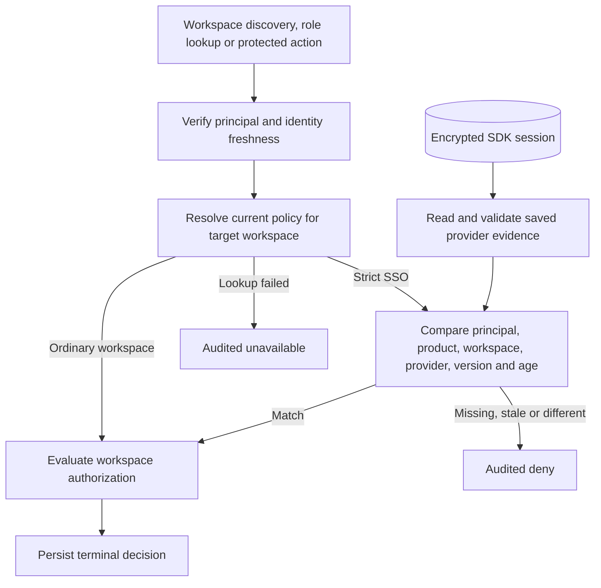

TypeScript and Go accept a server-side tenant SSO policy resolver on the runtime. A configured resolver returns the current organization, provider, protocol, policy version and maximum authentication age for a strict workspace. A null policy means ordinary product authentication is sufficient to proceed to the workspace authorization checks. Policy lookup errors stop the decision.

Evidence is attached to the session principal after the session store accepts the authenticated revision. A bearer principal has no stored provider evidence. The strict policy is evaluated per workspace decision. Changing the provider, protocol or policy version takes effect on the next decision. Earlier authorized work can finish under the release contract.

The reference harness seeds a member and owner for both Acme and Globex, verifies the Globex membership directly in OpenFGA, then marks Globex strict. It expects the ordinary session to discover only Acme, resolve no Globex roles and receive HTTP 403 on the Globex resource. SDK tests also exercise a matching saved SAML record, an OIDC workspace mismatch and policy rotation. These tests supply trusted saved evidence directly. Provider login and evidence issuance, atomic account switching, provider configuration, SCIM reconciliation and SIEM remain Phase 6 work.

## Verification

Source commit `40fb81aa7c228af1fe79d7a1dcc5b958e012a35c` passed the full workspace gate with 1,774 Vitest tests, Go race tests, package checks and 244 Mermaid diagrams checked in both Markdown and generated HTML. GitHub Actions runs `43504729790` and `43504720427` passed. Chromium rendered this page's flowchart from Railway docs deployment `74e31f9a-79e3-4ada-843d-b45ab7748e30`.

The pinned-service reference run `1c53781a-a8fd-490c-88ae-d91795e3956e` tested both deployed products. The ordinary browser session retained Acme access. Globex remained absent from discovery, returned an empty role list and returned 403 for its resource. PostgreSQL readback matched each authorization request to its terminal decision and confirmed a durable Globex deny for each of the three checks.

| Reference product | Railway deployment | Matched authorization decisions |
| --- | --- | --- |
| Ledger TypeScript | `a4879acf-07a8-4dc4-8b1b-b0b9b948b6e4` | 45 |
| Support Go | `79b658cf-6dca-42cf-ad99-1b5829724259` | 44 |

The local PostgreSQL run `heimdall-records-748e9f26d16941a39609eb5a41d74e80` also passed the reference and storage suites. An earlier local run stopped in discovery repair after the strict SSO assertions. The full retry passed, including both products' discovery repair checks.

## Signed product token binding

Both SDKs can scope an OIDC authorization request to the trusted target organization and require the signed product ID token to match a verified federation session. The verifier checks the issuer, audience, nonce, upstream-linked ZITADEL subject, session ID and authentication time. A provider session's verified timestamp is rounded down to seconds for comparison with the signed claim. Normal product login continues through the existing exchange path.

The live federation probe created fresh codes for each SDK and assertion against Railway ZITADEL and the Keycloak fixture. Each language accepted the matching SAML and OIDC session and rejected a code checked against a different session ID. Shared exchange fixtures additionally reject a missing or incorrect authentication time and a different subject.

| Upstream protocol | Live run |
| --- | --- |
| OIDC | `128e9606-2a24-46ba-a807-60341791fac6` |
| SAML | `2d2291e5-71e5-4436-994a-4963842d9ceb` |

Run the federation probe with `HEIMDALL_PROBE_SDK_FEDERATION=1` and the protected verification configuration described in [[phase-2-browser-federation]]. The probe supplies provider provenance directly to the internal exchange. Binding a product browser transaction to the exact provider intent and issuing an encrypted, identity-bound session are still required.
