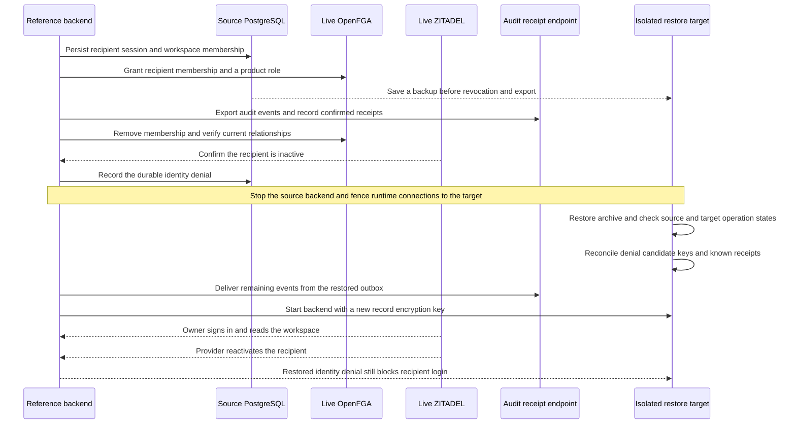

This release drill restores older PostgreSQL adapter and product state while ZITADEL, OpenFGA and the audit receipt endpoint remain current. Ledger uses the TypeScript SDK and Support uses the Go SDK. Both use disposable products on the Railway verification instances and isolated PostgreSQL 17.11 databases.



## Operator sequence

1. Schedule a maintenance window. Drain product traffic, operation reconcilers, directory jobs and audit workers. Keep runtime credentials fenced from the destination database until reconciliation is complete. Use the verified writer-quiescence procedure for outstanding OpenFGA requests. See [[phase-2-railway-recovery]].
2. Restore into an isolated database. Verify adapter compatibility and retained-state invariants using the procedure in [[phase-3-retained-storage-restore]]. The fixture restores within one disposable cluster where role identities already exist. For a different cluster, rebuild and inspect grants before reopening access.
3. Compare the backup with authoritative post-backup records. Preserve current identity denials and confirmed membership removals. Compare provider bindings, workspace lifecycle, operation history and tuples at higher consistency. Preserve the workspace block for any unresolved dispatch or unexplained disagreement. Discovery candidates are hints. Rebuilding them cannot restore membership.
4. Invalidate restored sessions and unfinished login records. Retire restored record keys and register a fresh key before enabling writers. See [[phase-3-key-rotation-restore]].
5. Reconcile confirmed audit deliveries by product, environment, sink and event ID. Preserve the authoritative acknowledgement time. Review unknown receipts, open decisions, holds, post-backup history and provider checkpoints while jobs are stopped. Resume delivery under the configured sink's idempotency rules.
6. Reopen the target using runtime credentials. Verify old cookies fail, a fresh unaffected owner can read the right workspace and an identity on the reconciled deny list cannot regain access through provider reactivation alone.

## Drill boundary

The fixture knows which changes it made after the backup. It verifies absence of unfinished operations in the tested product before reopening and keeps OpenFGA on its current state. It uses the SDK audit worker with a loopback receipt endpoint that rejects duplicate IDs. The separate [[phase-6-audit-delivery]] evidence covers the collector path. This drill does not reconstruct post-backup audit events, restore provider databases, or qualify recovery through an unknown operation or an unverified provider checkpoint. Those cases require authoritative history and separate reconciliation evidence.

Run from the repository root with the workspace installed, Docker running and the Railway verification origins and disposable-resource credentials configured in `HEIMDALL_PROBE_ZITADEL_ISSUER`, `HEIMDALL_PROBE_ZITADEL_PAT`, `HEIMDALL_PROBE_ZITADEL_LOGIN_PAT`, `HEIMDALL_PROBE_OPENFGA_URL` and `HEIMDALL_PROBE_OPENFGA_KEY`.

```sh
HEIMDALL_PROBE_REFERENCE_PRODUCTS=1 HEIMDALL_PROBE_COORDINATED_RESTORE=1 python3 tests/integration/postgres-records.py
```

## Verified results

Run `heimdall-records-7d34a45667214f2b88410bea0b7f3aad` restored both products from their own PostgreSQL snapshots and checked live ZITADEL and OpenFGA after the backup. The runtime login was fenced until reconciliation. Both products returned HTTP 401 for the restored cookie and for a new login after provider reactivation of the denied recipient. A fresh owner reached the scoped read with HTTP 200, and neither workspace regained the revoked recipient's OpenFGA relationships.

Each audit worker skipped 20 acknowledged IDs. Ledger delivered all 71 remaining pending events and Support delivered all 67. The receipt endpoint rejected duplicate IDs. The run record is `tests/integration/evidence/phase-7-coordinated-restore-2026-11-14.json`.
