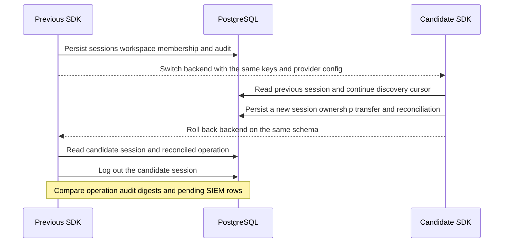

Ledger and Support exercise the same product code on SDK builds from `4eeddb7` and the tagged `0.1.0-rc.1` candidate. Each product keeps its PostgreSQL database, key material, ZITADEL client and OpenFGA model throughout the switch. The application database passes `managed-v5` readiness before the first backend starts.



The probe verifies that the candidate reads the previous session and membership, and resumes an earlier signed discovery cursor. After rollback, the previous build authenticates a candidate-issued cookie and sees ownership granted by the candidate. It reads the reconciled onboarding operation and invalidates the candidate session on logout. The harness compares historical audit digests and checks that committed events still have pending SIEM delivery rows.

This is a same-schema rollback with one running backend per product and the Railway verification providers. The [[phase-3-acceptance|storage foundation evidence]] covers migration admission and failure cases. The [[phase-7-sdk-candidate|candidate model rehearsal]] covers overlapping model pins.

## Verified results

Run `heimdall-records-693dc21aed8344a8b8e3dcf8c6478582` passed for Ledger and Support. Both candidate builds resumed the earlier cursor and accepted the earlier session. Both previous builds returned HTTP 200 for the candidate session after rollback and HTTP 401 after logout. The audit verifier matched the authorization requests and outcomes, checked that the added rollback operation read was audited, and verified the original and candidate operation histories. The exact archive hashes, module versions and results are in `tests/integration/evidence/phase-7-mixed-persistence-2026-11-14.json`.

## Reproduce

Download and verify the candidate archive as described in [[phase-7-sdk-candidate]]. Configure the verification provider credentials from the [[../reference-quickstart#verify-package-integration|reference quickstart]]. Run from the repository root.

```sh
HEIMDALL_PROBE_REFERENCE_PRODUCTS=1 HEIMDALL_PROBE_OPERATOR_QUICKSTART=1 \
HEIMDALL_PROBE_BUSINESS_WRITE=1 HEIMDALL_PROBE_CONSUMER_REVISION=v0.1.0-rc.1 \
HEIMDALL_PROBE_CONSUMER_ARCHIVE=/absolute/path/heimdall-sdk-0.1.0-rc.1.tgz \
HEIMDALL_PROBE_PREVIOUS_PERSISTENCE_REVISION=4eeddb78ab2e394b08ef9f1b6a4027188110a6bc \
python3 tests/integration/postgres-records.py
```
